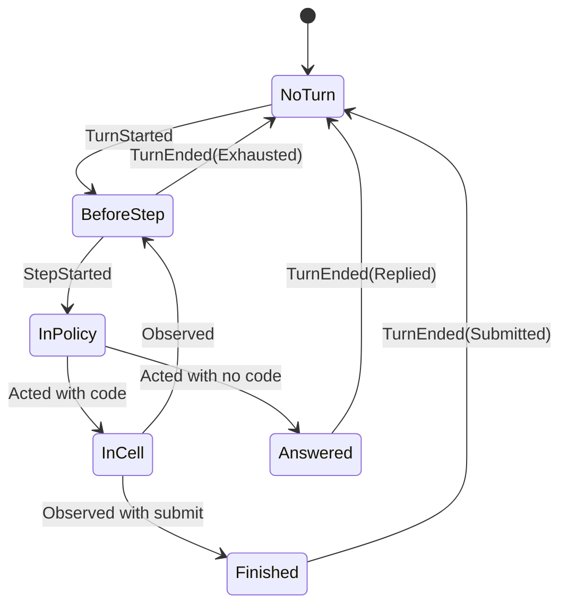

# Code harness: the design

Status: design, 2026-11-01. This document is the current design of the dspy4s harness. It takes the place of section 4
of [CODE_HARNESS.md](CODE_HARNESS.md), which keeps the analysis and the history. Nothing here exists in the code of
dspy4s yet. The sketches of the kernel and of the guest API compile and ran in checks (section 12). Section 14 lists
the choices that are new in this document. [CODE_HARNESS_ATLAS.html](CODE_HARNESS_ATLAS.html) has six diagrams of this
design, and [CODE_HARNESS_EVENTS.html](CODE_HARNESS_EVENTS.html) has its events, their catalog and their sequences.
Open them in a browser. [CODE_HARNESS_BLUEPRINT.html](CODE_HARNESS_BLUEPRINT.html) shows the plan of section 15 as a
graph, with the state of each node and the work that can run at the same time. `scripts/blueprint/blueprint.py` makes
it from [blueprint.toml](blueprint.toml) and the build results.

## Summary

The harness is a coding agent that acts only by writing Scala. A session is one journal, and four pure functions
decide everything about it. Small interpreters do the effects. The compiler, the handlers and an OS sandbox limit the
authority of a session. Each LM call is a `Predict` leaf, so the dspy4s optimizers can tune the full harness.

The controller, a work session, a child and an optimizer rollout are the same thing: a session with a different
configuration. So the design has one kernel.

## 1. The seven ideas

| # | Idea | Why |
|---|---|---|
| 1 | **Code is the only action.** The model writes Scala against a typed API, and the source of that API is its reference. | One cell can do the work of many tool calls. Its values stay in the REPL, outside the LM context. |
| 2 | **A session is one journal.** Only committed state is observable. | A live session, a reopened session and a test have one model. |
| 3 | **The kernel is pure.** `evolve`, `next`, `decide` and `repair` hold all the decisions, and threads only interpret them. | The laws can run with no thread, no model and no REPL. |
| 4 | **Authority has three levels.** A mode for the compiler, a guard for each call, and a sandbox for each process. | Each level stops what the level above it cannot see. |
| 5 | **The context is a projection.** A strategy changes only what the model sees, and the journal keeps all. | Compaction loses nothing, and the model can get each detail back. |
| 6 | **All work is a session.** A session can start other sessions, up to a limit that its capability holds. | Delegation needs no second mechanism. |
| 7 | **Each LM call is a leaf.** The policy, the summaries, the goal check and the reviewer are `Predict` leaves. | The optimizers see the full harness. |

## 2. What each project gives

| Project | What this design takes | What it leaves |
|---|---|---|
| atc | One action language, the API source as the reference, capabilities as `using` parameters, compile errors as observations, safe mode | The lock for the full JVM, compaction that loses detail |
| pi | The session as an append-only list, one file for each session, the context as a pure projection, `store` and `load` kept in the session | JSON tools as the action language |
| `pi-durable` | "Only committed state is observable", an intent and an outcome for each effect, request ids, version checks | Each task as a state machine, a deterministic JavaScript sandbox |
| uniichat | The memory tree, `zoom`, a cheaper model for summaries, the goal check, a report as a message | JSON tools, one chat for all work |
| deepseek-harness | Crash repair by append, the mark for optional entries, a sandbox that fails closed, recorded model streams, tests that kill a process | Agent teams with a task graph, the opt-in REPL that is never durable |
| Codex | Commit on success for the store, soft and hard stops as two commands, world-state diffs, taint, an LLM reviewer, best-of-N, a SQLite view that the session files can rebuild | Four levels of loops, the yield protocol, the message board |
| tacit | Results that show that capability-safe Scala works for agents, a timed-out cell that keeps the earlier state, an early MCP server | A validator as a boundary |
| dspy4s `RLM` | Inputs as REPL values, `llmQuery`, recursion that returns a typed value | The Python interpreter |
| dspy4s | `Predict`, `History`, `Module`, the optimizers | `AgentLoop.run` for this loop (`next` holds the limit) |
| Kyo | The claim token as a fence | `kyo-actor` for the first session host and `kyo-sql-sqlite` for the journal (choice 7), `kyo-mcp` for the MCP server (choice 10), `kyo-flow` for the turn, `kyo-ai` for `Predict`, `kyo-compat` for pluggable programs |

The analysis of each project is in [CODE_HARNESS.md](CODE_HARNESS.md) (sections 2 and 9),
[CODE_HARNESS_LOOPS.md](CODE_HARNESS_LOOPS.md), [CODE_HARNESS_RUNTIME.md](CODE_HARNESS_RUNTIME.md),
[CODE_HARNESS_DURABILITY.md](CODE_HARNESS_DURABILITY.md) and [CODE_HARNESS_KYO.md](CODE_HARNESS_KYO.md).

## 3. The words

These words settle section 4 of [CODE_HARNESS_CONCEPTS.md](CODE_HARNESS_CONCEPTS.md). Each word has one meaning. The
older documents keep their words: [CODE_HARNESS.md](CODE_HARNESS.md) and the Phase 0 report call the protections of
Phase 0 "guards".

| Word | Meaning | Do not use it for |
|---|---|---|
| Session | A durable conversation: an id and a journal | The live objects |
| Activation | The live part of a session in one process: the REPL, the threads, the mailbox | |
| Host | The harness process that runs the REPL and the handlers: host code, as against guest code | A machine, and a network host of the host list |
| Journal | The append-only list of the entries of a session | `History`, the transcript, the trace |
| Writer | The one thread of a session that takes messages from its mailbox and commits to its journal | The worker, which runs the turn |
| Feed | The view of one client: the committed entries of a session, in a bounded queue | The journal |
| Entry | One fact in a journal | An event for clients, which is a published event |
| Input | An `Input` entry: a message that enters a session | The values of a program call, which are its input fields |
| Commit | One atomic write of entries to a journal | A git commit, which is always "git commit" |
| Catalog | The derived list of the sessions, with one row for each session | The journal |
| Turn | From `TurnStarted` to `TurnEnded` | One model reply |
| Step | One policy call and what it starts | The result of `AgentLoop` |
| Cell | One unit of code that the REPL runs | |
| Effect | One guest API call | A tool call |
| Job | A command that runs after its cell ends | |
| Policy | The `Predict` leaf that writes the next cell | Guard rules, a sandbox profile |
| Guard | The rules of the `guarded` handler. Each says `Allow`, `Ask` or `Deny` (5.5). | The five protections of Phase 0 |
| Mode | The capabilities of a session, and their views | Code mode, a sandbox mode |
| Scope | The place of the work of a session: a directory, a worktree or a scratch directory | The range of a graph query, which is a `GraphRange` |
| Task | The work that a session gets at its start | A row of a task set, which is a rollout task |
| Goal | A condition that the work must meet | |
| Preamble | The text that a new REPL compiles before its first cell: the types, `submit` and the input fields of a session | A prompt |
| Pending call | A rule in `pending`: a call that waits for the answer of a person (5.5) | A plain question in the text of the model |
| Grant | The answer of a person to a pending call, or a permission in advance: a guard rule and a lifetime | A change of mode |
| Report | The message that a session sends to the session that owns it, after a turn, while it owes one (8.6) | The value of `rlm` |
| Steer | A message that enters between two steps (`Send` in a turn) | |
| Abort | The hard stop of a turn | `Thread.interrupt`, which is the only meaning of "interrupt" |
| Fork | Say which one: a journal fork, a workspace fork or a session fork | |
| Replay | A new run of cells with recorded results | Recovery, which is a fold |

## 4. The kernel

The kernel is pure data and pure functions. It has no thread, no REPL and no LM call. `tmp/design-check/` holds the
code in this section.

### 4.1 The journal

```scala
final case class Logged(seq: Long, meta: Meta, entry: Entry) derives Schema

// The data that the model never sees. `required` tells a reader what to do with an entry that it cannot decode.
final case class Meta(atMillis: Long, source: Source, taint: Taint, required: Boolean) derives Schema

enum Entry derives Schema:
  case Activated(versions: Versions, config: SessionConfig)    // a start, a reopen, or the first entry after a crash
  case Input(request: RequestId, text: String, values: Map[String, Json]) // `meta.source` is the sender
  case TurnStarted
  case StepStarted(step: Int)                                  // the intent of the LM call
  case Acted(reasoning: String, text: String, code: Option[String]) // the LM outcome, and the intent of the cell
  case EffectStarted(id: EffectId, op: String, args: Json)     // the intent of a guest API call
  case EffectDone(id: EffectId, result: EffectResult)          // the outcome of the guest API call
  case Observed(output: String, outcome: CellOutcome, writes: Map[String, Json]) // the outcome of the cell
  case StopRequested(reason: String)
  case JobsStopRequested(which: JobSelector, reason: String)   // a stop of jobs, apart from the turn (10.3)
  case Granted(request: RequestId, rule: GuardRule, lifetime: GrantLifetime) // a person widened the guard (5.5)
  case ScopeRecorded(head: String, clean: Boolean)             // the git head of the scope, at the end of each turn
  case TurnEnded(outcome: TurnOutcome)
  case Ended(outcome: SessionOutcome, reason: String)
  case ModelChanged(model: ModelChoice)                        // a person changed the model (CLI_SCREEN.md, 14)

final case class EffectId(cell: Long, n: Int)                  // `cell` is the `seq` of the `Acted` entry

enum EffectResult derives Schema:
  case Value(value: Json, rendered: String)                    // the value for a replay, and the text for a reader
  case Error(message: String)
  case NeedsApproval(rule: GuardRule)                          // a pending call (5.5)
  case Unknown                                                 // a stop or a crash cut the call

enum TurnOutcome derives Schema:
  case Replied(text: String)
  case Submitted(value: Json)
  case Exhausted, Aborted, Crashed
  case Failed(error: String)
```

The entries of one turn form a small language. `Input`, `StopRequested`, `JobsStopRequested`, `Granted`,
`ScopeRecorded` and `ModelChanged` can occur at any place:

```text
Turn  ::= TurnStarted Step* TurnEnded
Step  ::= StepStarted [ Acted [ Cell ] ]
Cell  ::= ( EffectStarted | EffectDone )* Observed
```

Five rules about the journal:

- **The commit.** `commit` returns after the write reaches the backend, so an intent is in the journal before its
  effect starts. A stream delta to a client is not state: a client can show it, and a crash can lose it.
- **One journal.** One commit writes to one journal. A commit across sessions needs all sessions in one database.
  Without it, each backend of `Journal` stays possible: a file on a local disk, a Pekko journal or a server database.
  Section 8.6 says how a message goes from one journal to another.
- **The flush.** A normal commit survives a crash of the process, and a power loss can remove it. A commit with an
  entry that `needsFlush` also reaches the disk before `commit` returns. A flush covers all earlier commits, so after
  a power loss the journal is a prefix. A read that a power loss removes does no harm, because nothing outside
  changed.
- **Unknown entries.** A reader that cannot decode an entry stops a rebuild if `required` is true, and it skips the
  entry if `required` is false.
- **The values.** A value in an entry is `Json`, which has only the six JSON cases. `Data` gives each value its form
  (5.1), and `parse(print(j)) == j` for that form. So a state from the journal equals the live state. The JSON codec
  of `DynamicValue` does not have this law (12).

| Effect | Intent | Outcome |
|---|---|---|
| The LM call of the policy | `StepStarted` | `Acted` |
| A cell | `Acted` with code | `Observed` |
| A guest API call, with `llmQuery` and `rlm(...)` | `EffectStarted` | `EffectDone` |

```scala
// The operations that change nothing outside the session. Each other operation flushes, so a new one is safe.
val readOnlyOps = Set("read", "keys", "load", "sessions", "jobOutput", "waitJob", "now", "zoom", "observe", "llmQuery",
  "llmQueryBatched")

def needsFlush(entry: Entry): Boolean = entry match
  case Entry.EffectStarted(_, op, _)             => !readOnlyOps(op)
  case Entry.Input(_, _, _) | Entry.Activated(_, _) => true   // a sender has an answer, or a parent has a child
  case _                                         => false
```

### 4.2 The state is a fold

```scala
enum Position:
  case NoTurn
  case BeforeStep(step: Int)
  case InPolicy(step: Int)
  case InCell(step: Int, cell: Long, code: String)
  case Answered(text: String)
  case Finished(value: Json)

final case class SessionState(
    config  : SessionConfig,
    nextSeq : Long,
    position: Position,
    stopping: Boolean,
    closed  : Boolean,
    waiting : Int,                       // inputs that no step has seen, since the last stop
    open    : Map[EffectId, OpenCall],   // effects with an intent and no outcome
    store   : Map[String, Json],
    inputs  : Map[String, Json],         // the values of the input fields, apart from the store (5.1)
    requests: Set[RequestId],
    grants  : Set[ActiveGrant],
    pending : Set[GuardRule],            // the pending calls, which wait for a person (5.5)
    lastTurn: Long,                      // the `seq` of the last `TurnStarted`
    jobs    : Map[EffectId, JobRecord]   // each `spawn` that has an intent
)

def evolve(s: SessionState, logged: Logged): SessionState   // total and pure
```

`evolve` is the only place where state changes. `state(journal)` is `journal.foldLeft(SessionState.initial)(evolve)`,
so a fold of a prefix continues to the same state: the journal is a free monoid, and the fold is a homomorphism from
it to the functions on the state. `state` is a function and not a method of `SessionState`, because the type
`SessionState` comes before `evolve`, and `evolve` comes before the fold.

Each other view of a journal is also a fold, for example the note of lost names (6), the ledger, the usage totals and
the deterministic part of a `SessionCard`. Folds compose, so several views need one pass:

```scala
final case class Fold[-E, S, +A](initial: S, step: (S, E) => S, done: S => A):
  def apply(entries: Iterable[E]): A = done(entries.foldLeft(initial)(step))
  def map[B](f: A => B): Fold[E, S, B] = Fold(initial, step, s => f(done(s)))
  def zip[F <: E, T, B](that: Fold[F, T, B]): Fold[F, (S, T), (A, B)] =
    Fold(
      (initial, that.initial),
      { case ((s, t), e) => (step(s, e), that.step(t, e)) },
      { case (s, t) => (done(s), that.done(t)) }
    )
```

### 4.3 The next piece of work is an unfold

`next` reads the state and says what comes next. So a session is an unfold of work and a fold of results.

```scala
enum Next:
  case Wait                                    // no open turn, or an effect is in progress
  case CallPolicy(step: Int, mustAnswer: Boolean)
  case RunCell(cell: Long, code: String)
  case End(outcome: TurnOutcome)

def next(s: SessionState): Next =
  if s.position == Position.NoTurn then Next.Wait
  else if s.stopping then Next.End(TurnOutcome.Aborted)
  else
    val limit = s.config.steps
    s.position match
      case Position.BeforeStep(i) if i < limit => Next.CallPolicy(i, mustAnswer = false)
      case Position.BeforeStep(i) if i == limit && s.config.kind == TurnKind.Chat => Next.CallPolicy(i, mustAnswer = true)
      case Position.BeforeStep(_)              => Next.End(TurnOutcome.Exhausted)
      case Position.InCell(i, _, _) if i >= limit => Next.End(TurnOutcome.Exhausted)
      case Position.InCell(_, cell, code)      => Next.RunCell(cell, code)
      case Position.Answered(text)             => Next.End(TurnOutcome.Replied(text))
      case Position.Finished(value)            => Next.End(TurnOutcome.Submitted(value))
      case Position.InPolicy(_) | Position.NoTurn => Next.Wait
```



A stop can end a turn from each of these states. The two stop rules are one rule in `next`:

| Event | Chat turn | Program call |
|---|---|---|
| A cell calls `submit(...)` | `Submitted` | The value is the output. |
| A reply with no cell | `Replied`, and the text is the answer | `Replied`, and the `finisher` leaf makes the output |
| The step limit | One more policy call with a note to answer. The harness runs no cell from it. | `Exhausted`, and the `finisher` leaf makes the output |

### 4.4 The repair

```scala
def closing(s: SessionState): Vector[Entry] =
  val effects = s.open.keys.toVector.sortBy(id => (id.cell, id.n)).map(Entry.EffectDone(_, EffectResult.Unknown))
  s.position match
    case Position.InCell(_, _, _) => effects :+ Entry.Observed("", CellOutcome.Failed("the cell did not complete"), Map.empty)
    case _                        => effects

def repair(s: SessionState): Vector[Entry] =
  if s.position == Position.NoTurn then Vector.empty else closing(s) :+ Entry.TurnEnded(TurnOutcome.Crashed)
```

A stop and a crash close a turn with the same entries. The old entries never change. Nothing runs an effect with an
unknown outcome again automatically.

### 4.5 The guard

`decide` says which entries a command can commit. It keeps each journal inside the language of 4.1.

```scala
enum Command:
  case Activate(versions: Versions, config: SessionConfig)
  case Send(request: RequestId, text: String, values: Map[String, Json])
  case Commit(entries: Vector[Entry])
  case Abort(reason: String)
  case StopJobs(which: JobSelector, reason: String)
  case Grant(request: RequestId, rule: GuardRule, lifetime: GrantLifetime)
  case Close(outcome: SessionOutcome, reason: String)
  case ChangeModel(model: ModelChoice)

def decide(command: Command, s: SessionState): Either[Rejection, Vector[Entry]]
```

| Command | What it commits |
|---|---|
| `Activate` | `repair(s)`, then `Activated`. If an input waits, also `TurnStarted`. |
| `Send` with a known request id | Nothing |
| `Send` to a session that has ended | Nothing. The command gets the rejection `SessionClosed`. |
| `Send` with no open turn | `Input` and `TurnStarted` |
| `Send` in a turn | `Input`. The projection shows it at the next `StepStarted`. |
| `Commit` | The entries, if each one is valid at that position (the rules below). |
| `Abort` in a turn | `StopRequested`, which also clears the inputs that wait. It changes no job. |
| `StopJobs` | `JobsStopRequested`. It needs no open turn, and it changes no turn. |
| `Grant` with a known request id | Nothing |
| `Grant` to a session that has ended | Nothing. The command gets the rejection `SessionClosed`. |
| `Grant` that answers a pending call | `Granted` and an `Input` from the harness. With no open turn, also `TurnStarted`. |
| `Grant` with no pending call | `Granted`. It starts no turn. |
| `Close` | `Ended`, only with no open turn |
| `ChangeModel` | `ModelChanged`, also in a turn. With the model of the session, nothing. A session that has ended gives the rejection `SessionClosed`. The fold puts the model in the configuration, so the next call to the policy and a reopen use it (CLI_SCREEN.md, 14.4). |

The rules for `Commit`:

- After `StopRequested`, only outcomes can commit: `EffectDone`, `Observed` and `TurnEnded`.
- `EffectStarted` needs an `EffectId` of the current cell. So a late message from an old cell cannot enter a later
  cell.
- A late `EffectDone` of a closed effect adds nothing, because an interrupt does not wait for a commit in progress.
- If an input waits when `TurnEnded` commits, `TurnStarted` commits with it.

Two questions have one answer here. An input that no step saw gets a turn, also after a crash. An input from before a
stop starts no turn, and the next turn shows it.

### 4.6 The worker

The worker interprets `next`. It holds no decision and no state of its own:

```scala
trait TurnEffects:
  def callPolicy(state: SessionState, mustAnswer: Boolean): Either[String, PolicyReply]
  def runCell(cell: Long, code: String): CellResult

trait Journal:
  def state: SessionState
  def run(command: Command): Either[Rejection, SessionState]
  final def commit(entries: Entry*): Either[Rejection, SessionState] = run(Command.Commit(entries.toVector))

@tailrec def drive(journal: Journal, effects: TurnEffects): SessionState =
  val state = journal.state
  next(state) match
    case Next.Wait => state
    case Next.CallPolicy(step, mustAnswer) =>
      journal.commit(Entry.StepStarted(step)).foreach { started =>
        val _ = effects.callPolicy(started, mustAnswer) match
          case Right(reply) => journal.commit(Entry.Acted(reply.reasoning, reply.text, reply.code))
          case Left(error)  => journal.commit(Entry.TurnEnded(TurnOutcome.Failed(error)))
      }
      drive(journal, effects)
    case Next.RunCell(cell, code) =>
      val result = effects.runCell(cell, code)
      val open = closing(journal.state).filter(_.isInstanceOf[Entry.EffectDone])
      val _ = journal.commit((open :+ Entry.Observed(result.output, result.outcome, result.writes))*)
      drive(journal, effects)
    case Next.End(outcome) =>
      val _ = journal.commit((closing(journal.state) :+ Entry.TurnEnded(outcome))*)
      drive(journal, effects)
```

A test gives `TurnEffects` as a script. The harness gives a `Predict` leaf and a REPL. A journal can be a value in
memory or a writer with SQLite behind it, and `drive` stays the same.

An example journal: a user asks a question, the model runs one cell with one guest API call, and then it answers.

```text
Activated  Input  TurnStarted
  StepStarted(0)  Acted(code)  EffectStarted  EffectDone  Observed
  StepStarted(1)  Acted(no code)
TurnEnded(Replied)  ScopeRecorded
```

The same journal, with a stop during the guest API call:

```text
Activated  Input  TurnStarted
  StepStarted(0)  Acted(code)  EffectStarted  StopRequested  EffectDone(Unknown)  Observed(Failed)
TurnEnded(Aborted)
```

### 4.7 The laws of the kernel

| Law | Statement |
|---|---|
| Fold | `SessionState` is the fold of the journal. |
| Homomorphism | `state(a ++ b)` is the fold of `b` from `state(a)`. |
| Language | Each journal is a word of the language of 4.1. |
| Commit | A reader sees an entry only after its commit. |
| Flush | After a power loss, the journal is a prefix that ends at the last flush. Each effect that changed the world has its intent in it, and so does each `Input` for which a sender got an answer. |
| Effect | An intent commits before its effect, and the outcome commits after the effect. Each intent has exactly one outcome after a repair. |
| Stop | After `StopRequested`, `next` starts no new work, and `decide` accepts no new intent. |
| One journal | One commit writes to one journal. |
| Input | Two `Send` commands with one request id give one `Input`. |
| Report | After the report pass of 8.6, each `TurnEnded` or `Ended` that needs a report has exactly one `Input` in the journal of an open owner. |
| Rest | With no open turn, no input waits. |
| Grant | A `Once` grant covers one call. A `Turn` grant ends at the next `TurnEnded`. No grant stays after `Ended`, and a journal fork starts with no grants. A repeat of a `Grant` commits nothing. |
| Pending call | A pending call has no active grant that covers it. `TurnStarted` and `Ended` empty `pending`, and a journal fork starts with no pending calls. A session with no person never gets a pending call. |
| Guard | `verdict` is a homomorphism from `Guard` to `Verdict`. A grant changes only `Ask`, and more grants never make a result stronger. |
| Job | An `Abort` changes no job. A stop covers only the jobs with an intent before it. After `Abort` and then `StopJobs(OfLastTurn)`, no job of that turn starts or runs. `Ended` stops all jobs, and a journal fork starts with no jobs. |
| Repair | `repair` closes each open part, and `repair(state after repair)` is empty. |
| Store | The store holds only the writes of cells that completed. |
| Names | The note after a restart lists the names of the cells that completed, and no name of a failed cell. |
| Secret | No known secret value is in a committed entry, and a second mask changes nothing. |
| Submit | A cell that called `submit` ends its turn with the first value, and the host refuses each later call of that cell. |
| Data | `decode(encode(v)) == Right(v)` for each value with a `Data`. An `encode` never throws. |
| Text | `parse(print(encode(v))) == encode(v)`. So a commit changes no value. |
| Form | Only `Data` reads the form of `Data`. The host reads the value of `submit` with `Data[O]`. |
| Shape | A type that a preamble defines from `shape` reads each value of the first type, and it writes the same `Json`. |
| Inputs | `inputs` is the fold of the `values` of the `Input` entries. A repeat adds nothing, a fork keeps them, and the store does not hold them. |
| Log | No part of the harness changes or removes an entry. |

## 5. Authority

### 5.1 The guest API

The guest API is one trait for each effect. The bare type is the read-only view, and `T^` is the full view. Each
definition that a cell can use has `@assumeSafe`, because safe mode rejects the other definitions.

```scala
@assumeSafe trait Cap extends caps.Stateful, caps.ExclusiveCapability

@assumeSafe trait Files extends Cap:
  def read(path: String): String
  update def write(path: String, content: String): Unit

@assumeSafe trait Shell extends caps.ExclusiveCapability:
  def exec(command: String)(using Files^): String
  def spawn(command: String, report: Boolean = false)(using Files^): JobId
  def jobOutput(job: JobId): String
  def waitJob(job: JobId, maxSeconds: Int): JobStatus
  def stopJob(job: JobId): Unit

@assumeSafe trait Store extends Cap:
  def keys: Vector[String]
  def load[A: Data](key: String): Option[A]
  update def store[A: Data](key: String, value: A): Unit

@assumeSafe trait Sessions extends Cap:
  def list(): Vector[String]
  update def tell(session: String, message: String): Unit

@assumeSafe trait Children extends Cap:
  update def rlm[A: Data](task: String, inputs: Map[String, String]): A
  update def rlmBatched[A: Data](tasks: Vector[(String, Map[String, String])]): Vector[A]

@assumeSafe object api:
  def println(value: Any): Unit = scala.Console.println(value)
  def read(path: String)(using f: Files): String = f.read(path)
  def write(path: String, content: String)(using f: Files^): Unit = f.write(path, content)
  def exec(command: String)(using s: Shell^, f: Files^): String = s.exec(command)
  def load[A: Data](key: String)(using s: Store): Option[A] = s.load[A](key)
  def store[A: Data](key: String, value: A)(using s: Store^): Unit = s.store(key, value)
  def now()(using t: Turn): Long                               // milliseconds since the epoch
  def input[A: Data](name: String)(using t: Turn): A           // the value of an input field of this session
  // and the other functions
```

`now()` and `input` take the given `Turn`, which the preamble of each mode binds. `Turn` is not a capability, so each
mode has it, and a cell cannot make one. The host gives the clock through it as a recorded guest API call, and the
input values from `SessionState.inputs`.

The sketch shows the shape. The full API also has `edit`, `httpGet`, `llmQuery`, `llmQueryBatched`, `rlm`, `start`,
`observe` and `zoom`. `submit` comes from the preamble of the session. This section gives no signature for `edit` and
`httpGet`, so the code of `harness-guest` proposes `edit(path, oldText, newText)` on `Files^` and a `Network` trait
with `get(url)` behind `httpGet`, for the review. `Sessions` has the signatures of 8.2. The source text of these traits, with a
notation header, is the API reference in the prompt. A search function and the reference on demand can come later, for
a large API.

The rules of the API reference:

- The reference holds only the parts of that text that compile in the mode of the session. A trait whose capability
  the mode does not give goes, an `update def` needs `C^`, and a function of `api` needs each capability of its
  `using` clauses. A part that goes takes its doc comment with it. `ApiReference` of `harness-repl` reads the source
  text and the table that also makes the givens of the REPL, so the reference and the compiler agree. The harness and
  the MCP server give this reference.
- The session types `SessionRef`, `Scope` and `StrategyName` are `@assumeSafe`, so a cell can make them, for example
  for `start`. Their `Schema` comes from a file with no capture checking, because the derivation of a `Schema` with
  capture checking exceeds the recursion limit of the compiler.
- The file of the session types belongs to `Sessions`. Only the calls of `Sessions` take or give these types, so the
  file stays only in a mode that gives the bare `Sessions` or `Sessions^`. In a mode with no `Sessions`, the
  reference has no word of the session API, also in a comment or a type. A comment outside the `Sessions` trait and
  the file of the session types names no call of `Sessions`.
- The source text holds no `given` that a cell cannot use. Safe code cannot name a `Schema`, so the `Schema` givens of
  the session types are in `SessionSchemas`, outside the text of the reference. The kernel imports them. The reference
  of the full mode is the whole source text, so the filter cannot remove a given, and the source text keeps none.
- The live sessions of 2026-11-10 gave these rules. The reference was the whole text, and a model in a work session
  told the person that it could use the network, other sessions and `rlm`. A cell that called them did not compile.
  In a live session of 2026-11-10, the work mode had no `Sessions`, and the model still named `tell`, `observe`,
  `zoom` and `Sessions.start`, from the comments of the session types.

**`Data` is the type of a value that a later cell, another session or the host reads back with a type.** Text has no
`Data`: `println`, the printed result of a cell, `write`, `exec` and `tell` take text. Safe code cannot name the
`Schema` of zio-blocks: `store("k", 1)` with `A: Schema` gives "Cannot refer to value int in object Schema from safe
code". A `Schema.derived` inside an inline of the guest API also fails: in a capture-checked cell, the macro crashes
the compiler with `RecursionOverflow`. So the guest API owns a small type class, which derives from `Mirror`:

```scala
@assumeSafe trait Data[A]:
  def encode(value: A): Json
  def decode(value: Json, path: String): Either[DataError, A]
  def shape: DataShape                             // what a value looks like, for the preamble of a new REPL

enum DataShape:                                    // a record and a union are lazy, because a type can hold itself
  case Plain(name: String)
  case Applied(name: String, args: Vector[DataShape])
  case Record(name: String, fields: () => Vector[(String, DataShape)])
  case Union(name: String, cases: () => Vector[(String, DataShape)])

@assumeSafe trait DataAuto:
  inline given auto[A](using m: Mirror.Of[A]): Data[A] = Data.derived[A]

@assumeSafe object Data extends DataAuto:
  given Data[Int] = ...                            // and the other numbers, String, Char, Boolean, Unit, Instant, Duration
  given [A: Data]: Data[Vector[A]] = ...           // and List, Seq, IndexedSeq, Set
  given [K: Data, V: Data]: Data[Map[K, V]] = ...
  given [H: Data, T <: Tuple: Data]: Data[H *: T] = ...
  given [A: Data]: Data[Option[A]] = ...           // and Some, None, Either, Left, Right
  inline def derived[A](using m: Mirror.Of[A]): Data[A] = // from the names and the elements of `m`
```

A case class or an enum needs no other code. A cell can write `case class Point(x: Int, y: String)`, and then
`store("p", Point(1, "a"))`. A recursive type, for example `case class Dir(name: String, kids: Vector[Dir])`, and two
types that hold each other need no other code either, because `derived` takes the `Data` of each field as a by-name
given. The sketch of section 12 needed one more line for them, `given Data[Dir] = Data.derived`, and the line still
works.

| Value | Its `Json` form |
|---|---|
| A number | A number. NaN, the infinities and -0.0 are strings. A `BigInt` or a `BigDecimal` with more than 34 digits is a string, because the reader rounds to 34 digits. |
| `Char`, `Instant`, `Duration` | A string |
| `Vector`, `List`, `Seq`, `IndexedSeq`, `Set`, a tuple | An array |
| A case class | An object with one field for each parameter |
| An enum, a sealed trait, `Option`, `Either` | An object with one field, the name of the case: `{"Failed":{"reason":"x"}}` |
| `Map[String, V]` | An object |
| Another `Map` | An array of pairs |

The rules of `Data`:

- A capability, a function, `Any`, a plain class, an `Array`, an `Iterator`, a `LazyList` and a mutable collection
  have no `Data`. The compile error names the type and says what can leave a cell. A `var` in a case class does not
  pass the capture checker, so a value has no cycle.
- `load` gives `None` for a key with no value. A value that does not fit the type throws a `DataError` with its path,
  and the cell fails: `at a.y: expected a field of P, found {x}`. `load` ignores an extra field.
- The journal holds no type. `load` reads a value with the type of the cell that calls it, so a later cell can define
  the type again.
- A cell can also write `derives Data`, but the reference does not show it. The capture checker rejects `derives Data`
  in a cell that also has a `def` or a lambda with a capability. The second try of section 6 covers this case.

**Where a typed value crosses.** Both ends use `Data`:

| Place | From and to | The reader |
|---|---|---|
| `store`, `load` | A cell to a later cell | `Data` in the later cell |
| `submit` in a program call | A cell to the host | `Data[O]` in the host |
| `submit` in a child | A child to its parent | `Data[A]` in the parent |
| The input fields of a program call | The host to a cell | `Data` in the cell, through `input` |
| The `inputs` of `rlm` | A parent to a child | `input[String]` in the child |

**Only `Data` reads the form of `Data`.** `Data` and `Schema` write different JSON, and each fails on the text of the
other:

| Value | `Data` writes | `Schema` writes |
|---|---|---|
| `Some("n")` | `{"Some":"n"}` | `"n"` |
| `None` | `{"None":{}}` | No field |
| An enum case with no fields | `{"Fix":{}}` | `"Fix"` |
| `Map(1 -> "a")` | `[[1,"a"]]` | `{"1":"a"}` |
| `Right(1)` | `{"Right":1}` | `{"Right":{"value":1}}` |
| `NaN` | `"NaN"` | The encode throws |

So `Harness[I: Data, O: Data]` reads the value of `submit` with `Data[O]` (9), and the compiler derives it.
`Schema[O]` stays for the LM side, so the `finisher` leaf gives an `O` as before. This takes the place of the decode
in F3. `Data` is a second codec next to `Schema`, only at the boundary of a cell. A field with a hand-written `Schema`
needs a hand-written `Data`, and the compile error names the type.

**The preamble.** A new REPL compiles a text before its first cell. The harness writes this text from `shape`, because
the REPL of a child has none of the types of its parent:

```scala
// the cell of the parent
case class Point(x: Int, note: Option[String])
val p = rlm[Point]("find the point", Map("doc" -> text))

// the preamble of the child: the types, a companion with one given for each type, and an object with `submit` and
// one `val` for each input
case class Point(x: Int, note: Option[String])
object Point:
  given _root_.dspy4s.harness.guest.Data[Point] = _root_.dspy4s.harness.guest.Data.derived
object Preamble:
  def submit(x: Int, note: Option[String]): Nothing = ...
  val doc: String = input[String]("doc")
import Preamble.*
```

- The givens are in the companion objects, and `submit` and the vals are in an object, because of a defect of the
  compiler (6): in safe mode, a top-level given of `Data.derived`, or a top-level `def` or `val` whose type has a
  collection or a type of the same chunk, breaks each later Array chain. The full name of `Data` stays right when a
  case of the type has the name `Data`. A val of `Preamble` reads its input when a cell first uses the object.

- `SessionConfig.preamble` holds the text (8.1), and the journal holds no `DataShape`. A new REPL after a crash or a
  reopen compiles the same text. The text holds no value, so it holds no secret.
- A new REPL compiles the givens of its mode before safe mode starts, and then the preamble of the session in safe
  mode. So a cell can use the types, `submit` and the inputs, and it cannot name the host.
- The API reference in the prompt also shows the preamble, so the model sees the types and `submit`.
- A program makes its preamble from `Data[O].shape` and `Data[I].shape` when it is built. A child gets its preamble
  from `Data[A].shape` when `rlm` is called. A session with no output type has `submit(value: String)`.
- A record gives `submit` one parameter for each field (F3). Another type gives `submit(value: T)`.
- The JSON of a value does not hold the name of a type. So the preamble can write `Box[Int]` as a class with an `Int`
  field, and a sealed trait as an enum, with the same form.
- Five things have no preamble: two types with one name and two forms, a sealed trait inside a sealed trait, an input
  with the name of a guest API function, and a type or an input with the name `Preamble`. A program fails at its
  build, and `rlm` fails with a plain error.

**The values of the input fields.** The input fields of a program call and the `inputs` of `rlm` are in the `values`
of the `Input` entry. `SessionState.inputs` is their fold, apart from the store, so a `store` cannot change an input.
`input[A](name)` reads this fold. It needs no capability, because it reads only what the session got. It is not an
effect, because the journal already holds the value. The `inputs` of `rlm` stay `Map[String, String]` in the first
version. A typed value in `inputs` can come later by the same route.

**A child that gives no value.** `rlm[A]` gets its value only from `submit`. The `finisher` leaf makes an `O` and not
an `A`, so it cannot help. A child that ends with `Replied` or `Exhausted` makes the call fail, and the error holds
the last text of the child. `rlmBatched` fails if one child fails, and the error names the task.

**How `submit` ends a cell.** `submit` has the type `Nothing` (F3). It records its value with the host, and then it
throws a `ControlThrowable`. A `catch` of `Exception`, `scala.util.Try` and `finally` do not stop the signal, and safe
mode rejects `NonFatal`. A `catch` of `Throwable` stops it, and the compiler warns. So the rule is in the host:

- A cell that called `submit` ends its turn with the first value, whatever the cell does after the call.
- After `submit`, the host refuses each later guest API call of that cell, and a second `submit`.
- The store writes before `submit` commit, as for a cell that completes.
- The host removes the line of the signal from the output of the cell.
- A cell that ends by `submit` defines no name, because the signal leaves the cell.

**`now()` gives the time.** Safe mode rejects `System.currentTimeMillis` and `System.nanoTime`, and models write them.
`now()` is a guest API call like the others, so `recorded` stores its value. It closes nothing: safe mode allows
`java.time.Instant.now()`, `scala.util.Random` and `Math.random()`, so a cell is not deterministic by its type. Choice
9 leaves this for a later replay.

### 5.2 Modes

A mode is a set of givens that the compiler checks. As a value, a mode is an element of a bounded meet-semilattice: a
product of chains `None < Read < Full`.

```scala
enum Access:
  case None, Read, Full

final case class Mode(files: Access, shell: Access, network: Access, llm: Access, sessions: Access, children: Access, store: Access):
  def <=(that: Mode): Boolean
  def meet(that: Mode): Mode
```

`Access` and `Mode` are in `harness-guest` (10.5). A mode says which capabilities of the guest API a session gets, so
the REPL uses it for the preamble. `SessionConfig` (8.1) holds two modes, so the kernel uses it too.

| Mode | Givens in the preamble |
|---|---|
| Full | `files: Files^`, `shell: Shell^`, `net: Network^`, `llm: Llm^`, `peers: Sessions^`, `children: Children^`, `state: Store^` |
| Local | `files: Files^`, `shell: Shell^`, `llm: Llm^`, `peers: Sessions^`, `children: Children^`, `state: Store^` |
| Read-only | `files: Files`, `llm: Llm^`, `peers: Sessions`, `state: Store^` |
| Controller | `files: Files`, `llm: Llm^`, `peers: Sessions^`, `children: Children^`, `state: Store^` |
| A child, a rollout | The givens of its base mode, with the bare `peers: Sessions` and with `children: Children^` |

Each mode has `Store^`, because the store changes only the state of the session. A change of mode needs a new REPL,
because the preamble changes, so it is a new activation.

**The ceiling law.** A `Sessions^` or a `Children^` capability holds a ceiling. The mode of a new session is at most
that ceiling. For a work session, the ceiling is its own mode, so a child never has more authority than its parent.
For the controller, the ceiling comes from the configuration of the user. So the controller can start a session with
`Files^`, but it cannot write a file itself.

**The closed law.** A child and a rollout have the mode `base.meet(Mode.closed)`, where `Mode.closed` is `Mode.full`
with `sessions = Read`. They keep `rlm`, with its depth limit, and the compiler rejects `start` and `tell`. So nothing
that they start can outlive them, and an optimizer run stays inside its own fork.

### 5.3 Handlers

The value behind each given is a handler. Handler transformers form a monoid under composition, for example
`recorded(guarded(Files.overlay(base), guard))`.

| Handler | Purpose |
|---|---|
| `Files.local(root)`, `Files.overlay(base)`, `Files.memory(snapshot)` | Real files, copy on write for one rollout, or files in memory for tests |
| `Shell.sandboxed(root, profile)`, `Shell.denied` | Commands in an OS sandbox, or no commands. If no sandbox works, `exec` fails. |
| `Store.snapshot(state)` | A snapshot for one cell and a write buffer. `CellResult.writes` holds the buffer. |
| `recorded(h)` | Commits `EffectStarted` before each call and `EffectDone` after it |
| `replayed(journal)` | Answers each call from a journal |
| `guarded(h, guard)` | Calls `guardCheck` before each call (5.5). A deny rule wins. |
| `reviewed(h, leaf)` | Asks a `Predict` leaf about a call that the rules do not settle. It fails closed. |

Laws:

- `guarded` is a monoid homomorphism: `guarded(allowAll)(h)` behaves as `h`, and `guarded(p)(guarded(q)(h))` behaves
  as `guarded(p and q)(h)`.
- For the calls in a journal, `replayed(journal)` gives the same results as the handler from which `recorded` wrote
  it.

### 5.4 The sandbox

Capture checking stops at the process boundary. A command that a session can start can run code that the session
wrote. So each command runs in an OS sandbox, with a profile from the capabilities at the call. F7 and F8 of
[CODE_HARNESS.md](CODE_HARNESS.md) have the threat model and the backends.

| Capabilities at the `exec` call | Profile of the child process |
|---|---|
| No `Shell` | No child process |
| `Shell^` and `Files^` | Writes only under the scope and a private temporary directory. No network. |
| `Shell^`, `Files^` and `Network^` | The same, plus the network through a proxy that applies the host list |
| Each mode | Secrets and classified paths are not readable. Other paths outside the scope are read-only. |

Law: `profile` is monotone in the mode, and the authority of a child process is at most the authority of the
capabilities at its `exec` call.

The folder of the journals is closed to each profile and to `Files`. So `zoom` and `observe`, through `Sessions`, are
the only ways to read another session.

Seatbelt on macOS and bubblewrap on Linux come first. `kyo-pod` is a possible later backend for rollouts.

**The first version (phase 3).** `Profile.forMode(mode, scope, layout, hosts)` gives the profile. Four observations
are its meaning: `canRun`, `canRead(path)`, `canWrite(path)` and `canConnect(host)`. The laws and the escape tests
compare each backend with these observations.

- The layout names the private temporary directory, the folder of the journals, the secret paths and the names of the
  secret files. The secret paths are `~/.ssh`, `~/.aws`, `~/.azure`, `~/.gnupg`, `~/.kube`, `~/.docker`, `~/.netrc`,
  `~/.npmrc`, `~/.pypirc`, `~/.git-credentials`, `~/.password-store`, `~/.config/gcloud`, `~/.config/gh`,
  `~/Library/Keychains`, and the credential files of common tools: `~/.config/git/credentials`, `~/.config/op`,
  `~/.codex/auth.json`, `~/.claude/.credentials.json`, `~/.m2/settings.xml`, `~/.gradle/gradle.properties`,
  `~/.sbt/.credentials`, `~/.ivy2/.credentials`, `~/.cargo/credentials`, `~/.cargo/credentials.toml`,
  `~/.local/share/keyrings`, `~/.pgpass`, `~/.vault-token` and `~/.terraform.d/credentials.tfrc.json`. A file or a
  folder with the name `.env` or `.env.*` is secret in each folder. A file call refuses such a name, and on macOS a
  command cannot reach it either (the next item). A proposal: the design names only `~/.ssh`, `~/.aws` and `.env`.
- The host list is a set of patterns: `name`, `name:port` or `name:*`. A name `*.d` matches each subdomain of `d`. A
  pattern with no port allows only the ports 80 and 443. A proposal: the design gives the host list no type.
- Seatbelt denies by default, as in Codex. A child can start programs, read files, and look only at the processes of
  its own sandbox. It cannot reach launchd and the other services of the system, so it cannot start a process outside
  the sandbox. `sh`, `git`, `python3` and `java` run with these rules.
- bubblewrap keeps the network closed in each mode, also with `Network^`, because the proxy needs a bridge into the
  network namespace, as in Codex. Less network is less authority, so the law holds.
- A read-only mount does not stop a connection to a UNIX socket of the host, and a network namespace covers only the
  abstract sockets. Through the D-Bus bus of the user, a command can start a process outside the sandbox, and
  docker.sock gives root. So bubblewrap loads a seccomp filter: `socket` for `AF_UNIX` gets `EPERM`, and so do
  `socketpair` for a datagram pair, `io_uring_setup`, and each call of another ABI. A stream pair from `socketpair`
  stays allowed. The filter exists for aarch64 and x86_64, and on another host bubblewrap does not work. Seatbelt
  denies these connections by default.
- Commands use the fixed profile of the mode, with no walk of the scope. Until 2026-11-12, the shell walked the
  writable roots for secret names before each command, and it read the times of each folder. So each command waited in
  a large scope: the first `exec` waited 34 s in a scope of 1.75 million entries, and 9.7 s in a scope of 300,000
  folders. Now a backend that can close a name (`Backend.closesNames`) gets the secret names in its profile
  (`Profile.hiddenNames`). Seatbelt closes each name with one rule on the path, a regex for each folder
  (`Seatbelt.nameRule`). A probe on macOS showed that the rule also stops a read through a symbolic link, a hard link,
  a move and a new file with a secret name, and that `.envrc` and `notes.env.txt` stay open. bubblewrap cannot close a
  name, so on Linux a command can read, write, link or move a file named `.env` or `.env.*`. A proposal for the
  review: this gap of Linux goes against the rule of CODE_HARNESS.md that `.env` is not readable. The words of the
  task tell the model which rule its host has. The optional `Profiles.forCommand` and `SecretIndex` utilities remain,
  and the shell does not use them.
- A future full scan must start only on request, show progress and accept a stop. Session startup and normal commands
  must not wait for it. Automatic checks must have a fixed work limit and use paths that the harness already has;
  they must not walk the scope. The harness can suggest a full scan from those paths, but must not start one to decide
  whether to suggest it. There is no client command for an on-demand scan yet.
- Seatbelt escapes a quote, a backslash, a newline and a return in a path, so a file name cannot stop the next
  commands.
- A backend works when `/bin/sh -c true` runs under its own command line. A probe with other arguments can pass in a
  container where each command fails, for example where bwrap can mount `/dev` but not `/proc`.
- In a container, the JVM can be PID 1 with no init. Then an orphan of a command stays a zombie after it ends, and
  `ProcessHandle.isAlive` is true for it. The handler counts a zombie as stopped, so the time limit does not wait for
  it. A zombie uses no memory, but only an init reaps it, so run the harness with an init in a container.
- `scripts/sandbox-linux/run.sh` runs the laws on Linux in a podman container, as a normal user.
- The proxy listens on the loopback address, for plain HTTP and for `CONNECT`. A host or a port that is not on the
  list gets 403, and the proxy opens no connection for it. The proxy resolves the names, so a child needs no DNS. It
  sends the `Host` header of the URL that it checked, and it refuses a folded header. It serves at most 64
  connections at a time, and a connection above the limit gets 503. A side that is silent for the idle time ends the
  connection.
- Two limits stay. A tunnel of `CONNECT` can carry another host in its TLS name or in its inner `Host` header, as
  with any proxy that does not open TLS. A second request in one plain connection keeps its own `Host` header, but the
  proxy asks the host to close after the first answer.
- A proposal: `exec` gives the standard output and the standard error as one text. A last line tells about a cut of
  the output, the end of the time limit, and an exit code that is not 0. The time limit stops the command and each
  child that the handler saw.
- A person can delete the folder of the scope after `open`. So the shell checks the folder before each command of
  `exec` and of `spawn`. When the folder is not there, the call fails with a text that names the folder and says that
  it does not exist. The text of the JDK names only the program, and a model read it as a missing `bash`. The live
  sessions of 2026-11-10 gave this rule.

### 5.5 Approvals: a cell never waits for a person

Each rule of a session says `Allow`, `Ask` or `Deny` for the calls that it matches. The strongest verdict wins, and a
call that no rule matches is allowed. A grant changes only `Ask` to `Allow`.

A call with `Ask` and no grant does not run. The cell gets a `NeedsApproval` error, and `EffectDone` holds the rule of
that call as `EffectResult.NeedsApproval`. The rule stays in `pending`, and it is a pending call. A client reads it
from the journal and asks the person, so a `catch` in the cell cannot hide it. The model ends its turn and asks. The
person answers through a client, which sends `Grant(request, rule, lifetime)`. The new turn makes the call again.

```scala
enum ArgMatch derives Schema:
  case Exact(value: Json)                                      // only these arguments
  case Prefix(field: String, text: String)                     // a text argument that starts with `text`
  case AnyArgs                                                 // each call of `op`

final case class GuardRule(op: String, args: ArgMatch) derives Schema:
  def matches(callOp: String, callArgs: Json): Boolean         // pure and total
  def covers(call: GuardRule): Boolean                         // a grant of this rule allows that pending call

enum Verdict derives Schema:                                   // a chain, so `join` is a semilattice
  case Allow, Ask, Deny
  def join(that: Verdict): Verdict                             // the stronger verdict

final case class VerdictRule(rule: GuardRule, verdict: Verdict) derives Schema

final case class Guard(rules: Vector[VerdictRule]) derives Schema: // `and` is a monoid, and `allowAll` is its identity
  def verdict(op: String, args: Json): Verdict                 // the join of the rules that match, or `Allow`
  def and(that: Guard): Guard = Guard(rules ++ that.rules)

enum GrantLifetime derives Schema:
  case Once, Turn, Session

final case class ActiveGrant(rule: GuardRule, lifetime: GrantLifetime) derives Schema

enum GuardResult:
  case Run
  case NeedsPerson(rule: GuardRule)
  case Refused(reason: String)

// The handler `guarded` calls this after the commit of `EffectStarted`.
def guardCheck(s: SessionState, op: String, args: Json): GuardResult =
  val granted = s.grants.exists(_.rule.matches(op, args))
  s.config.guard.verdict(op, args) match
    case Verdict.Allow                           => GuardResult.Run
    case Verdict.Deny                            => GuardResult.Refused("a rule denies this call")
    case Verdict.Ask if granted                  => GuardResult.Run
    case Verdict.Ask if s.config.owner.hasPerson => GuardResult.NeedsPerson(GuardRule(op, ArgMatch.Exact(args)))
    case Verdict.Ask                             => GuardResult.Refused("no person can answer in this session")

def forked(prefix: Vector[Logged]): SessionState =
  state(prefix).copy(grants = Set.empty, pending = Set.empty, jobs = Map.empty)

// Three examples. `args` gives the `Json` of the arguments of the call.
Grant(request, GuardRule("exec", ArgMatch.Exact(args("git push origin main"))), GrantLifetime.Once)
Grant(request, GuardRule("write", ArgMatch.AnyArgs), GrantLifetime.Turn)
Grant(request, GuardRule("exec", ArgMatch.Prefix("command", "git push")), GrantLifetime.Session)
```

| Lifetime | Use | `evolve` removes the grant at |
|---|---|---|
| `Once`, the default | One call | The `EffectDone` of the first call that the rule matches |
| `Turn` | A loop of calls | The next `TurnEnded` |
| `Session` | Work that the person trusts | `Ended` |

**The normal form of `Prefix`.** A raw `startsWith` lets a cell dodge a rule with `//etc`, `/./etc` or two spaces, so
`Prefix` compares a normal form:

- A rule text that starts with `/` is a path rule. Both sides lose their empty parts and their `.` parts, and a `..`
  removes the part before it. The value matches when its parts start with the parts of the rule, so `/etc` matches
  `/etc/hosts` and not `/etcetera`. A relative path never matches, so a handler gives absolute normal paths.
- Another rule text is a text rule. Each run of whitespace becomes one space on both sides. The value matches when it
  starts with the rule text and its next character cannot go on with a word: it is not a letter, a digit, `-`, `_` or
  `.`. So `git push` matches `git push;rm x` and `git push origin`, and not `git pushx`.

`decide` also refuses an `EffectStarted` whose id is not above each id that its cell started, open or closed, so one
id names one call. `SessionState.lastCall` holds the largest one.

`Ended` removes all grants, so a reopened session asks again. The lifetime is in the grant, because only the person
knows how much they trust that call.

**The answer.** A `Grant` that answers a pending call commits `Granted`, an `Input` and, with no open turn,
`TurnStarted` in one commit. So the client sends one command. The harness writes the text of the `Input`, and
`meta.source` is `Source.Harness`. While the work is open, the owner gets a report of that turn (8.6). A repeat with
the same request id commits nothing, so one OK gives one grant. To refuse, a person sends a plain message. A new turn
empties `pending`, and the model asks again if it still needs the call.

**A session with no person.** `hasPerson` is true for an owner that is the user or a session. It is false for a cell
and an optimizer. So in a child and a rollout, `Ask` gives a plain error, and `pending` stays empty. The model of a
child can try another way. If it cannot finish, `rlm` fails in the parent, and the parent can make the call with its
own approval.

**The first rules.** `SessionConfig.guard` holds the rules, so a change of rules is a new `Activated`, as a change of
mode is. The default has one rule, only in a mode with `Network^`: `exec` with the prefix `git push` gets `Ask`. In
local mode the sandbox already stops a push. A rule on the text of a command is only a help, because `sh -c` goes
around it. The sandbox is the real limit (5.4), and a grant cannot open what the sandbox closes.

**The cost.** One approval costs two more LM calls: one to ask and one to continue. A cell with no `catch` also loses
its values, and a `catch` of `NeedsApproval` keeps them (12). `Turn` and `Session` grants make repeats rare. A short
wait in the handler can come later with no kernel change, because `Granted` can already commit during a cell.

- No thread waits for days, so a restart loses nothing.
- Only a client of the user can send `Grant`. The model and the controller cannot.
- A grant widens the guard rules. It does not change the mode, and a deny rule still wins.
- A cell cannot make a `NeedsApproval` error, because safe mode rejects its constructor (12).
- A power loss can remove a `Granted` with no `Input`. The next call then asks again, so this does no harm.
- The `NeedsApproval` error holds the narrowest rule, with `Exact`. A client can offer a wider rule.
- `guarded` reads the state after the commit of `EffectStarted`, so a `Once` grant must stay until the outcome. A
  crash still uses up the grant, because `closing` commits `EffectDone(Unknown)`. The call then needs a new approval.
- The calls of one cell run one at a time, so the next call sees the removal. A later version with parallel guest
  calls must change this rule (condition 3 of section 6).
- A `Once` grant that no call uses stays until `Ended`.
- `Exact` compares `Json` values, so a grant matches its call before and after a restart.
- A grant belongs to one session. A child or a session from `start` does not get it, and `forked` drops all grants of
  a journal fork. So a rollout never gets an approval that a person gave for other work.

### 5.6 Secrets and taint

**A secret never enters a cell.** So a secret never enters the journal, a derivation or a prompt. Four rules hold:

- A handler adds a secret to a request (`secretHeaders`), and a cell never sees the value.
- Each mode keeps the secret paths unreadable (5.4), for example `~/.ssh`, `~/.aws` and `.env`.
- A command from `exec` or `spawn` gets only an allowlist of environment variables: `PATH`, `HOME`, `SHELL`, `TMPDIR`,
  `TMP`, `TEMP`, `LANG`, `LC_ALL`, `LC_CTYPE`, `LOGNAME`, `USER`, `TERM`, and the names in `SessionConfig.env`. A name
  that contains `KEY`, `SECRET`, `TOKEN`, `PASSWORD`, `PASSWD`, `CREDENTIAL` or `AUTH` never goes through, also if the
  session adds it. `GIT_AUTHOR_NAME`, `GIT_AUTHOR_EMAIL` and `GIT_AUTHOR_DATE` are not secret, because `AUTH` is in
  `AUTHOR`. The harness process holds the keys of the LM provider, and Java and Codex pass all variables by default.
- The writer masks each known secret value in each string of an entry before the commit, as `«secret:NAME»`. The known
  values are the values behind `secretHeaders` and the values of the secret-like variables of the harness process. A
  longer value goes first, so a value inside another value is not cut. This rule is a second guard: it does not find a
  value that a command cuts across two lines or encodes.

- `Meta.taint` marks each entry from external content. The model does not see this mark. The reviewer and the graph
  read it.

**`Classified` comes later.** atc and tacit have a type `Classified[A]`: code can send its value to an allowed place,
but it cannot print or read the value. The first version has no such type, because no call gives a classified value. A
later `Classified` must be a plain class with no `Data`, so the compiler keeps it out of `store`, `submit` and the
`values` of an `Input`. Two points are open for it. A trusted LM for the classified parts needs the clear value, and
the journal does not hold it. A function that `Classified.map` runs can leak a bit through an exception or its time.

## 6. The REPL

- **One REPL for each activation.** `ReplDriver` runs in the same JVM, with capture checking and safe mode. The five
  protections of Phase 0 stay ([CODE_HARNESS.md](CODE_HARNESS.md), section 11, calls them guards).
- **One cell at a time, on its own thread,** with `Console.withOut` and the stop flag.
- **A cell commits only if it completes.** After `CompileError`, `Failed` or `TimedOut`, a later cell sees only the
  definitions from before the cell, and the store writes are gone.
- **One call at a time in a cell.** Safe mode rejects `Thread`, `Future`, `Executors` and `CompletableFuture`, so
  model code cannot start concurrent work. The guest API has two batch calls for this need: `llmQueryBatched` and
  `rlmBatched`. Each is one guest API call with one result, and the host runs its work at the same time, with a limit.
- **The clock of a cell.** The timeout counts only the time of guest code, as in atc. It stops during a guest API
  call, and each call has its own limit: `timeoutSeconds` for `exec`, `maxSeconds` for `waitJob`, and the budget and
  the depth limit for `rlm`.
- **A second try in two parts.** The capture checker can reject a cell that defines a type and uses a capability. The
  error says "is not included in the allowed capture set of the enclosing object". The same code compiles when the
  type definitions come first. So after this error, the host parses the cell, and it compiles the type definitions and
  then the rest. The host compiles all other cells as written, because a class can use a `val` of its own cell.
- **A failed second part.** The host adds the first part to `invalidObjectIndexes`, and it keeps the `objectIndex` of
  the REPL. If a later cell uses that index again, the REPL throws `NoClassDefFoundError` from a class that did not
  initialize.
- **A compiler crash.** `ReplDriver.run` can throw, for example `RecursionOverflow`. The host catches this at the
  cell, or the process stops.
- **Error hints.** The host adds a hint to the compile errors that models cannot read:

| The error | The cause | The hint |
|---|---|---|
| "Maximal number of successive inlines (32) exceeded" | A type that the inline derivation of `Data` cannot end on | `given Data[T] = Data.derived` |
| "Mutable variable n is defined in a class that does not extend `Stateful`" | A top-level `var`, which capture checking refuses in a cell | A `val`, or the `var` in a block |
| "is not included in the allowed capture set" after the second try | A capability in a place that must be pure | The name of the capability |
| "Found: (x$1: (String, Vector[String]{val prefix1: ..." | A `Vector` in a pair, for example `groupBy(f).map { case (k, v) => ... }` | `.view.mapValues`, `groupMapReduce` or `.toList` |
| "Found: ((Array[(String)?]^{any.rd}))?^{x1.rd}" | `case Array(x, y)` inside `collect` | `.toList`, and then `case List(x, y)` |
| "Line 1: empty quoted identifier" | A Markdown fence ```` ```scala ```` around the code, which the harness did not remove (9) | The code field holds only Scala code, with no ```` ``` ```` fence |
| "Cannot refer to method error in package object sys from safe code" | `sys.error("...")`, which safe mode refuses. A model uses it to fail a cell with a message. | `throw IllegalStateException("the reason")`, which fails the cell with the message |

The session has two kinds of state between cells:

| State | What it holds | After a restart |
|---|---|---|
| The store | `Data` values under a key, as `Json`. It is a fold of the journal. | It comes back from the journal, and `load` reads it with the type of the cell. |
| The REPL state | Definitions and live objects. It is a cache. | A new REPL starts, and the model gets a note with the names that it lost. |

**Long work is a job.** A build or a test run can take minutes, and a cell must stay short. `spawn(command)` starts a
job and gives a `JobId`, which is plain data that holds the `EffectId` of the `spawn`. So it stays valid in a later
cell, and the store can hold it. The session owns each job: an `Abort` does not stop a job, and `StopJobs` and the end
of the session do (10.3). After a crash of the host, the process of a job is gone in the first version, and `status`
reports the job as lost. This takes the place of the yield protocol of Codex.

Two calls make a job useful. `waitJob(job, maxSeconds)` blocks until the job ends or the time is up. Safe mode rejects
`Thread.sleep`, and a model that polls pays for each step and uses up its step limit. `spawn(command, report = true)`
also sends a message when the job ends: a `Send` with `Source.Harness` and a request id from the `JobId`. So a repeat
gives one `Input`, and the message can start a turn. The default is no message. A job that a stop ended sends no
message. A cell has a timeout, and no second cell runs at the same time.

**Replay comes later.** Replay of cells ([CODE_HARNESS.md](CODE_HARNESS.md), 8.4) can rebuild the definitions, because
the journal already holds each typed result and the versions. The first version has no replay. After a restart, a new
REPL compiles the preamble (5.1), the store comes back, and the model gets a note of the names that it lost.

**The note of lost names.** After a crash the old REPL is gone, so the note comes from a fold of the journal. For each
cell that completed, the parser of the compiler finds the top-level names: `val`, `lazy val`, `def`, `class`, `trait`,
`object`, `enum`, `type`, the names in a pattern, extension methods and imports. A later cell that defines a name
again moves the name to that cell. A cell that failed defines nothing, as in the REPL, and so does a cell that ended
by `submit` (5.1). The note lists each name with its cell, and the model can read that cell with `zoom` and run it
again. The parser needs no state of the old REPL, so the note is the same after a crash, a reopen and a change of
mode.

**One restart for each cause.** A crash, a reopen, a change of mode, an unclean host (protection 3 of Phase 0) and the
cell limit (protection 5, about 300 cells) all start a new REPL in the same way: the preamble, the store and the note.
Replay would not suit the cell limit in any version. The limit exists because the memory of a REPL grows with its
cells, and a replay of 300 cells makes the same 300 cells again.

**The note after a new activation.** Each activation has a new REPL, so the names of the cells of the earlier
activations are gone. The live sessions of 2026-11-10 gave these rules: after a reopen, the model got no note, and it
only guessed that its `val` was gone.

- The first step after a new activation gets the note of a restart, with the same words, so the model sees one form.
  For example: "The harness started a new REPL, because the session opened again. These names of earlier cells are
  gone: total. Define them again if you need them."
- The projection of the open turn of a chat puts the note in the observation of that step, before the messages of
  the step (`NewReplNote.afterActivation`). The window and the memory tree both use this projection
  (`Window.openTurn`), so a work session gets the note with each strategy.
- The note comes from the journal: the journal has more than one `Activated`, and no `Acted` comes after the last
  one. The names come from the fold of the note of lost names. So the projection stays a pure function of the journal
  (7).
- A later step or turn of the same activation gets no note. A step whose policy call gave no `Acted` gets the note
  again at the next step.
- With no lost name, there is no note. A program call has one activation, so it gets no such note.

**A defect of the compiler, and its restart.** The compiler of the 3.10 nightly has a defect in a REPL with capture
checking and safe mode. After some top-level definitions, each later Array chain fails, for example
`Array(4, 5).map(_ + 1).sum` with `Found: Array[Int]^{any.rd}`, `Required: Array[Int]`. A plain compile with the same
options compiles the same code. A bare REPL with only capture checking and safe mode has the defect after a
top-level `val v = Vector(1, 2)`. The definitions that cause it in the REPL of the harness, as far as the probes of
2026-11-09 and 2026-11-10 found:

- a top-level `def` or `val` whose type has a collection (`Vector`, `List`, `Seq`, `Map`, `Set`), also in a bare REPL;
- a failed top-level `val` with no type, such as `val xs = Array(1, 2, 3)`, which safe mode refuses;
- a top-level `def` whose signature names a type of the same cell;
- a top-level given of `Data.derived`, and a top-level `val` that holds an object with capability fields.

The last three did not cause it in a bare REPL, so they need an earlier cell of the harness too, such as a capability
given. A draft of a report for the compiler is in `tmp/`, and it is not committed.

The same definitions in an object, used through an import, cause nothing. So the start cells have no `val` of the
bindings, and the preamble puts its givens in companion objects and `submit` and the vals in an object (5.1). A cell of
the model can still cause the defect. So `ScalaRepl.needsRestart` becomes true after the error of a failed `val` with no
type, and after the error of the defect itself in a cell after the first cell. In the first cell of a new REPL that
error is a real error, and a restart would repeat. Then the harness starts a new REPL in the way of this section, and the
observation of the cell ends with a note: the names of earlier cells that are gone, and that the model can run the cell
again. A cell that did not compile never ran, so it repeats no side effect. The first instructions of the policy also
say to prefer a `Vector` or a `List` to an Array and to convert the result of `split` at once. In the broken state a
Vector chain still works. The test "Known compiler defect" is an expected failure: when it passes, a fix of the
compiler came, and the restart can go.

**A full REPL, and the echo.** After the cell limit (`HarnessLimits.cellLimit`, 300 cells), the harness starts a new REPL as for the defect of the compiler, and the note gives that reason. Its names include the names of the last cell when that cell completed. The note says that the model can run the cell again only after a compile error, because a cell that completed can have side effects. The REPL shows the value of each `val` that a cell defines. That echo is cut to 400 characters with a note, so a long value does not fill the observation a second time. `println` and the guest API keep their whole output, and the harness cuts the whole observation. A hint of a compile error that the cut removed comes after the cut text.

**When no restart comes.** No new REPL starts after a cell that ended by `submit`, or after the cell of the last step, because no cell can come after it. The parser of the note of lost names runs under one lock, because one parser state of the compiler is not safe for threads: two restarts at the same time made it throw.

**The text of a cell.** `CellRun.text` is the text that an agent sees: the output; for a compile error, its lines and
hints; for a failure, a timeout or a submit, the output and a note. The MCP server and the harness both show it, so the
model of the harness sees the hints and learns that a cell stopped at its time limit.

**The conditions for a later `parallel`.** The first version has no `parallel` (choice 18). A later version needs five
things:

1. A task has the type `A ->{caps.any.rd} B`, as the `map` of `Classified` in atc, so it can capture only read-only
   views. The compiler then rejects a write, `exec`, `store`, an LM call and a shared `var` in a task. The guest API
   gives read-only views such as `Files^{files.rd}`, because a task cannot read through the givens of the preamble.
2. Before a cell runs, the host refuses a task that uses a top-level definition of its own cell. Such a task waits for
   the class initializer of the cell, so the cell hangs. A definition of an earlier cell or of a block is safe. The
   parser finds these names, as for the note of lost names.
3. One call claims a `Once` grant at `EffectStarted`. A second call that matches it while it is claimed gets
   `NeedsApproval`, and the grant goes away at `EffectDone` (5.5).
4. The kernel simulation covers several open calls in one cell, with stops, crashes and repairs.
5. The clock of a cell stops while at least one call is open.

An LM call is not read-only, so batch calls stay the way to call an LM many times.

**The early MCP server.** In phase 2, a small module `harness-mcp` offers the REPL and the guest API to another agent,
for example Claude Code, before the harness has its own loop. So real models can try the guest API, `NeedsApproval`,
the preamble and the note of lost names before phase 4. The server uses the MCP Java SDK, which dspy4s already has in
its `mcp` module, and it runs on JDK 21. It has two tools: `run_cell(code)` gives the output of one cell, and a second
tool gives the API reference. Two rules hold:

- Only the transport writes to the stdout of the process, because stdout carries the protocol. At its start the server
  sends `System.out` to stderr, and a cell writes to its own buffer. In the check of section 12, one late print of a
  library broke each later call of a server with no such rule.
- Until the sandbox of phase 3 exists, the server starts only the read-only mode of 5.2, with no `Shell^` and no
  `Network^`. The other agent has its own shell, so the server only tests the guest API. The first server also has no
  LM and no other sessions, so it gives `files: Files` on the workspace and `state: Store^` in memory.
- `files` cannot read a file with a secret name or a secret path of the home folder (5.4), as for a command. The
  check takes the path as the cell writes it and its real path, so a link with a secret name is closed too.

## 7. The context

A strategy derives data from the journal and makes the policy input. It never changes the journal.

```scala
trait Derivation[D]:
  def empty: D
  def update(journal: Vector[Logged], d: D)(using RuntimeContext): Either[DspyError, D]  // can call Predict leaves

trait ContextStrategy[D] extends Derivation[D]:
  def project(journal: Vector[Logged], d: D, budget: Int): PolicyInput                   // pure
  def guestApi: GuestApi                                                                 // for example `zoom`

final case class PolicyInput(task: String, api: String, status: String, observation: String, history: History)
final case class PolicyStep(text: String, code: Option[String])
```

| Strategy | Derived data | Projection | Use |
|---|---|---|---|
| Window | None | The last entries that fit | A rollout, a child |
| Prefix summary | Summary entries | The last summary, then the entries after it | A work session |
| Memory tree | The nodes of a binary tree of summaries | A cut through the tree, with `zoom` in the guest API | The controller, a long work session |

- **Cheap steps first.** A strategy cuts long observations with no LM call, and it adds a note that says how to read
  the remainder. A summary that does not shrink is rejected.
- **The status section.** `status` holds the names in the REPL, the keys of the store, the scope, and the jobs with
  their states: running, exited, stopped or lost. It is typed, and it renders only its changes, so the prompt prefix
  stays the same.
- **The last step of a chat.** A chat has one more step after the step limit, which only answers (4.3). Before the
  step `steps - 1` of a chat, the status says "Step n of n. The next step only answers, with no code." Before the step
  `steps`, it says "The last step: answer with no code." A program call has no step that only answers, so its last
  step says only "Step n of n." The live sessions of 2026-11-10 gave this rule: the model read "Step 10 of 10" as the
  last step, answered with no code one step early, and lost a step that could run a cell.
- **Laws.** `project` depends only on the journal and the derived data. Two updates give the same structure as one
  update on the full journal. The memory tree has the laws Coverage, Zoom, Prefix, Immutability, Order, Size and Roots
  ([CODE_HARNESS.md](CODE_HARNESS.md), 6.2).
- **Derived data has a journal of its own.** An LM makes it, so a new derivation costs money and gives a different
  result.
- **The first version.** Phase 4 has the window strategy. The end of section 9 has its proposals: `project` gives a
  `Projection`, the derived data is a type member, and the budget counts characters.

### 7.1 The memory tree (phase 8)

Phase 8 brings the memory tree of [CODE_HARNESS.md](CODE_HARNESS.md), section 6, for long work sessions. The plan is
a typed skeleton, as in 10.6: each type is complete, each new function and method has a `???` body, and the laws are
tests that fail until the bodies exist. These choices were made with the user on 2026-11-10:

- One message of the memory log is one step: a message of the person or of the harness, a cell with its output, or
  the reply of a turn. The control entries stay out. `MemoryLog.messages` is a fold of the journal, so a longer
  journal gives a longer log with the same start.
- The strategy builds the summary lines in `update`, before each policy call, with the leaves `compress` and
  `merge`. No new thread runs. A background builder can come later, if the steps are too slow.
- A cell reads a part of its own session with `zoom(ref)`, a function of `Turn`. So each mode has it, with no new
  capability. `zoom(session, ref)` of `Sessions^` stays for phase 9.
- The metric uses planted facts: generated long sessions with facts in the early turns, and late questions that need
  them. The score is the share of right answers, and the size of the view.

The parts of the plan:

| Part | Types and functions | Laws |
|---|---|---|
| The algebra | `MessageKind`, `MemoryMessage`, `NodeId`, `MemoryLine`, `Memory`, `LineKey`, `View` with `advance`, `MemoryLog` | `Memory:`, `Memory log:` |
| The strategy | `CompressInput`, `MergeInput`, `Summary`, `LineStore`, `MemoryState`, `MemoryTree`, `ZoomSource`, `ContextStrategy.zoom`, `HarnessLimits.summaryCalls` | `Memory tree:` |
| The guest API | `Turn.zoom`, `api.zoom(ref)`, and `zoom` in `JournalTurn`, `recorded`, `GatedTurn` and the other turns, and `ZoomSource` in `HarnessEffects` | `Mode givens:`, and the zoom laws of `Memory tree:` |
| The host | the table `memory` of the session file, `FileLines`, and `WorkRuntime.strategyOf` | the memory laws of `File:` and `Work:` |
| The metric | `MemoryTasks`, `MemoryLiveRun` | `Memory tasks:` |

The laws of the algebra are the laws of [CODE_HARNESS.md](CODE_HARNESS.md), 6.2: Coverage, Zoom, Prefix,
Immutability, Order, Size and Roots. The strategy also has the law of section 7: two updates give the same structure
as one update on the full journal.

These points are proposals for the review:

- A message id is the `Long` index of the message in the log, not an opaque type.
- `MemoryLine.of` cuts a text to 512 bytes of UTF-8 at the end of a character, so a leaf never gives a longer line. A
  source of 512 bytes or less is its own line, with no LM call.
- `Memory.buildNode` of a node that is not ready gives the same memory, so the algebra has no error case. `Memory.zoom`
  gives `None` for a node outside the log, or for a node whose halves are not built.
- The size of a view is its number of parts. A line has at most 512 bytes, so a view of `high` parts has at most
  `high * 512` bytes. `fit` merges the oldest pairs first, while the view has more than `high / 2` parts. The Size law
  holds when `roots(n)` has at most `high / 2` nodes.
- The view of a step covers the messages up to the reply of the last turn, so it stays the same during a turn, and the
  prompt cache keeps it. The messages and the steps of the open turn come as in the window strategy.
- A reference is `level.index`, for example `3.5`. The render of a view gives each line with its reference, so the
  model can zoom.
- The built lines are derived data with a journal of their own (7): the table `memory` of the session file, through
  `LineStore`. A reopen reads them, so it makes no new LM call. A program call keeps them in memory.
- A program call, a child and a rollout keep the window, so the structure of an optimizer has no summary leaf yet.
- The leaves `compress` and `merge` use the model of the session. A cheaper model for summaries comes later.

**The spec review of the plan (2026-11-10).** A subagent read the plan, and it found 15 problems. These choices were
made with the user:

- The view takes its room of the budget first: `MemoryTree.room(high)` characters, in full, never cut and never
  dropped, so the prompt cache keeps it. The default of `high` is 24, about 12,600 characters of the budget of 40,000.
- A failed `compress` or `merge` gives the line of the source, and the store keeps it, so one bad message never blocks
  a session. The input of `compress` is cut to `MemoryTree.MaxSource` characters first.
- The summary calls run through the `PolicyRunner` of the activation, so a hard stop cuts them. They have a budget of
  their own for each turn, `HarnessLimits.summaryCalls`, apart from `modelCalls`. A spent budget or a stop gives the
  line of the source as a stand-in (`Memory.standIns`), but not to the store. A node above a stand-in is a stand-in
  too, with no leaf call, so a merge never uses a stand-in and the store never keeps a line made from one. The next
  update with a call in its budget takes the stand-ins out and builds them again. While the budget of the turn is
  spent, the stand-ins stay. Before this rule, the stand-ins stayed until a reopen (session 00429ec8, 2026-11-11).
- A work session gets its strategy from `config.strategy` (`WorkRuntime.strategyOf`). A new session has the memory
  tree. A reopened session of phase 7 keeps the window of its journal. `PrefixSummary` has no code, so its activation
  fails with a clear error.

The other findings changed the plan with no choice:

- `fit` depends on the view before it. With `high = 3`, an update at 4 messages and then at 6 gives
  `[2.0, 0.4, 0.5]`, but one update at 6 gives `[2.0, 1.2]`. So the view of `n` messages is
  `View.advance(View.empty, m, high, n)`: one `extend` and one `fit` for each message. Then two updates give the
  state of one update, and a law checks it with `high = 3` at each entry.
- `MemoryLog.beforeOpenTurn` counts the messages up to the reply of the last `TurnEnded`. A `Cell` message comes at
  its `Observed`, so a report during a cell comes before it, and a crashed cell gives none.
- A key of the store holds a SHA-256 of the texts under the node (`LineKey`), and each store keeps the first line of a
  key. So a store never gives a line of other messages, also after a change of `MemoryLog`.
- A reference has a level from 0 to 62 and an index below `2^(62 - level)`, so its span fits a `Long`. The model
  writes the reference, so `parse` refuses the others.
- `render` gives one line for each part: a newline of a line becomes a space.
- Each connection of the session file waits up to 5 seconds for the other (`busy_timeout`), and the lines of one
  update go to the file in one transaction. `SessionFile` sets the same timeout.
- `JournalTurn` and `HarnessEffects` get a `ZoomSource`. After each update, the effects set the reader
  `strategy.zoom` of the new derived data, and a cell reads it.
- The laws of a work session use a model that answers the summary requests, so they hold with the memory tree. The
  stop law counts only the policy requests.
- Two laws pin `fit`: after a change, a view has at most `high / 2` parts or the roots, and its levels do not grow
  from the oldest part to the newest.
- The metric has near tasks as a control, which the window can answer, and facts in messages and replies too. The
  score is also given for each distance from the fact to the question.

**The proofs (2026-11-10).** Each law of the plan passes, and the bodies follow the plan. The points that the plan did
not fix:

- `fit` is one pass with a stack, with the newest part on top. The parts under the top have no pair that can join, so
  the pair of the top two is always the oldest pair that can join, as the plan says.
- `Memory.key` gives each kind and each text with its length first, so two other logs never give the same bytes to
  SHA-256.
- The runner of a work session reads the stop before each call. So after a stop, each summary of the rest of the
  update gets the line of its source with no call, and the store keeps none of these lines. The policy call after the
  update stops too, and the turn ends `Aborted`. A law checks a leaf call that a stop cut.
- `FileLines` holds derived data: a failed read gives no line, and a failed write keeps no line. Neither one ends a
  turn, so the next update makes the line again.
- The error of `zoom` with no memory tree is `ContextStrategy.NoMemory`. A cell gets it as an exception with a plain
  message.
- `MemoryLiveRun` is in `harness-host`, because it needs a real work session: `zoom` in a cell, and the file of a
  session. Each strategy has one session with the journal of the tasks, and each question is the next turn, so the
  memory builds its lines once.
- The harness has 10 new mutants, each one killed: `fit` that stops at `high`, `advance` in one step, a key with no
  text, a node before its halves, a view over the open turn, `render` with newlines, a budget that does not stop the
  calls, a store that keeps the line of a stopped call, a projection with no room for the view, and a projection with
  no view. The laws of `harness-host` pass in the Linux container too.

**The first live run of the metric (2026-11-10).** It failed: the first update of the memory tree did not end in 30
minutes, so the first question got no answer. A probe of the endpoint showed why. The model wrote 5,000 to 10,000
reasoning tokens for each merge of two lines, so one merge took 36 to 70 seconds, and the 180 merges of the session
would take more than 2 hours. With `{"chat_template_kwargs": {"enable_thinking": false}}` on the request, a merge took
0.5 to 0.7 seconds. The test wrote its results only at its end, so the scores of the window were lost too. The fixes,
each with a law that failed first:

- Each summary request gets the option bag of the provider in `DSPY_SUMMARY_OPTIONS`, a JSON object, through
  `Predict.config`. `WorkEnv.summaryOptions` reads it for the CLI and the live run, and a text that is not a JSON object
  is an error.
- The leaf calls of one round need only the rounds before, so they run at the same time, at most
  `HarnessLimits.batch` at a time. The runner of a work session keeps each call that runs, and a stop cuts all of
  them.
- The store gets the lines of each round, so an update that stops in the middle keeps the rounds that it ended.
- The live run adds each answer to its file at once, with the seconds of the turn. A question with no answer after 30
  minutes is a wrong answer, and the session asks no more questions.
- Three more mutants, each one killed: one call at a time, no line in the store for a round, and no summary options.

The second run, with the summary options, ended in about 2 minutes. The memory tree answered 6 of 6 questions right,
and the window 2 of 6: the window answered the two facts of the last turns, and it found none of the four facts of the
first quarter. The first question of the memory tree took 56 seconds, with the build of all lines of the session.
Section 12 has the numbers.

## 8. Sessions

### 8.1 One kernel, four configurations

```scala
final case class SessionConfig(
    kind    : TurnKind,          // Chat or Program
    steps   : Int,
    mode    : Mode,
    ceiling : Mode,              // the most that a session started from here can get
    strategy: StrategyName,
    scope   : Scope,
    owner   : Owner,             // the user, an optimizer, a session (`start`) or a cell (`rlm`)
    guard   : Guard,             // the rules of 5.5
    preamble: String,            // the types, `submit` and the input fields of this session (5.1)
    model   : ModelChoice,
    goal    : Option[String],
    env     : Set[String]        // more names of variables for a command (5.6)
)
```

`Activated` holds this value, so a journal keeps it for good, and it must hold no secret (5.6). The entry before an
`Activated` says why the session came alive: nothing for a start, `Ended` for a reopen, and `TurnEnded(Crashed)` for a
return after a crash in a turn. A crash with no open turn and a change of mode look alike, apart from the new
configuration. Neither one cut any work.

| Session | Mode | Strategy | Scope | Lifetime | Started by |
|---|---|---|---|---|---|
| Controller | Controller | Memory tree | The home of the user | Never ends | The harness, one for each user |
| Work session | Full or local | The choice of the user | A directory, a worktree or a scratch directory | Until the user closes it | The user or `start` |
| Child | At most the mode of the parent, and closed | Window | The scope of the parent, or a fork | Until `submit` | `rlm(...)` |
| Rollout | Local, and closed | Window | A workspace fork | One task | An optimizer |

### 8.2 The operations

| Function | Needs | Meaning |
|---|---|---|
| `rlm[A: Data](task, inputs): A` | `Children^` | Runs a child inside the cell and gives its value. It is one effect of the parent, and the child has its own journal. A child that ends with no `submit` makes the call fail (5.1). |
| `rlmBatched[A: Data](tasks): Vector[A]` | `Children^` | Runs several children at the same time inside the cell. Each task has its inputs, as the inputs of `rlm`. It is one effect of the parent, and each child has its own journal. |
| `start(goal, scope, strategy): SessionRef` | `Sessions^` | Starts a session in the background. Its report comes back as an `Input` with `Source.Child`, and this starts a turn (8.6). |
| `tell(session, message)` | `Sessions^` | `Send` to that session, with `Source.Controller` or `Source.Child`. It returns after the receiver commits (8.6). |
| `observe(session, question): String` | `Sessions`, `Llm^` | A read-only `rlm` with the journal of that session as an input. It changes nothing in that session. |
| `zoom(session, ref): String` | `Sessions` | Reads a part of a journal. |
| `list(): Vector[SessionCard]` | `Sessions` | The cards of the sessions. The catalog gives the deterministic part (10.2). |

`rlm` shares the budget of the parent and has a depth limit. `start` has no budget of its parent, and the new session
knows only its goal: it has no view of the conversation of its parent. There is no third form of subagent. The
`spawn(command)` of `Shell` is a job (10.3), and it stays.

### 8.3 What the controller sees

Information goes from the sessions to the controller. A session reads the graphs only on demand, and nothing goes into
its context automatically. The decisions of [CODE_HARNESS.md](CODE_HARNESS.md), 7.10 stay.

| Layer | What it is | LM |
|---|---|---|
| Ledger | A fold of the effects of a session: what it read and what it made | No |
| Graph | Facts and links with time. An LM extracts them at the end of each turn, and they are a derivation. The ontology is a value, and it is pluggable. | Yes |
| Probes | `observe(session, question)` | Yes |

The controller journal gets an entry only when a layer changes in a way that matters. Sections 7.5 to 7.8 of
[CODE_HARNESS.md](CODE_HARNESS.md) have the ontology, the time queries and `Graph`, with `GraphRange` as the name of
`GraphScope`.

### 8.4 The end of a session

The end is an entry, and the journal stays. A pure function makes a release plan from the state of the scope:
`releasePlan(scope, outcome): Vector[ReleaseItem]`. A reversible item runs automatically, and an item that stays
irreversible needs a `Grant`. Section 7.9 of [CODE_HARNESS.md](CODE_HARNESS.md) has the plans and their laws.

### 8.5 The goal

A goal stays in the configuration, but the permission to continue by itself is live, and a person must give it again
after a restart. After a turn, the `goal` leaf answers "is the goal met now?". On `false`, the harness sends a message
with `Source.Harness`, and this starts a turn. A goal is "blocked" after three turns with the same blocker. The check
does not run while `pending` has a pending call, so a session that waits for a person uses no LM calls.

### 8.6 Messages between sessions

One commit writes to one journal (4.1). So a message between two sessions is two commits, and a crash can occur
between them. A second send is safe, because `Send` with a known request id commits nothing (4.5).

| Operation | The order of the commits | After a crash between them |
|---|---|---|
| `tell` | The sender commits `EffectStarted`, the receiver commits `Input`, and the sender commits `EffectDone`. | The effect gets `Unknown`. Nothing sends the message again automatically, and the model sees the outcome. |
| `start` | The parent commits `EffectStarted`, the new session commits `Activated` and its task in one commit, and the parent commits `EffectDone`. | The effect gets `Unknown`. The new session can exist, and its reports still reach the parent. |
| `rlm` | The parent commits `EffectStarted`, the child runs until `submit`, and the parent commits `EffectDone`. | The effect gets `Unknown`, as in scenario 6 of section 11. |
| A report | The session commits `TurnEnded`, and its owner commits `Input`. | The report pass sends the report again. |

The handler of `tell` waits for the commit of the receiver through `Journal.run`. So `EffectDone` with a value means
that the `Input` is in the journal of the receiver.

A report is a pure function of the journal of the session. So a second send has the same request id and the same text:

```scala
// An `Input` of the owner opens a debt at the first step or stop that sees it. One `Send` for each `TurnEnded` and
// for `Ended` while the debt is open. `Submitted`, `Exhausted`, `Aborted` and `Ended` close the debt.
// The request id holds the session and the `seq` of that entry.
def reports(session: SessionId, journal: Vector[Logged]): Vector[Command.Send]

def missing(session: SessionId, journal: Vector[Logged], owner: SessionState): Vector[Command.Send] =
  reports(session, journal).filterNot(send => owner.requests(send.request))
```

A message of the owner opens a debt. While a session owes its owner a report, each turn ends with a report, whatever
started the turn. That covers a message of the owner, a message that a person types, the message at the end of a job,
a goal message and the message after a grant. The debt closes when the work ends: a turn that ends in `Submitted`,
`Exhausted` or `Aborted`, or the end of the session. A turn that ends in `Replied` can hold a question, so it keeps
the debt open. So a person can answer a question of the session by typing, and the owner still gets the result. After
the work ends, a typed chat turn gives no report until the owner sends a new message.

While the work is open, each turn of the session starts a turn of its owner, so the owner pays one LM call for each.
The policy instructions tell a session with an owner to end the work with `submit` and its result. A model that only
replies keeps the debt open, and it keeps reporting. A child of `rlm` and a rollout have no report. The owner of a
child is a cell, which gets the value through the effect. The owner of a rollout is an optimizer, which reads the
journal.

**The report pass.** The host runs `missing`, in the order of `seq`, for each session that has a session as its owner.
It does this at its own start, and again when an owner opens. A session with an open turn first gets `Activate`, so
the repair commits `TurnEnded(Crashed)`, and the report says so. An owner that has ended rejects `Send` with
`SessionClosed`, and the pass sends the report when that owner opens.

### 8.7 The controller (phase 9)

Phase 9 brings the controller of [CODE_HARNESS.md](CODE_HARNESS.md), section 7: one session above the work sessions.
The plan is a typed skeleton, as in 10.6: each type is complete, each new function and method has a `???` body, and
the laws are tests that fail until the bodies exist. These choices were made with the user on 2026-11-10:

- The controller comes first, and the graph comes later. Phase 9 has the controller session, `Sessions^`, the report
  pass, the ledger, probes and release plans. The graph of 8.3 gets its own plan as phase 10. A card shows the goal,
  the scope, the status and the ledger of a session, and `observe` answers each other question.
- One CLI process holds the controller and each session that it starts, because a host holds a lock on each open
  session. `--controller` opens the controller, `/open ID` shows another session, and `/controller` shows the
  controller again. The reports reach the controller while the CLI runs. The sessions stop when the CLI ends, as in
  phase 7.
- The host makes the scope of `start`. `Scope.Worktree` holds the repository and the base branch, and `start` runs
  `git worktree add` before the open, inside the recorded `start` effect. The controller still has no `Shell`, and the
  same handler of the host runs the release plans.
- `observe(session, question)` is a probe, as 8.2 says: a program call of a harness with the journal of that session
  as an input, and only `Llm^`. Its model calls come from the budget of the current turn of the controller.

The parts of the plan:

| Part | Types and functions | Laws |
|---|---|---|
| A. The controller | `Controller`, `Peers`, `HostSessions`, `LocalHost.startWith`, `openWith`, `runAs`, `journalOf` and `zoomInto`, `WorkRuntime.taskOf`, `ownedConfig` and `forHost`, the record of `Sessions` in `recorded`, `Scope.Worktree` with `repo` and `base`, `SessionCard` with the scope and the ledger, and in the CLI `--controller`, `Desk`, `HostDesk`, `cardText`, `/sessions`, `/open ID` and `/controller` | `Controller:`, `Sessions:`, the sessions law of `Recorded:`, and the first laws of `Desk:` |
| B. The report pass | `ReportPass.owed` and `repairable`, `LocalHost.reportTo`, the live report of `OpenSession`, `HostHooks` | `Report pass:`, and the report law of `Crash:` |
| C. The ledger | `Ledger`, `LedgerState`, `ledger`, `Scopes.snapshot`, the `ScopeRecorded` of each turn, `CatalogRow` with the goal, the scope and the ledger | `Ledger:`, the scope laws of `Work:`, and the row law of `Catalog:` |
| D. Probes | `Probe`, `ProbeLink`, `HarnessProbe` | `Probe:` |
| E. Release plans | `ScopeState`, `ReleaseItem`, `ReleaseResult`, `ReleaseStep`, `ReleasePlans`, `releasePlan`, `irreversible`, `Entry.Released` and its mask, `Scopes` and `GitScopes`, `LocalHost.planOf` and `release`, and in the CLI `planText` and `/close OUTCOME` | `Release:`, `Scopes:`, `Host release:`, and the release laws of `Desk:` |

The proofs go in the order A, B, C, E, D, so a controller that starts and hears its sessions comes first.

The groups of the blueprint have no cycle. So `Peers` is a part of the host API beside `SessionHandle`, `HostHooks`
is a host type, the functions of the report pass are pure and the host runs their sends, and the handler of
`Sessions` gets the configuration of a new session through a function, `WorkRuntime.ownedConfig`. A probe gets the
home and the secrets, not `WorkEnv`. The types of a release are apart from the plans, so `Entry` uses the types and
the plans use `SessionOutcome`.

These points are proposals for the review:

- The controller has the fixed id `controller` in the root of a host, the scope `Home`, the memory tree, the owner
  `User`, and the mode `Controller.mode`: `Mode.controller` with no `Children^`, as a work session has no `rlm`.
- The source of a message of `tell` is `Source.Controller` from the controller, and `Source.Child(sender)` from another
  session (8.2). The request id of `tell` and of the task of `start` holds the sender and the effect, so a second send
  after a crash commits nothing (8.6).
- `start` commits the `Activated` of the new session and its task in one commit (8.6): the command `Begin`, through
  `LocalHost.openWith`. The new session has the owner `Owner.Session(caller)`, the goal, the strategy of the call, the mode
  `WorkRuntime.workMode` met with the ceiling of the caller, and the model of the caller. Its task tells it to end the
  work with `submit` and its result (8.6).
- `tell` to a session that has ended gives an error, and it does not open the session again. `tell` opens a session of
  the catalog that is not open in this host, with the configuration of its journal. The check reads the journal, not
  the row of the catalog, which can lag.
- `zoom(session, ref)` reads the memory of that session from its file: the journal and the table `memory`, with no LM
  call. A node with no built line gives the line of its source, as a spent budget does (7.1).
- The live report: after a `TurnEnded` or an `Ended` of a session whose owner is a session, the host gives the
  missing reports to one reporter thread, which puts them into the mailbox of the owner with `Writer.tryPost` when the
  owner is open in this host. The report pass runs when an owner opens. At the start of a host, the pass opens each
  session with a session owner and an open turn, so the repair commits `TurnEnded(Crashed)`, and the report says so.
  The sends of the start wait for the open of the owner, because a host opens no owner by itself.
- A report holds the outcome of the turn or of the session with its text, as `reports` gives it: the reply, the value
  of `submit`, or the reason of the end.
- The ledger is a `Fold` of the journal (11: Derived): the files that the session read, the files that it wrote or
  edited, the number of commands, the last `ScopeRecorded`, and each `Released`. An effect counts with a value. A write
  with `Unknown` counts too, because it can have changed the file.
- After each `TurnEnded` in a git folder, the host commits `ScopeRecorded(head, clean)` (decision 10 of
  [CODE_HARNESS.md](CODE_HARNESS.md), 7.10). The git commands run on one ordered thread for each session, outside the
  sandbox, with the rules of `Scopes` for git. The controller gets no snapshot: its scope is the `Home` of the person,
  it writes nothing there, and `git status` of a home can take a long time.
- The catalog row holds the goal, the scope and the ledger, so `list` reads no journal. The host puts the row when
  its status or its ledger changes.
- The journal of a probe goes to `<root>/probes/<caller>.<cell>.<n>.db`, so `list` does not show it, and its name
  links it to the `observe` call. The top session of a harness call has no source of a parent, so the name holds the
  link.
- A release runs at `/close OUTCOME` in the client of the person. The client shows the plan, the host commits
  `Releasing(plan)`, stops the jobs, runs each reversible item, and runs an irreversible item only after the person
  confirms it in the client. Each step commits `Released(step)` before `Ended`, so the ledger records it. The
  controller cannot end a session. It asks the person to do it (7.9).
- The default plans of 7.9 have only reversible items. A `KeepRef` comes before each `DeleteBranch` of a branch that
  is not merged, and an archive comes before the removal of a scratch directory.
- The goal check of 8.5 stays for later.

**The spec review of the plan (2026-11-11).** A subagent read the plan, the skeleton and the laws, and found 20
problems. Each one held against the code. These choices were made with the user:

- The host makes and owns the folders of `start`. A `Scratch` or a `Worktree` of `start` has an empty path, and the
  host makes `<work>/<id>`, a folder beside the root of the host, because the sandbox hides the root. A `Worktree`
  gets a new branch from its base. `start` refuses `Home`, `Fork`, a path that is not absolute, a path that exists, a
  branch equal to its base, and a repository inside the scope of a session that has not ended. A `Directory` must
  exist, and the guard of the controller asks for it (`Controller.guard`). A release plan removes only a folder that
  the host made and that no other open session uses (`ScopeState.owned` and `shared`).
- A release is a part of the journal. The kernel entry `Releasing(plan)` comes first, only with no open turn, and it
  flushes. After it, `Send` and `Grant` give `Rejection.Releasing`, and no turn starts. The host stops the jobs first,
  and after a crash it goes on from the first item with no `Released`.
- The turns that no person starts have a limit. After `SessionState.UnattendedTurns` (8) such turns in a row, a message
  from another session, the harness or a job waits in the journal, and the next message of the person starts the turn
  that sees it. A restart starts no such turn either. So `decide` gets the sender of a `Send`.
- The authority of the controller stays narrow in phase 9. The person ends a session in a client, so
  [CODE_HARNESS.md](CODE_HARNESS.md), 7.9 changes. The person makes the commits of a worktree, because its `.git`
  stays read-only in the sandbox (F7). So the rows of 7.9 for a merged branch apply to the commits of the person.
  `--session` refuses a session whose owner is a session (`openRefusal`), because its reports reach only a host
  where its owner is open, and only an owned session reports.

The other findings changed the plan with no choice:

- The git of the host can run code that a session wrote in a repository: a hook or an fsmonitor. So each git command
  of `Scopes` runs with no hooks and no fsmonitor, with only `PATH`, `HOME` and `LANG`, and a read takes no lock of
  the index. A ref comes after `--`, and a branch that starts with `-` or that git refuses gives an error. A risk
  stays: a smudge filter in the configuration of a repository runs when `git worktree add` checks out the files, and
  git has no option to ignore the configuration of a repository. The guard of phase 9 is that `start` refuses a
  repository inside the scope of a session that has not ended.
- A `SessionRef` reached the file system: `zoom(SessionRef("../../x"), ...)` made a database outside the root. So
  `SessionId.valid` checks each id that comes from outside the host, `zoom` and `observe` need a row of the catalog,
  and a read opens the file read-only (`SessionFile.readOnly`).
- `decide` could not give `Activated` and the task in one commit. So the kernel has the command `Begin`, which only a
  journal with no entry takes (`Rejection.NotNew`), and `sourceOf` gives its `Activated` the source `Harness`.
- A kept ref named no branch, and the head of a worktree is not always the tip of its branch. So `ScopeState` has
  `tip`, `KeepRef` names its branch, `DeleteBranch` names the commit that it expects, and `irreversible` needs a
  `KeepRef` of the same branch and commit. The host asks `irreversible` again before each step, so a failed `KeepRef`
  makes its delete wait for a confirmation.
- `Scopes.release` takes `confirmed`, and only a confirmed step uses `--force`. An ignored file counts as a change,
  because `git worktree remove` deletes it.
- The live report ran on the thread of the writer, so it could block it or wait for the lock of the host. Now one
  reporter thread puts each report with `Writer.tryPost`, and the pass runs on the thread that opens an owner.
- `runAs` reopened a session that had ended. Now it gives `Ended`. `/open` of an ended session says so, and `/reopen ID`
  opens it.
- A mode with `Files` and no `Shell` read no file, because `Profile.canRead` needed `canRun`. So the controller could
  not read. A law of the controller now fails until the fix.
- The CLI shows another session: `deskStep` gives the session that the client shows, and the client subscribes to its
  feed. `/close` with a desk goes through the release, and `/close` of the controller prints that it never ends.
- The window showed each message of a session as "Another session wrote". Now it names the session, so the controller
  can answer it.
- `DeleteBranch` comes only after the `RemoveWorktree` of the scope, and a worktree with changes keeps its branch too.
- `taskOf` gets the id of the session, the card has the number of reads, `clean`, and a scope that can be none, and
  the catalog has the status `Releasing`.

## 9. Programs and optimization

`Harness` is a dspy4s `Module`, so the current optimizers can tune it:

```scala
final case class Harness[I: Data, O: Data](
    signature: Signature[I, O],
    policy   : Predict[PolicyInput, PolicyStep],
    finisher : Predict[FinishInput, O],
    subQuery : Predict[Query, Answer],
    goal     : Predict[GoalInput, GoalVerdict],
    strategy : Strategy,               // its leaves join the leaves of the harness
    env      : HarnessEnv,             // handlers, workspace, REPL factory, mode; not optimizable
    limits   : HarnessLimits           // not optimizable
) extends Module[I, O]
```

`forward` makes a journal in memory and a REPL in a workspace fork. It sends an `Input` with the values of the input
fields (5.1), runs `drive`, and reads the last `TurnEnded`. `Submitted` gives the output through `Data[O]`. `Replied`
and `Exhausted` run the `finisher` leaf. This path needs no writer and no thread other than the cell thread.

| Leaf | Where | What it decides |
|---|---|---|
| `policy` | Each step | The next cell or reply |
| `finisher` | The end of a program call | The output, from the journal |
| `subQuery` | `llmQuery` | The answer to a question from code |
| `goal` | After a turn | If the goal is met |
| `compactor`, or `compress` and `merge` | A strategy | What a summary keeps |
| `extract`, `card` | The controller layers | The facts and the card of a session |
| `reviewer` | `reviewed` | If a call is safe |

- **What the optimizers tune.** The work rules in the policy instructions. The API reference is an input field, so
  GEPA cannot change it.
- **The thought.** The policy has `text` and `code`. A `reasoning` field is an option of the leaf, and it is on only
  for a model with no native reasoning. `Acted.reasoning` holds either one.
- **Metrics.** A `FeedbackMetric` runs the tests in the fork of the rollout. A memory metric asks questions about old
  messages. A graph metric compares the graph with probes. Critical-path time can be a second score.
- **Rollout tasks.** The first source is the history of this repository: a commit that makes a test pass gives a
  rollout task and a metric.
- **Tests with no model.** A script of `TurnEffects`, and later recorded model streams.

**The first version (phase 4).** The module `harness` holds the worker of 4.6, a journal in memory, the mask of 5.6,
the handlers of a call (5.3), the window strategy (7) and `Harness`. These choices were made on 2026-11-09:

- A call of phase 4 has the mode `Files^`, `Shell^` and `Store^`, and nothing else (`HarnessEnv.taskMode`). The mode
  of a rollout in 8.1 gives `Llm^`, `Children^` and the bare `Sessions`, and their handlers come later. Phase 5 adds
  `Llm^` and `Children^`.
- `Harness` has only the leaves `policy` and `finisher`, the leaves that run in a program call. So an optimizer sees
  only leaves that run. `subQuery` comes with `llmQuery` in phase 5, and `goal` with the goals of sessions in phase 7.
- `forward` copies the workspace to a new private temporary folder. `Files.local` and `Shell.sandboxed` work on the
  copy, so both see the same files, and the copy is deleted at the end of the call.

And these are proposals for the review:

- `Journal.run` takes the sender, which gives the source of each entry through `sourceOf`, so the `Acted` of a step
  comes from the policy. `Journal.log` gives the entries to a strategy.
- The journal in memory is the writer of one call. It masks each entry before the commit, as the writer of 5.6 does.
- `Secrets.known` keeps no value shorter than 8 characters, because its mask would change common text, and no value
  that is a part of a mask, because a second mask would change the first one.
- The recorder is `recorded(h)` of 5.3: each guest API call commits `EffectStarted` and `EffectDone`, also `read`,
  `load` and `now`. `input` reads the journal, so it is not an effect. `guarded` stays in phase 7.
- `Files.local` applies the profile of 5.4 itself: a write only under a writable root and not in `.git`, and no read
  or write of a hidden path or of a secret file that exists.
- A strategy gives a `Projection`: the status, the last observation and the history. The harness adds the task and
  the API reference, which do not come from the journal. The derived data is a type member of `ContextStrategy`, so
  `Harness` has no third type parameter, and `guestApi` waits for the memory tree.
- The window holds the steps of the open turn, oldest first. The last observation is always in it, cut to half of the
  budget. The budget counts characters, so the projection needs no tokenizer. The status renders in full at each step.
- `HarnessEnv.journals` gets the journal of each call, because the owner of a rollout is an optimizer, which reads the
  journal (8.6).
- `OptimizableStructure` and `ProgramRunner` of a harness are givens of its companion, which each optimizer of dspy4s
  needs: `P: {OptimizableStructure, ProgramRunner}`. The runner puts the encoded output in `RawPrediction.values`,
  where a metric reads it.

The proofs of phase 4 added these points, also for the review:

- The window gives the output of the last cell as the observation, cut to half of the budget. An earlier step is a
  message of the history with the input field `observation`, the output before that step cut to an eighth of the
  budget, and the output fields `text` and `code`, each also cut to an eighth of the budget. The newest messages that
  fit the rest of the budget stay, so the last step stays when the status is short.
- `recorded` takes the root of the copy, so the path of a file call in the journal is absolute and normal. A path
  rule of a guard needs that (5.5).
- The journal keeps at most `HarnessLimits.maxObservation` characters of the output of a cell.
- The task of a call holds the instructions of the signature and the value of each input field. The preamble also
  has a `val` for each input field, so a cell reads the whole value.
- `Harness` keeps `Data[I]` and `Data[O]` as values, because a replace of its leaves needs `copy`.
- The chat adapter keeps the text `null` of an optional string field, as DSPy does. So the harness reads a code of
  `null` or `None` as no code, and the first instructions of the policy tell the model to leave out the field `code`
  in a step with no code.
- The field `code` holds only Scala code. A model can put the code in one Markdown fence, with ```` ``` ```` and an
  optional word for the language on the first line, and ```` ``` ```` at the end. A fence does not parse. So
  `callPolicy` removes one outer fence after it strips the white space around the field, and `Acted` and the history
  hold the code with no fence. A fence inside the code, for example in a string, stays. A code that is empty after
  this is no code. A fence that the harness does not find gets the hint of 6. The live sessions of 2026-11-10 gave
  this rule: the model put each cell in a fence, the window showed the fence of the failed step again, and one habit
  cost five steps of ten.
- A policy call has the adapter of the context in a `PolicyAdapter`. When that adapter cannot parse a reply, the harness
  reads the reply with these rules, before the JSON fallback, so the step costs one model call. A reply with a field
  `code` and no field `text`: the text is the part before the first marker. A reply with no field markers and exactly
  one ```` ```scala ```` fence: the text is the reply with no such fence, and the code is the code in the fence. A reply
  with no field markers and no ```` ```scala ```` fence: the whole reply is the text, with no code. A fence of another
  language, or with no language, is a part of the text, so a reply with an example of a shell command ends the turn and
  does not run the example (2026-11-11). Each other reply, for example one with two ```` ```scala ```` fences or with a
  fence that does not end, gets the error of the adapter, and the error of the turn shows the first 200 characters of
  the reply. The journal masks the secrets of that text. A live session of 2026-11-11 gave these rules: with native
  reasoning, 25 of 30 replies to the first policy request had no field `text`, and each such reply ended the turn
  `Failed("JSON parse failed and no fallback was applied")`.

A code review of phase 4 on 2026-11-09 added these rules:

- `Files.local` refuses a path with a part that is a symbolic link to a place that does not exist, and a file with
  more than one hard link. It opens a file for a read or a write with no link at the last part. A command in the
  sandbox can make these links, and the JVM is not in the sandbox. One limit stays: a job can swap a folder for a link
  between the check and the open.
- After a cell whose thread still runs, or after the heap guard closed the REPL, the recorder refuses each later
  call, and the harness stops the turn. The error of the call gives the reason. The thread of the cell can still run
  in the JVM, but it cannot reach a handler. A full REPL starts a new REPL instead (6).
- The recorder chooses the id of a call and commits its intent under one lock. So two calls of one cell on two
  threads cannot get a false refusal. Today only a thread that did not stop can make a second call, and in phase 5
  `llmQueryBatched` can too.
- `forward` gives a `DspyError` when the copy of the workspace fails, and it deletes the part of the copy. The copy
  leaves out a named pipe, a socket and a device, because the open of a named pipe can wait with no limit. On JDK 21,
  `Files.copy` clones a file on APFS and on a Linux file system with reflinks, so the copy costs mostly the walk.
- An exception during a call stops the turn with its reason and closes it with `TurnEnded(Crashed)`, as a repair does
  (4.4). So the journal of a call is always one turn. The stop comes first, because the kernel starts a new turn for
  an input that no step saw.
- Only the status says that a step is the last one, and the code of that step does not run.

The first live run of phase 4 on 2026-11-09 added these rules. It used a private OpenAI-compatible endpoint with an
open model of 27B parameters that sends its reasoning apart from its text:

- The task of the policy shows the source of the preamble. Before, the model knew `submit` only from the
  instructions, so it wrote `submit(13)` for `submit(answer: String)` and lost a step to a compile error.
- `PolicyStep` has the output field `reasoning` with the type `Reasoning`, as `ChainOfThought` has. For a model that
  declares native reasoning, the prompt has no such field, and the adapter fills it from the reply. A model with no
  native reasoning writes the field. So `Acted.reasoning` holds either one. Before, it was always empty.
- Each message of the history has an empty `reasoning`, because the window keeps no thought. With no such key, the
  adapter shows the text `None` for the field, as DSPy does, and a model can copy it.
- The port declares no capability for a server that is not OpenAI. With `LmCapabilities(reasoning = true)`, dspy4s
  sends its default effort `low`, and this server obeyed it: the reasoning of a step fell from 9,000 to 27,000
  characters to 100 to 400, and a call took 1 to 2 s in place of 20 to 60 s. One task needed two more steps, because
  of a compile error.

**The first version (phase 5).** Phase 5 adds `Llm^` and `Children^` to a harness call. These choices were made on
2026-11-10, while the user was away, with the permission to make the proofs with no spec review first:

- The task mode gives `Llm^` and `Children^`, as 8.1 gives a rollout. `recorded` records `llmQuery`,
  `llmQueryBatched`, `rlm` and `rlmBatched`, with their arguments and their values through `Data`.
- A third leaf, `subQuery: Predict[SubQuery, SubAnswer]`, answers `llmQuery`. The names are not `Query` and `Answer`,
  because the tests have a type `Answer`. The structure of a harness has three leaves: `policy`, `finisher` and
  `subQuery`.
- `llmQueryBatched` runs at most `HarnessLimits.batch` queries at the same time on host threads, and it keeps the order
  of the prompts. A cell cannot start threads, but the host can.
- `rlm[A]` runs a child turn inside the cell. The child has its own journal, which `env.journals` gets, a new REPL with
  a preamble from `Data[A].shape` and one `String` input for each key of `inputs`, the same `policy` leaf, the window
  strategy and the same copy of the workspace. Only `submit` gives its value (5.1). `rlmBatched` runs at most
  `HarnessLimits.batch` children at the same time, and it keeps the order of the tasks.
- The budget `HarnessLimits.modelCalls` counts each policy call of the whole tree and each query of one program call.
  The finisher does not count. A policy call with a spent budget ends the turn `Failed`, and a query with a spent
  budget fails its cell.
- The depth limit `HarnessLimits.depth` is 2. The top call has depth 0. A REPL at depth d has `Children^` only when d is
  below the limit, so at the limit `rlm` does not compile.

The proofs of phase 5 added these points, also for the review:

- `HostThreads` runs each query and each child with the context of the program call, and it keeps their trace. The
  harness adds that trace to the trace of the call after each cell, so an optimizer sees `subQuery` and the policy of
  a child. It works like `ContextPropagation.futureExecuted`.
- After one failure, an item of a batch that did not start does not run, and an item that runs is not stopped. The
  error gives the first failure in the order of the items.
- A child has the mode `env.mode.meet(Mode.closed)`, `Owner.Cell`, and its task has the source `User`, because the
  kernel has no source for a cell. The inputs of `rlm` go in the order of their names.
- The structure is two nested pairs. The inner pair has no name, so the names of `policy` and `finisher` stay.
- `ChildTurns` gets a `ChildStart` from the harness and does not name `Harness`, so the plan has no cycle. A child and
  the top call share one path in `Harness.scala`.
- `HarnessEnv.journals` can run on several threads at the same time, because the children of `rlmBatched` end on
  several threads.

A code review of phase 5 on 2026-11-10 added these rules:

- A program call has one cancel for its whole tree, in its budget. The end of the top call closes it. After that, each
  spend fails, and the recorder of each session of the tree refuses each guest API call, so a child that outlives its
  parent cannot spend, write or exec.
- An interrupt of a program call repairs its open turn, sets the interrupt flag again, and gives an error.
  `env.journals` gets each journal in a `finally`, so an interrupted call and an interrupted child give a journal with
  a closed turn. `ScalaRepl` stops its cell when its own wait is interrupted.
- A batch that ends early, by an interrupt or by an `Error` of an item, interrupts its items and waits at most 3 s for
  them. That is shorter than the 5 s that the REPL waits for a cell to stop.
- Only the top session joins the trace of the host threads, and the join sorts the trace and the history by their
  timestamps, so the entries of the tree come in the order of the steps.
- A child checks the budget before it makes its journal and its REPL, so a spent budget starts no child.

**The review of the choices (2026-11-10).** The user reviewed the choices of phase 5 after the work. The choices above
stay, with these changes and notes:

- `rlmBatched` takes a task and its inputs for each child: `rlmBatched[A: Data](tasks: Vector[(String, Map[String,
  String])])`. With only a task text, the usual RLM pattern, one child for each part of a long text, put each part into
  the task. The task goes in full into each policy prompt of the child. An input goes into the prompt only as a
  preview of 2,000 characters, and the child reads all of it in a `val`.
- The instructions of `subQuery` are "Answer the prompt of the code." They set no length, because a cell can ask for a
  list or a long extract.
- The names `SubQuery` and `SubAnswer` stay, because the signature of a user often has its own type `Answer`, and a
  wildcard import would clash with it.
- The children of a batch share the copy of the workspace, as 8.1 says. The API reference tells the model to give each
  child its own file to write.
- The task of a child keeps the source `User` until phase 7. Phase 7 brings session ids, and with them a source for a
  parent cell and a link from the journal of a child to the journal of its parent.

## 10. The runtime

### 10.1 The layers

A runtime enters in two places. The middle stays the same in each option, because the model writes direct-style code
and a cell needs a thread.

```text
Session host: mailbox, writer, worker start and stop, feeds     <- pluggable; first version on a plain thread
Kernel: evolve, next, decide, repair                            pure, one implementation
Worker, cell, REPL: drive on plain threads                      one implementation
Guest API handlers: LM, files, shell, network                   <- pluggable; each handler can use Kyo inside
```

```scala
trait SessionHost:
  def open(id: SessionId, config: SessionConfig): Either[DspyError, SessionRef]

trait SessionRef:
  def send(command: Command): Either[DspyError, Unit]   // into the mailbox; it does not wait for the commit
  def state: SessionState                               // the committed state
  def subscribe(capacity: Int): Feed                    // only committed entries

trait Feed:
  def poll(): Option[Either[Behind, Logged]]            // `Behind`: this client lost entries (10.2)
```

Each of the kernel functions, `drive`, `Journal` and `SessionHost` is free of the types of a runtime. So a Kyo, ZIO or
Pekko host stays possible.

### 10.2 The first session host

- **A thread and a queue.** One virtual thread for each session takes messages from a bounded mailbox, and it is the
  one writer of its journal. A worker commit puts a message with a `CompletableFuture` and waits for it. An interrupt
  of a cell thread reaches only its own wait, so the commit stands.
- **`sqlite-jdbc` for the journal.** One file for each session, at `<root>/sessions/<id>.db`. The writer holds one
  connection for the full activation, and no pool replaces it. One row for each entry, with a primary key on the
  session and `seq`. The primary key rejects a stale writer of that file. The `session` column stays in each file, so
  a copy of the rows moves a session to another file or to a server database. A JSONL file stays possible behind
  `Journal`.
- **A catalog for `list` and search.** `<root>/catalog.db` has one row for each session: the id, the owner, the parent
  of a fork, the status and the last `seq`. This row is the deterministic part of a `SessionCard`, so it is a `Fold`
  of the journal. The writer updates the row after a turn ends or when the status changes. After a crash a row can
  lag, so the host lists the folder at its start and folds each journal that differs from its row. A removal of the
  catalog file loses nothing.
- **The flush on SQLite.** Each file uses WAL, `synchronous=NORMAL` and `fullfsync=ON`. For a commit that `needsFlush`
  (4.1), the writer sets `synchronous=FULL` and then sets `NORMAL` again. `synchronous` belongs to a connection, so
  the writer holds one connection. On macOS `fullfsync` uses `F_FULLFSYNC`. On other systems it does nothing, and
  `FULL` uses a plain `fsync`.
- **The end of a session.** The writer sets a flag and then fails each message in the mailbox. A caller checks the
  flag after its put, so a message after the last drain also fails. So a call after the end gets an error, and it does
  not wait for ever.
- **A failed write.** It ends this session only. Each caller that waits gets the error, and the other sessions go on.
- **The folder of the scope.** `open` with a configuration refuses a `Home`, `Directory` or `Worktree` scope whose
  path is not an existing folder. `OpenFailed` names the path. The check comes before the lock and the file, so a
  refused open makes no journal. The harness makes the folder of a `Scratch` or a `Fork` scope, so these have no
  check. An open with no configuration has no check, so a client can still read the journal of a session whose
  folder is gone. The live sessions of 2026-11-10 gave this rule.
- **Feeds.** The writer publishes an entry only after its commit, and it never waits for a client. If the queue of a
  client is full, the writer empties it and marks the client as `Behind`. The client subscribes again, reads the
  journal from its last `seq`, and skips each entry with a `seq` that it has. So it misses nothing.
- **Timers.** A stop starts a timer for the grace period of 10.3. The timer only puts a message in the mailbox, so the
  writer stays the one place that commits.
- **The JDK.** The host needs no Kyo and no JDK 25. The checks of section 12 ran on JDK 21 and on JDK 25, and dspy4s
  stays on JDK 21 (choice 8).

One file for each session makes a session one item on disk. A person can remove or archive it as one file. A corrupt
file, a stuck transaction or a large WAL stops only one session, and two terminals need no coordination. The graph of
a session can stay in its file.

Throughput does not decide this, because an LM step takes seconds. The wait time does. The lock of SQLite has no fair
order. In the check of section 12, a writer on one shared file waited for up to 2.7 s. A shared file would need one
writer for all sessions, and that works only inside one process.

The costs: `list` needs the catalog, and a report needs the report pass of 8.6. The parent of a journal fork must stay
until each fork has copied its prefix. 10,000 rollouts also make 10,000 files of at least 16 KB. The primary key holds
the session, so a later version can put the rollouts of one optimizer run into one file. Phase 6 shows if this is
necessary.

[CODE_HARNESS_KYO.md](CODE_HARNESS_KYO.md) has the measurements and the limits.

### 10.3 The path of a hard stop

1. `Abort` arrives as a message, and the writer commits `StopRequested`.
2. The host sets the stop flag and interrupts the cell thread. The worker thread gets no interrupt, so its commits
   complete.
3. The host stops the LM transport and the process groups of the running `exec` calls: TERM, a grace period, then
   KILL.
4. The cell ends, and the worker commits the closing entries and `TurnEnded(Aborted)`.
5. If the cell does not end after a grace period, the host marks the process as unclean (protection 3 of Phase 0). The
   writer then commits the closing entries. A later commit from that worker gets a rejection.

A stop never cuts a commit, because the commit runs in the writer.

**The stop of a job.** An `Abort` stops no job, because a job must be able to outlive a turn, for example `sbt ~test`.
`StopJobs` stops jobs, and it also works with no open turn:

```scala
enum JobSelector derives Schema:
  case One(job: EffectId)
  case OfLastTurn                   // the open turn, or the last turn if no turn is open
  case All

final case class JobRecord(turn: Long, stopRequested: Boolean) derives Schema
```

1. The writer commits `JobsStopRequested`, and `evolve` marks the jobs that the selector covers.
2. The host copies the marks to its job table. It stops the process groups of these jobs: TERM, a grace period, then
   KILL.
3. A `spawn` in flight finds the mark in the job table. It does not start its process, and it returns an error.

The list of jobs is a fold of the journal: `EffectStarted` with the op `spawn` adds a job. So a stop also covers a
`spawn` that has an intent and no process yet. It also covers a `spawn` that a stop cut, whose `EffectDone` is
`Unknown`. The job table holds only the live part: the process groups, the output and the marks. `stopJob(job)` in a
cell is `StopJobs(One(job))`, and `Ended` marks all jobs.

A client has two controls:

- **Stop** sends `Abort`. If a job of that turn still runs, the client says so and offers to stop it.
- **Stop all** sends `Abort`, then `StopJobs(OfLastTurn)`. After `StopRequested`, `decide` accepts no new intent, so
  no job of that turn can start later.

**A crash of the host.** A process can outlive its host. So each job runs under a small wrapper that holds a pipe to
the host. When the pipe closes, the wrapper stops the process group. After a restart the job table is empty, and
`status` reports a job with no mark and no row as lost.

### 10.4 Distribution

Distribution comes later. "Sessions in a cluster" means three different things:

| Meaning | What it needs | Sharding? |
|---|---|---|
| Rollouts on many machines | A job queue. A failed rollout runs again. | No |
| A session on one machine, and its tools on another | A remote handler behind `Files` and `Shell` | No |
| Many sessions on many machines, addressed by id | One writer for each session, and routing | Yes |

Only a multi-user server needs the third meaning. An idle session with a clean scope has its state in the journal and
in a git commit, so it can reopen on another machine. A session in a turn cannot move.

With files, this move is a copy of one file. The host closes the file first, and SQLite then moves the WAL into it. A
copy has no fence, because each machine then has its own file. So the first machine must stop all writes to that
session. The files stay on a local disk, because WAL needs one machine.

The third meaning needs one database that all machines can reach, behind `Journal`, with the same table. The primary
key of the journal is the fence there. JDBC also reaches a server database, but no check has run one.

### 10.5 The modules

| Module | Contents | Depends on |
|---|---|---|
| `harness-guest` | The guest API traits, `Data`, `Access`, `Mode`, `Scope`, `StrategyName`, `SessionRef` and `SessionCard`. The source text is the API reference. | zio-blocks only |
| `harness-kernel` | `Entry`, `SessionState`, `evolve`, `next`, `decide`, `repair`, `reports`, `Fold` | `harness-guest`, zio-blocks |
| `harness-repl` | `ScalaRepl`, the protections of Phase 0, the note of lost names | `harness-guest`, `harness-kernel`, `scala3-repl` |
| `harness-mcp` | The early MCP server of section 6 | `harness-repl`, `harness-sandbox` for the secret paths and names, the MCP Java SDK |
| `harness-sandbox` | The profiles, Seatbelt, bubblewrap, the proxy of the host list, the allowlist of variables, and the handler of `Shell` | `harness-kernel` |
| `harness` | `Harness`, `drive`, the journal in memory, the mask of secrets, the handlers, the context strategies and the memory tree, the leaves. A strategy needs `RuntimeContext`, `DspyError` and `History` of dspy4s, so it is not in the kernel. | The modules above, dspy4s `programs` and `adapters` |
| `harness-host` | The session host, the SQLite journal, the feeds, the timers, the catalog, the jobs, and the runtime of a work session. The report pass comes with phase 9. | `harness`, `sqlite-jdbc` |
| `harness-cli` | The terminal client: the loop, the views, and the line editor | `harness-host`, JLine |

### 10.6 The first version (phase 7)

Phase 7 makes a coding agent for daily use, one session at a time. The plan is a typed skeleton: each type is
complete, each new function and method has a `???` body, and the laws are tests that fail until the bodies exist.
These choices were made with the user on 2026-11-10:

- The phase has four parts: (A) the host and its journal, with chat sessions, (B) jobs and the hard stop, (C)
  approvals, and (D) the CLI. The skeleton and the laws cover all four. The proofs go in the order A, C, D, then B,
  so a usable CLI comes before the jobs.
- The window strategy gives a chat step the earlier turns of the session: each message and its last reply, the
  newest that fit the budget, and the message of the open turn. Phase 8 brings the memory tree for long sessions.
- `Source.Parent(session, effect)` is the source of the task of an `rlm` child. It links the journal of the child to
  the `rlm` call in the journal of its parent. Each session of a program call has its own id, and `env.journals`
  gets the id with the journal.
- The CLI runs on JDK 21. Its start time is a check, and an AOT cache on JDK 25 comes only if the start is too
  slow (choice 8).
- A work session has `WorkRuntime.workMode`: local mode with no `Sessions^` and no `Children^`. `Sessions^` comes
  with phase 9, and the network of a work session comes with a recorded handler of `Network^`. So the CLI has no
  flag for the mode, and a work session has no `rlm`. `rlm` stays in program calls, with the link of
  `Source.Parent`.
- An `exec` runs under the same wrapper as a job (`ProcessWrapper`), so a crash of the host stops it on each system.
  The time limit of an `exec` is a loop in the JVM, so after a crash nothing else stops it.
- Each chat turn gets a new budget of `HarnessLimits.modelCalls` model calls. `HarnessEffects` and `LeafLlm` take a
  function that gives the budget of the current turn, and a program call gives its one budget.

The parts of the plan:

| Part | Types and functions | Laws |
|---|---|---|
| A. The host | `SessionFile`, `Writer`, `WriterJournal`, `Feeds`, `Timers`, `Catalog`, `Rebuilt`, `catalogRow`, `SessionHost`, `SessionHandle`, `SessionRuntime`, `Activation`, `LocalHost`, `WorkRuntime` | `File:`, `Writer:`, `Timer:`, `Feed:`, `Catalog:`, `Host:`, `Work:`, `Chat window:`, `Link:` |
| B. Jobs and the hard stop | `JobTable`, `JobShell`, `ProcessWrapper`, `SandboxedShell.launch`, `SandboxedShell.stopAll`, `ScalaRepl.stopCell`, `Writer.expire`, the fence of `WorkerTicket` | `Jobs:`, `Wrapper:`, `Shell stop:`, `Stop cell:`, `Hard stop:`, `Crash:`, and the job laws of `Work:` |
| C. Approvals | `guarded`, `GuardStop`, and the client side of `Grant` in `commandsFor` | `Guarded:`, and the approval laws of `Work:` and `CLI:` |
| D. The CLI | `CliArgs`, `Line`, `parseLine`, `commandsFor`, `entryText`, `Cli` | `CLI:`, `CLI start:` |

These points are proposals for the review:

- The host trait of 10.1 is `SessionHandle`, because the guest API already has the data type `SessionRef`. It also
  has `run`, which waits for the commit, so a client can show a refusal.
- A session id is a random UUID. The root of the CLI is `<home>/.dspy4s/harness`, and its command line is
  `[--root DIR] [--session ID] [--script] [--list] [FOLDER]`. `--session` also takes the start of an id when only one
  session of the root has it.
- A live test drives the CLI with no person (2026-11-10). With `--script`, each line waits until the session has no
  open turn, each command goes through `run`, and the end of the input waits for the open turn. So each message
  starts its own turn, in the order of the lines. A live test reads the exchange file of the session (below) to see
  each request and reply, and `scripts/live/exchanges.py` prints one line for each exchange. Until 2026-11-12,
  `DSPY_TRACE=FILE` wrote one JSON line for each model call, and O5 of [OBSERVABILITY.md](OBSERVABILITY.md) removed
  it. `scripts/dspy4s-harness` runs the CLI, and it builds the CLI first when
  a source file is newer than the class path. `scripts/live/chat.sh` runs it in the script mode, or for a
  person when its input is a terminal.
- A study of the TUI libraries for Scala and Java (2026-11-11) found no Scala library that fits better than JLine:
  termflow uses only the alternate screen, and TamboUI and termflow bring the JLine 3 bundle, a second copy of the
  JLine packages. TamboUI, with its inline runner, is the choice for a richer client later.
- A work session starts no walk for secret files at its open or activation. Commands use the fixed profile (5.4),
  with no directory walk before `exec` or `spawn`. On macOS, that profile closes the secret names with one rule.
- The line editor has the screen of [CLI_SCREEN.md](CLI_SCREEN.md), phase A (2026-11-11). `Screen` reads each entry: a
  finished step goes into the history as its text and one summary line of its cell, for example `▸ Ran 2 commands, read
  1 file · 1.4 s #17`, and the reply shows in full. The step that runs is the live block, above a rule and the prompt `›
  `, with a status line such as `⠹ 9 s · step 3 of 10 · ctrl-c stops`. The status line shows a label only for a wait
  that needs a reason: the summaries of the memory (`Activity.MemorySummaries`) and a stop. The footer is a JLine
  `Status` with the folder, the mode, the model, the memory (`SessionHandle.memoryUse`), the jobs and the calls that
  wait. Ctrl-O switches the detail of a cell, `/show ID`
  prints a cell or a call in full, and Tab completes the commands. The live block is a prompt of several lines, which a
  timer redraws every 125 ms through a widget of JLine, because only a widget can change the line of a read from another
  thread. A law with a model of the screen (`FakeScreen`) shows that a smaller live block leaves no old row, and that
  Enter leaves only the line of the person in the history. The cursor is a blinking block during a turn. The script mode
  keeps the plain lines of `entryText`.
- During a call to the policy, the live block shows the draft of the step: the reasoning and the text that the model
  writes now (CLI_SCREEN.md, 13). The host keeps the draft of the call that runs (`Drafts`), and a client polls it
  through `SessionHandle.draft`, as it polls the activity. The draft never goes into the journal. The stream of the
  policy is a preview, so the predictor still tries its fallback adapter, and a step does not depend on a client.
- Each activation writes the HTTP exchanges of its model calls to `<root>/sessions/<id>.http.jsonl`
  ([OBSERVABILITY.md](OBSERVABILITY.md), 4, 2026-11-12). A request line has the exact body, the session, the `seq`
  before the call and the predictor. A reply line has the status, the headers, and the body or each line of the
  stream. The mask of 5.6 covers each text. `DSPY_EXCHANGES=off` turns the file off.
- `dspy4s-harness --inspect` serves the inspector of a root on 127.0.0.1:7411 ([OBSERVABILITY.md](OBSERVABILITY.md),
  5). It only reads: a list of the sessions, a session as a tree with each exchange after its entry, three views of
  each entry (card, Scala and JSON), the raw rows, and the follow of a session that runs. The page of one exchange has
  a chat view, the exact request and reply, and a diff against the earlier request of the same predictor. A read-only connection to a
  closed SQLite file with WAL made a `-wal` and a `-shm` file that stayed, so `SessionFile.readOnly` now opens a file
  with no `-wal` file with `immutable=1`.
- Until a real configuration file exists, the CLI reads its variables also from `<home>/.dspy4s/harness/.env`
  (2026-11-10). It reads this file also with another `--root`, so a live scenario with a temporary root finds it. A
  variable of the process wins over the file. The base URL and the key are the exception: both come from the file when
  the file gives one of them, else both come from the process. So a key of a shell never goes to a base URL of the
  file. The mask covers the secrets of the process and of the file.
- `HostError` holds a rejection, a failed write, the end of a session, a fenced activation and an open that failed.
  `WriterJournal` gives a rejection as a `Rejection`, and it throws for the other errors, so `drive` stops and the
  turn stays open, as after a crash.
- The grace period of a hard stop is 5 seconds, and a mailbox holds 256 messages.
- The recorder calls `guarded` for each call of each session. A program call has `Guard.allowAll`, so it does not
  change.
- A work session reuses `HarnessEffects`. The REPL lives as long as the activation, so a value of a turn stays for
  the next turns.
- A chat turn has its own task, `WorkRuntime.chatTask`: the folder of the session, the rules of its shell and the
  files of the project. The instructions of the policy come one time, in the system message, so the task does not
  repeat them (2026-11-12). The controller gets its own instructions as the instructions of its policy
  (`WorkRuntime.policyOf`), and its task holds only the home folder.
  A chat turn ends with a step with no code, so the task has no text about input fields and no text about `submit`.
  Before this rule, a chat turn had the task of a program call, which told the model to give the result with
  `submit`. The live sessions of 2026-11-10 gave this rule.
- The task of a chat turn with a shell also gives the limits of the shell, from the profile of the activation
  (`WorkRuntime.shellWords`, `Profiles.words`): the places that a command and the file calls can write, the read-only
  `.git`, the closed paths and the network. It tells the model to stop and tell the person when a task needs a write
  that the shell refuses. In the live session 00429ec8 (2026-11-11), each `git worktree add` failed with "Operation not
  permitted", and the model used three steps to find the cause.
- The task of a work session also holds the files of the project (`ProjectFiles`), after the shell rules and before a
  goal: `AGENTS.md`, then the first of `README.md`, `README`, `README.rst` and `README.txt`, at the top of the folder.
  The activation reads them once through the file calls of the session, so the rules of `read` apply, and the task
  stays the same during the activation. A change of a file shows after a reopen. Each file has at most 8,000
  characters, cut at a line end, with a note that gives its size and names `read(path)`. The text tells the model to
  do what `AGENTS.md` says when it agrees with the rules above it. The controller gets no files, because it works in
  the home folder. In a live session (2026-11-12), the model used one more step to read the README with a cell.
- The request of a call to the policy (2026-11-12). A measured request had no description of a field, the memory as a
  fake first step of the history with an empty reply, and the large fields after the history. So each later step
  reused only 256 of about 3,200 tokens from the cache of the endpoint.
  - Each field of the policy has a description (`Harness.policyFields`), and each policy has the signature of
    `Harness.policySignature`.
  - The view of the memory is the input field `memory`, and the history holds only the steps of the open turn.
  - Each message of the memory log starts with its speaker: `The person wrote:`, another sender (`Window.speaker`),
    `The model ran a cell:` or `The model replied:`. The summary instructions keep who wrote each part. In session
    70e1947a (2026-11-11), the model read its own earlier reply in the memory as its instructions. A new text of a
    message gives new keys of the store, so an existing session builds its lines again one time.
  - The policy adapter moves the fields `task`, `apiReference` and `memory` to the end of the system message
    (`PolicyAdapter.moved`). The steps of the turn and the last user message, with the status and the observation,
    come after it. So each request of a turn starts with the same messages, and the endpoint can reuse them from its
    cache. An empty field does not move, and a request that does not match stays as it is. The chat adapter of DSPy
    does not change.
  - A live run with two turns after these changes: the endpoint reused 3,072 of 3,418 prompt tokens at the second step
    of a turn, and 3,072 of 3,443 at the first step of the next turn. Each instruction text came one time.
- The job table belongs to the open session in the host, not to the activation, so a new activation keeps the jobs.
  `spawn` finds its `JobId` from its own open effect in the journal. `stopJob` is `StopJobs(One(job))`, and the table
  gives the end of a job with `report` to the host, which posts the message to the writer.
- `CatalogRow.parent` is the parent of a journal fork. Phase 7 makes no fork, so it is `None`.
- The `test->test` dependency of `harness-host` and `harness-cli` on `harness` lets their tests use the scripted
  effects and models of the tests of `harness`.

**The review of the plan (2026-11-10).** A subagent that read the skeleton and the laws, and not the conclusions of
the plan, found 15 gaps. The four choices above about the mode, `rlm`, `exec` and the budget came from it. These
rules of the plan came from it too:

- A ticket belongs to one activation, and `activate` gets the `WriterJournal` with that ticket. So the fence after a
  hard stop also reaches the commits of the effects and of the recorder of a stuck activation.
- The grace timer calls `Writer.expire` with the turn of the stop. The writer checks and closes that turn on its own
  thread, so the timer never touches a later turn that the same worker runs.
- The hard stop has its own operations: `ScalaRepl.stopCell` stops one cell and keeps the REPL, and
  `SandboxedShell.stopAll` stops the running `exec` calls. An interrupt of the thread of an `exec` stops its process
  tree first.
- The job table starts each process on one launcher thread for its life. On Linux, `--die-with-parent` stops a
  process when the thread that started it ends, and a cell thread ends with its cell. `sync` returns at once.
- `LocalHost` holds an exclusive lock on `<root>/sessions/<id>.lock`, so a second host gets `OpenFailed` for an open
  session. The catalog has a busy timeout, and a failed write of the catalog never ends a session.
- `rebuild` gives a result for each file, so one bad file does not stop the start of the host. The file has a column
  `required`, so a reader skips a row that it cannot decode when the row is not required (4.1). The writer gives the
  next entry the `seq` after the largest `seq` of the file.
- `open` takes `Option[SessionConfig]`: `None` keeps the configuration of the journal, and a mode above the ceiling of
  the session gives `OpenFailed`.
- A feed has an end, so a client ends after `Close` or a failed write.
- The laws of a stop now send the stop while a turn is open, check that the processes end, and use a latch in place
  of a sleep. The report of a job waits for a file that the test makes, so its order is fixed.

**The review of the proofs of parts A, C and D (2026-11-10).** A second subagent read the bodies of the host, of the
approvals and of the CLI, and found 12 defects, most of them with a probe. Each fix has a law that failed first. The
rules that came from it:

- A session has one end, `shutdown`, for each path: `Ended`, a failed write, and the close of the host. It runs once,
  and it closes the activation, stops the jobs, ends the writer and frees the lock. After it, a commit starts no
  worker. A failed write calls a hook of the writer, so the session ends, and a reopen in the same host works at once.
  `LocalHost.open` waits for an ending session with no lock of the host held.
- A failure of the turn machinery ends the turn and waits for the next command: the harness sends `Abort`, so the
  waiting messages count as seen, and then commits the end of the turn. A failed activation and an exception of the
  effects never start the same turn again by themselves. After a fatal error, no worker starts again.
- The ticket of an activation exists before the activation, so a stop while a REPL starts gets its grace timer.
- `JobTable.close` waits for each stop, also for a stop that `sync` started, and a second close does nothing. The report
  of a job waits for the end of its output.
- The recorder compares the arguments of a call with the mask, as the journal holds the pending rule and the grant. The
  first rules of 5.5 cover `spawn` too.
- A message after the last step of a turn belongs to the next turn in the window, as in the kernel.
- The CLI uses `Secrets.known`, so a short placeholder key is not a known value. It ignores an empty line, removes the
  control characters of each text, reads the state before its feed, and gives the exit code 1 after a failed write.
- The guest API label of the journals is `phase-7`.

**Part B: the jobs and the hard stop (2026-11-10).** Each rule has a law that failed first.

- `exec` and each job run under `ProcessWrapper`, a bash script that holds a pipe to the host. The end of the pipe is
  the one signal of a stop: the host closes it, or the host crashes. Then the wrapper stops the process group of the
  command with STOP, reads the tree of the command from `ps`, and gives TERM to the group and the tree, then CONT. It
  waits until no process of them runs, at most the grace period and one second more, and gives KILL. The wrapper ends
  after the stop, so the end of the wrapper is the end of the stop.
- The tree is necessary on Linux. bwrap puts the sandbox in a new session (`--new-session`, against TIOCSTI), so the
  group does not hold it. A stop during the start of bwrap killed the first bwrap before `--die-with-parent` of the
  second one worked, and the sandbox and its command stayed. In the container, a stop 5 ms after the start left the
  processes in 2 of 4 runs. The STOP comes first, so no new process starts between the read of the tree and the TERM.
- The wait does not count a zombie. A JVM that is PID 1 with no init does not reap its orphans.
- The host sends no signal to a wrapper that runs, because a TERM to the watcher of the wrapper stops the stop.
  `stopAll` and the job table only close the pipe. After the end of the wrapper, the host stops each process that it
  saw and that still runs.
- A stop cuts a long policy call. The LM call runs on a thread of its own through `PolicyRunner`, and the stop of the
  activation cancels it. The update of the derived data of the strategy stays on the worker thread. A call that a stop
  cut fails, and `drive` then commits no `TurnEnded(Failed)`: the next round ends the turn `Aborted`. A stop that comes
  before the call starts is in the journal, so the call reads it and stops too.
- `ScalaRepl` reads the stop of the turn (`stops`) while it waits for a cell, and the reset of the stop flag moved from
  the cell thread to `dispatch`. So a stop just before the start of a cell also ends the cell, and the REPL stays.
- The laws of `harness-host` also run on Linux: `MODULE=harness-host scripts/sandbox-linux/run.sh`. That run found the
  start race of bwrap, and a law of `list` that read the row before the end of the turn.
- The blueprint gives the complete phases no row of their own, because they can use each other. A row made flat edges
  between them, and dot failed on a flat edge with a label when phase 7 became complete.

**The gaps of the terminal client (2026-11-10).** A review of the CLI after phase 8 found eight gaps. One gap was
against 10.3. After a Stop, the client must say that a job of the turn still runs, and it must offer a stop. The other
gaps were features that a person needs. Each rule has a law, and a live run in a real pseudo-terminal checked the
rules together (12).

- `SessionHandle.jobStatus` gives the status of each job from the job table. After a turn that ends `Aborted`, the
  client names each job of that turn that runs and has no stop mark. It also gives the command that stops the job.
- A job has one name: the cell and the number of its `spawn`, for example `12.0`. The report of the host and the
  model (`JobId(12, 0)`) use the same two numbers. `/jobs` lists the jobs, and `/stopjob 12.0` sends
  `StopJobs(One(job))`.
- A pending call has one number: the `seq` of the last entry that asked for it. The prompt and `/status` show the
  number, and `/allow N` grants that call only while it is pending. The number of a call does not change when other
  calls change. `/allow` with no number still grants each pending call.
- The stop notice offers only `/stopjob`. `/stopall` stops the jobs of the newest turn, and a new turn can start after
  the notice.
- `/status` shows the folder, where the turn stands, the pending calls and how many jobs run. The client printed one
  line at each `StepStarted`, so the person saw that the model worked during a long model call. The status line of the
  editor now shows this with a spinner and the time, so the client prints no line at a `StepStarted` (2026-11-11). The
  call to the model has no words: `/status` says `Step 2 of 30.`, because "the model works" read as a claim that the
  model is correct, and a study of seven harnesses found that most of them show no words there.
- The client shows the reasoning of a step, each line after a bar. `/reasoning off|short|full` sets how much the next
  steps show. `short` is the default, and it shows the first 400 characters.
- Each text of the client goes through `printable`. It removes control characters, and it makes a mark of the
  direction of the text visible. A command or an argument that a model chose shows in quotes on one line. It has an
  escape for each control character, each format character and each surrogate with no pair. So a model cannot hide a
  pending call, and it cannot change the terminal.
- The catalog row also has the folder, the time of the last entry and the first message on one line. The journal
  fixes each field, so the row stays a fold. The fields have no default values. So a row of an earlier catalog does
  not decode, and `rebuild` folds its journal again. The cut of the first message keeps whole characters, because a
  JSON writer refuses a surrogate with no pair.
- `--list` prints the sessions, the newest first, and each journal file that it cannot list, with the reason. It
  opens no session, and it makes no file in a root with no journals. A new line in a name or a folder shows as an
  escape, so it adds no line to the list. A failed write of the catalog does not hide a session, because the catalog
  is a copy of the journals. `rebuild` also removes a row with no file that does not decode. `--session` takes an id, or the start of an id that only one session
  has. The journal files give the ids, so a session with no catalog row still opens.
- At a terminal, the client reads with the line editor of JLine 4, at the version of the REPL. The person can edit a
  line, and the up key gives the earlier lines. `<root>/history` keeps the lines after the mask of the secrets (5.6).
  The text of the session goes above the line of the person. In the script mode and for a pipe, the client reads
  plain lines as before. `scripts/live/chat.sh` runs the line editor when its input is a terminal.
- Enter after an odd number of `\` at the end of the line changes the last `\` into a new line, and the line goes
  on. A paste goes into the line as it is, so a pasted `\` stays. The event expansion of JLine is off, so a `!` in a
  message stays.
- The editor turns off the signals of the terminal (ISIG) and the software signals of JLine, so Ctrl-C is a key. On
  an empty line, it is `/stop` during a turn, and a hint with no open turn. On a line with text, it clears the text.
  A Ctrl-C while no read waits stays in the input, and the next read gets it. So the terminal never sends SIGINT to
  the process group, which holds the wrappers of the jobs. A wrapper that a SIGINT stopped left its command with no
  owner, and the job table then gave a wrong status.
- At its end, the client gives the terminal back before it closes the host, because that close can wait for the stop
  of jobs. It first ends a read that waits, at most for 2 s, and it writes the texts that turn off bracketed paste
  and the keypad mode. A shutdown hook does the same at a SIGTERM.
- JLine asks the terminal for its modes while it makes the terminal, and it reads the answers from the input. So the
  client makes its console before it starts the host. A line that the person types after the start of the host
  stays.
- The laws of the line editor use a `DumbTerminal` or an `ExternalTerminal` of streams. A terminal of
  `TerminalBuilder` with streams uses a pseudo-terminal of the system. That terminal drops its input at Ctrl-C and at
  the end of the stream, so its results depend on the machine.
- `/help` shows the one list of the commands, and a law parses each command of that list. The start of the client
  took 0.9 s in `CLI start:`, so the AOT cache of choice 8 stays out.

These points are proposals for the review:

- the names of the commands
- one history file for each root
- Ctrl-C as `/stop`
- the first message as the label of a session, until the goal of phase 9
- Ctrl-C as a key: it does not stop a client that hangs, and Ctrl-Z does not suspend the client

**The review of the client (2026-11-11).** A review at the highest level found 15 defects in the first version of
these rules. Ten angles found the candidates, and a verifier checked each candidate. Each fix has a law that the
change wrote before the fix. The worst defects:

- The new views printed the command of a model with its control characters. So a return could show a pending call
  as a different call.
- The approval prompt showed a command with new lines on several lines, and it removed the other control characters
  with no mark.
- A row of an earlier catalog decoded with empty fields, so `--list` showed the time 1970-01-01.
- The cut of a first message could break a surrogate pair. Then each write of the row failed, and `--list` hid the
  session.
- A paste lost each `\` before a new line, and Ctrl-C outside a read stopped the JVM.
- The end of the client left bracketed paste on.

A review of the fixes, in three parts with the cases of each part, found 19 more defects. Most of them were in the
fixes, and each fix has a law or a check in a real pseudo-terminal. The worst:

- A Ctrl-C while no read waited kept the JVM alive, but the terminal also stopped the wrappers of the jobs.
- JLine 4 gave one Ctrl-C two times: as a signal, and as a key. So a Ctrl-C on a line with text could stop the turn.
- The report of a job could cut a surrogate pair. Then the journal refused the message, and the session ended.
- `--list` called a good journal "not a journal" when the write of the catalog failed.

The rule of the report now holds for each cut of a text for the journal or for a model. These cuts keep each
character whole: the text of a value of a call, the cut of the window, the source of a compress call, and the output
buffer of a job. One set of functions in `Texts.scala` of `harness` makes each cut, and the laws `Cut:` test them. The
reader of the output of a job also keeps a character whole when its bytes come in two reads.

## 11. The kinds of state, and the questions that test them

[CODE_HARNESS_CONCEPTS.md](CODE_HARNESS_CONCEPTS.md) lists eight kinds of state. Each kind has one model:

| Kind | Model |
|---|---|
| Control | `Position`, `stopping` and `closed`: a fold of the journal |
| Record | The journal |
| Data | `SessionConfig` in `Activated`, and the store: a fold of the journal |
| Derived | A `Fold` if it is pure. A `Derivation` with a journal of its own if an LM makes it. |
| Live | The activation. Nothing outside it depends on it, and a restart makes a new one. |
| World | A handler. `ScopeRecorded` records the head, and a turn reads the world again. |
| Remote | Not modeled. The prompt cache is a benefit of a stable prefix, and a provider handle is stored as data. |
| Transient | A published event or a stream delta. It is never state. |

The answers to the scenarios of [CODE_HARNESS_CONCEPTS.md](CODE_HARNESS_CONCEPTS.md), section 5:

| # | Scenario | Answer |
|---|---|---|
| 1 | A message during a 10-minute cell | The cell does not see it and does not stop. The `Input` commits at once, and the policy reads it at the next step. |
| 2 | `sbt ~test` with `spawn`, and the turn ends | The session owns the job. It stays until `stopJob`, `StopJobs` or the end of the session. An `Abort` does not stop it. |
| 3 | A session closes and opens the next day on another machine | It is the same session: one id and one journal, which moves as one file (10.4). A new activation and a new REPL start, and the store comes back. The scope comes from `ScopeRecorded` if it was clean. |
| 4 | `val x`, then the next line throws | A later cell gets `Not found: x`, and it still sees the earlier definitions. |
| 5 | A rollout forks a session at entry `k` | A journal fork is a pointer to the parent and `k`. The workspace fork starts at the last clean `ScopeRecorded` at or before `k`. The REPL is new, and the store is the fold up to `k`. The fork has no grants. No process comes along, and the prompt prefix stays the same. |
| 6 | `rlm(...)`, and the parent crashes during the call | Both views hold: it is an effect of the parent, and a session of its own. The effect gets `Unknown`. The child gets `Crashed` at its next activation, and nothing runs it again. |
| 7 | A reply with text and no code | In a chat turn, it ends the turn. In a program call, the `finisher` leaf makes the output. |
| 8 | An approval that comes two days later | A cell never waits for a person (5.5). The answer is a `Grant` and a new turn. |
| 9 | A compaction between two steps | It belongs to no unit. The derivation runs in the background, and a step reads what is built. An `Abort` does not cut it. |
| 10 | A cell yields after 10 s | A cell does not yield. Long work is a job, so no new step runs during a cell. |

## 12. What ran

The checks used Scala `3.10.2-RC1-bin-20261015-88be2f5-NIGHTLY` and JDK 25.0.5, and the plain session host, Phase 0
and the start probe also ran on JDK 21.0.11. The code is in `tmp/design-check/`, `tmp/kyo-check/` and
`tmp/plain-host/`, and it is not committed.

| Check | Result |
|---|---|
| The kernel under random schedules, with no threads | 200,000 runs with 318,283 crashes, 223,402 stops, 70,885 late messages, 684,647 grants, 55,191 calls under a `Once` grant, 65,382 jobs and 19,289 `spawn` calls that a stop refused. The calls go through `guardCheck`: 50,606 gave a pending call, 11,733 grants answered a pending call, and 189,989 grants were repeats from a client. Each crash read the journal through the JSON codec of `Logged`: 7,785,588 entries, with no change. No run broke a checked law of 4.7. A second phase of 50,000 runs had 132,952 power losses, which cut the journal at the last flush, and no run broke a law. The 485,904 values of inputs stayed a fold of the journal. The law One journal did not run. For the law Report, only `reports` ran: 448,426 reports match the turns of an open debt. |
| The check of that check | Thirty-eight mutants. Fifteen for the kernel: keep the waiting inputs after a stop (78,443 runs fail), accept an effect of any cell (8,584), keep a late outcome (17,704), remove a `Once` grant at `EffectStarted` (45,405), keep a `Once` grant after its call (21,636), keep a `Turn` grant after its turn (117,250), keep a grant after `Ended` (48,318), let an `Abort` stop jobs (50,090), keep the jobs after `Ended` (11,205), let `OfLastTurn` reach other turns (15,957), take the list of jobs only from the live table (9,548), no flush at all (43,719 runs of the second phase fail), a flush at the outcome in place of the intent (205), no flush for `Input` (32,374), no flush for `Activated` (13,946). Eleven for approvals: nothing in `pending` (33,116), keep a pending call after a new turn (17,465), no check of a repeated `Grant` (98,346), no `Input` after an answer (14,913), the old rule of reports (140,087), a debt that never closes (105,531), a debt that closes on a reply (46,407), a pending call in a session with no person (33,430), a grant above a deny rule (14,216), the first rule wins (39,446), and a goal check while a pending call waits. Only the fixed flows find the last one: 6 turns in place of 1. Six for the values: a wrong field in a preamble (17 problems), a preamble with no givens (2), a host that reads with `Schema` (1), no values in the state (138,589 runs), values in the store (138,589), and a fork with no values (138,589). Six for the plain session host: no drain at the end, no answer after a failed write, no timer, a writer that waits for a client, a silent drop, and a publish before the commit. Each one fails a fixed flow of the host. |
| `drive` with scripts | A chat answer, `submit`, the step limit of both kinds, a failed cell, a failed LM call, a stop during a cell, and a crash during a cell give the expected journals. |
| The fixed flows of an approval | A session from `start` asks, the person approves, and the owner gets two reports, the last with the result. A repeat of the `Grant` commits nothing, also after the call. A typed message after the result gives no report. A session asks a plain question, the person answers by typing, and the owner gets the result. A new message of the owner opens a new debt, and the end of a session that owes gives a report. A session with a goal uses one turn while it waits. A child and a rollout get a plain error. `Verdict` is a semilattice, `verdict` is a homomorphism from `Guard`, and a grant never widens a deny rule. |
| A denied call in a real REPL with safe mode, with a stub of the handler | With no `catch`, the cell stops, and a later cell does not see its `val`. With a `catch` of `NeedsApproval` or `Exception`, or with `scala.util.Try`, the cell continues and keeps its values. Safe mode rejects `NeedsApproval(...)` in a cell. |
| `Mode` | The semilattice laws hold over 81 modes. A meet with `Mode.closed` never gives `Sessions^`, and it keeps `Children^`. |
| Modes as givens in a real REPL, with capture checking and safe mode | Read-only mode: `read` compiles, and `write`, `exec`, `spawn`, `stopJob` and `tell` do not. Controller: `tell` compiles, and `write`, `exec` and `stopJob` do not. Local: all compile. Read-only also rejects `rlm` and `start`. Controller: `rlm` and `start` compile. Closed: `rlm`, `write` and `exec` compile, and `start` and `tell` do not. `rlmBatched` follows `rlm`, `waitJob` needs `Shell^`, and `llmQueryBatched` compiles in all four modes. |
| Safe mode in the same REPL | It rejects `asInstanceOf`, the name of the host, `caps.unsafe`, `@assumeSafe`, `Thread`, `Future`, `CompletableFuture`, `Executors`, `System.exit`, `System.currentTimeMillis`, `System.nanoTime`, `System.getenv`, `sys.env`, `java.io.File`, `java.nio.file.Files`, `scala.io.Source`, `Runtime`, `Predef.println`, `java.util.Random`, `UUID.randomUUID` and the `Schema` of zio-blocks. It allows `java.time.Instant.now()`, `java.time.Clock`, `scala.util.Random`, `Math.random()` and `Object.hashCode`. |
| The JSON codec of `DynamicValue` | 19 of 30 kinds of value change or throw. `Long(5)` comes back as `Int(5)`, `Double(2.5)` as a `BigDecimal`, a `Variant` and a `Map` as a `Record`. NaN, the infinities and a record as a map key throw at the encode. A `GuardRule` with `Exact` matches its call before the codec, and it does not match after the codec. |
| The lost names from the journal, with the parser only | 51 cells: 21 that cover patterns, givens, extension methods, imports, enums, types, a name that a later cell defines again, a compile error and a failure at run time, and 30 from a model. The parser read the 44 cells that completed in 9 ms. It found each name that the old REPL completes and a new REPL does not, apart from the names that the REPL makes: `res0`, the wrapper objects and the names of anonymous givens. It also found two types that the completion of the REPL does not list. The names of the 7 failed cells were absent from the old REPL too. |
| The environment of a command and the mask of secrets, with fake values | With all variables, `env` showed 3 of 3 secret variables, and with the allowlist of 5.6 it showed 0. A normal command ran, and a secret name that a session adds did not go through. The mask hid a key that a command printed from a file, and a key in JSON. On 100,000 random texts, no known value stayed, and a second mask changed nothing. A key cut across two lines and a key in base64 stayed. |
| A read-only task type, `A ->{caps.any.rd} B`, in a real REPL on JDK 21 | Pure work and a local `var` in one task compile and run. A write, `exec`, `store`, an LM call and a shared `var` are rejected. A plain `read` is rejected, because the task captures the object of the preamble. A `read` through a view `Files^{files.rd}`, in a block or in an earlier cell, runs with no hang, and a write through that view is rejected. |
| `submit` in a real REPL, on JDK 21 | 12 cases. `submit` records its value and throws a `ControlThrowable`. A `catch` of `Exception`, `Try` and `finally` let the signal through, and safe mode rejects `NonFatal`. After a `catch` of `Throwable`, a `store` and a second `submit` got a refusal, and the first value stayed. A `store` before `submit` happened, and a `val` of that cell was gone in the next cell. |
| The early MCP server on the MCP Java SDK 2.1.0, with a real REPL, on JDK 21 | 35 calls of `run_cell` with prints, definitions, a compile error, an exception, and a library that prints to stdout during a cell and 50 ms after it. With stdout as the wire and no rule: 6 calls worked, and after the late print each later call timed out. With the rule of section 6: 35 of 35 worked, with a median of 14 ms for each call. |
| A model value with the name of a given of the preamble | `val files`, `val state`, `val shell`, `val llm`, `val peers` and `val children` did not hide the capability from a later cell. |
| `Data` with `decode`, in a real REPL | Enums, sealed traits, recursion, mutual recursion, generic types, tuples, named tuples and maps come back equal through the journal text. The compiler rejects capabilities, functions, `Any`, plain classes, iterators, lazy lists and mutable buffers. |
| The laws of `Data` on random values | 300,000 values, with 0 failures. The first run found that the reader rounds a number to 34 digits. |
| The forms of `Data` and `Schema` | Of 13 kinds of value, 7 differ, and each reader fails on the text of the other. A plain record, an enum case with fields, a `Map` with string keys, a `Set`, an `Instant` and a tuple have one form. |
| A child from a `shape`, in two real REPLs with capture checking and safe mode | 15 kinds of value: records, `Option`, enums, nested types, recursion, mutual recursion, generic types, reserved words, maps, tuples, named tuples, `Either`, `Set`, `Instant` and sealed traits. 13 go from the parent to the child and back, and they come back equal. 2 give the plain error of 5.1. |
| A program call in a real REPL | The host has `In` and `Out`, and the REPL has only the preamble. The cell sees the input fields as typed values, a wrong argument is a compile error, and `Data[Out]` reads the value. `Schema[Out]` fails on the same text. A new REPL with the same text gives the same output. |
| Cells that models wrote, from 30 tasks | Haiku and Sonnet did not know the design, and each wrote the 30 cells twice. A local model wrote 8. See the table after this one. |
| `Schema.derived` inside an inline of the guest API | In a capture-checked cell, the compiler crashes with `RecursionOverflow`, and the exception stops the process. |
| `parallelMap(items)(f)` on real threads, in a real REPL with the stop flag | The work runs at the same time: 8 tasks of 200 ms took 389 ms, and 16 took 591 ms with a limit of 8. The results keep their order, a failed task waits for the others, and a stop ended a loop and a blocked call in a task, with no task left. It has three problems. A task that uses a `val` of its own cell hangs until the stop, and so does a `def` of the cell that holds the call. A thread dump shows the cause: the cell runs in the class initializer of its wrapper object and waits for the tasks, and each task waits on the class initialization monitor of that object. The capture checker accepts a local `var` that tasks share, and 8 tasks gave 840,409 of 1,600,000 updates. It also accepts two tasks that write with one `Files^`. |
| Batch calls and job calls in the same REPL | `llmQueryBatched`, `rlmBatched`, `waitJob` and `spawn(..., report = true)` compile, and a batch has no hang with a definition of its cell. Their handlers are stubs. |
| The second try, with the parser of the compiler | After a failed second part, a later cell cannot use the class, as a term or as a type, and it can define the name again. A class that needs a `val` of its cell compiles only with no split, so the host does not split each cell. |
| A session host on `kyo-actor` with threads | 2,000 sessions with a stop at a random time: no violation ([CODE_HARNESS_KYO.md](CODE_HARNESS_KYO.md), 4.1). |
| A commit through `kyo-actor` to SQLite | About 140 µs from a plain thread and back, with no full flush of the disk cache. |
| A plain session host against a session host on `kyo-actor` and `kyo-sql-sqlite`, each with one SQLite file for each session, on JDK 25 | Both: 2,000 sessions with a stop at a random time and the disk equal to the live state, and SIGKILL in 20 rounds with no lost answer and no corrupt file. A normal commit: 49 µs against 355 µs. A commit with a flush: 4.2 ms against 5.1 ms. 2,000 open sessions: heap +15 MB against +35 MB. The two hosts have 80 and 75 lines, with no feeds and no timer ([CODE_HARNESS_KYO.md](CODE_HARNESS_KYO.md), section 9). |
| The pool of the Kyo driver | It replaces an idle connection, by default after 10 minutes, and `fullfsync` goes from 1 to 0 with no error. With an idle time of 2 s, a commit with a flush went from 7.5 ms to 2.0 ms. |
| The plain session host of 10.2 on JDK 21 and on JDK 25 | 2,000 sessions one after the other and 256 at the same time: no problem, and the disk equals the live state. SIGKILL in 20 rounds: 35,736 and 61,326 commits with an answer, none lost, and no corrupt file. A normal commit: 59 µs and 66 µs. A commit with a flush: 4.0 ms and 4.4 ms. With the feeds, the timer and the rules for the end, the host has about 145 lines. |
| The plain session host with fixed flows | A call after the close gets an error. A failed write gives the error to the caller, and another session goes on. A cell that ignores a stop ends at the timer, and later commits from its worker get a rejection. A client that reads too slowly does not stop the writer, and it gets 20,005 entries once and in order. A client saw 200 of 200 entries only after their commit. |
| The two file layouts of 10.2, with Python's SQLite 3.49.1 and not `sqlite-jdbc` | 64 writers: 5,300 commits per second and a longest wait of 45 ms with one file for each session, and 3,500 and 2.7 s with one shared file. Section 2 of [CODE_HARNESS_KYO.md](CODE_HARNESS_KYO.md) has all the numbers. |
| `PRAGMA fullfsync` in the same check | One writer: 5 to 9 ms for each commit, against 75 µs without it. |
| A flush for only some commits, with the same SQLite and one writer | A commit that flushes: a median of 4.4 ms. A normal commit: a median of 48 µs, and 266 µs right after a flush. A cell of 100 `write` calls spends 0.54 s in commits, and a cell of 100 `read` calls spends 0.03 s. |
| SIGKILL of a writer with normal commits, with the same SQLite | 50 rounds with 29,016 commits that got an answer: none lost, and no corrupt file. |
| dspy4s on JDK 25 | A compile from no classes passes, and 2,172 tests have no failures (6 skipped). |
| The Phase 0 experiment on JDK 21.0.11 and on JDK 25.0.5 | The same 43 checks pass on both, and the same 3 known problems fail. The first REPL in a JVM: 1,048 ms and 1,026 ms. The heap after 600 cells: 349 MiB and 348 MiB. |
| A new JVM up to the end of the first harness cell, with the preamble of 5.2 | JDK 21: 2.51 s. JDK 25: 2.51 s. JDK 25 with an AOT cache from one training run: 1.69 s, and the cache file has 64 MB. Each number is a median of 5 runs. |
| `sqlite-jdbc` on JDK 25 | It prints a warning about native access, and the warning names the flag `--enable-native-access=ALL-UNNAMED`. JDK 21 prints no warning. |
| The laws of `harness-sandbox` on Linux, with `scripts/sandbox-linux/run.sh`: Ubuntu 24.04, bwrap and JDK 21 on arm64, in a privileged podman container, as a normal user | 63 tests: 57 pass, and 6 of Seatbelt skip. Each probe of 5.4 gives what the profile allows. The first run found three errors, fixed here. A command made a new file `.env.new`, because a mount of bubblewrap cannot hide a name, so 5.4 now protects the secret files that exist when a command starts. The probe of bubblewrap passed in a container where each command failed. The time limit waited 2 s for a zombie when the JVM was PID 1. |
| The laws of `harness-sandbox` and `harness-host` on Linux after part B of phase 7, in the same container | `harness-sandbox`: 72 tests, 66 pass, and 6 of Seatbelt skip. `harness-host`: 78 tests, and 78 pass. The first run of the host laws found that a stop during the start of bwrap left the sandbox and its command, because `--new-session` puts the sandbox out of the process group. The fix in the wrapper (10.6) passed a stop at 0 to 1000 ms after the start, with no process left. |
| A live chat through the CLI of phase 7: JDK 21, Seatbelt on macOS, the private endpoint with the open model of 27B parameters, and a script that sends one message at a time | Five turns in 64 s, and the first model call took most of the first 44 s. `exec` listed the 3 files of the folder. A cell defined `val x = 41` and started the job `sleep 301` with `spawn`, and `waitJob` gave `Running`. `stopJob` and `waitJob` gave `Stopped`, with no process left. `/stop` during `exec("sleep 302")` ended the turn `Aborted` 0.2 s later, with no process left. The next turn computed `x + 1 = 42`, so the REPL stayed. `/quit` gave the exit code 0, and the journal has 53 entries. The run found one problem, fixed with a law that failed first: the output of the stopped cell showed the stack trace of the `InterruptedException` of the stop to the model. |
| The terminal client after the work on its gaps (10.6), with its line editor in a real pseudo-terminal that a Python script drives: JDK 21, Seatbelt on macOS, and the private endpoint with the open model of 27B parameters | 20 of 20 checks passed in the second run. A message over two lines started a turn, and `/help` and `/status` answered. A cell started the job `sleep 301` and then ran `exec("sleep 60")`, and Ctrl-C 4 s later ended the turn `Aborted`. The notice named the job, `/jobs` showed that it runs, `/stopjob 1` stopped it, and no process stayed. The up key gave the last line again. `--list` showed the session with its first message, and `--session` with 8 characters of the id opened it. The first run found that JLine lost a line that came during its questions to the terminal. After the fix, three runs that typed `/quit` at once all ended with the code 0. |
| The terminal client after the fixes of its review (10.6), in the same pseudo-terminal setup | 20 of 20 checks passed. `/help`, typed at once after the line that opens the session, answered. Ctrl-C on a typed line cleared the line, and Ctrl-C during `/wait 3` gave the hint and kept the client alive. A real bracketed paste kept its `\`, and `--list` showed it. The stop notice named the job `14.0`, and `/stopjob 14.0` stopped it, with no process left. After `/close`, bracketed paste was off, and the output had no exception. |
| The live memory metric of phase 8 (`MemoryLiveRun`): one generated chat of 60 turns with 6 planted facts, a work session for each strategy with that journal, and each question as the next turn. The private endpoint with the open model of 27B parameters, Seatbelt on macOS, and `DSPY_SUMMARY_OPTIONS` that turns off the reasoning of the summaries | The memory tree: 6 of 6 right. The window: 2 of 6 right, the two near facts, and none of the four facts of the first quarter. The window said that it had no information on a far fact, or it looked for it in the files. The first question of the memory tree took 56 s, with the build of the lines of the whole session, and the others took 1 to 9 s. A first run with the reasoning on did not end its first question in 30 minutes: one merge took 36 to 70 s with 5,000 to 10,000 reasoning tokens, and 0.5 to 0.7 s with the reasoning off (7.1). |
| A code review of phases 1 to 3 at the high level, and the fixes | 10 findings, each fixed with a test that failed first. The worst: bwrap let a command reach the UNIX sockets of the host, so the D-Bus bus or docker.sock could start a process outside the sandbox. A probe reproduced it on Linux, and a seccomp filter fixed it. The others: the MCP files read `.env`, the proxy kept the `Host` header of the client and allowed each port with no limit of connections, the secret paths missed common credential files, `Prefix` compared raw text, `decide` took an effect id two times, `AUTH` matched `AUTHOR`, each command walked the whole scope, and the preamble did not escape a name. A review of the fixes found 6 more cases, fixed too. The sandbox has 36 mutants, the kernel 27, and each one is killed. |
| A code review of phase 4 at the high level, and the fixes | 10 findings. 9 are fixed, each with a test that failed first, and 1 needed no change. The worst: `Files.local` wrote through a symbolic link to a place that does not exist, so a command could make the JVM write outside the root and outside the sandbox. The others: a cell thread that did not stop, or a REPL that the heap guard closed, ran on into the next cells; two calls of one cell could get a false refusal; a code field `null` ran as a cell; a copy that failed threw out of `forward` and left its part; a long text or code dropped the whole history; and three cleanups. The full copy of the workspace needed no change, because `Files.copy` on JDK 21 clones each file. A review of the fixes found 2 more cases, fixed too: a read through a link at the last part, and an exception that left the turn of the journal open. The harness has 70 laws and 29 mutants, and each mutant is killed. |
| A first live run of `Harness` with a real model: `HarnessLiveRun`, five small tasks, Seatbelt on macOS, a private OpenAI-compatible endpoint with an open model of 27B parameters | Run 1: 5 of 5 answers right, with 1 to 3 model calls a task and 5 to 84 s a task, nearly all in the first call, with 9,000 to 27,000 characters of reasoning. The model used `read`, `exec` and `write` well. It found two gaps: the model did not see the preamble, so it wrote `submit(13)`, and `Acted.reasoning` was empty. Run 2, after the fixes and with native reasoning declared: 5 of 5 right, 1 to 4 calls and 1 to 6 s a task. The shell task now ended with `submit` and needed no finisher. A run with a reasoning field in the prompt found that the history showed `None` for that field, fixed too. The suite runs only with `HARNESS_LIVE=true`. The harness has 74 laws and 32 mutants, and each mutant is killed. |
| The raw vLLM trace of a live call, and the Array chains of a cell | The trace showed that a cell refused `split(...)` then `take(5).foreach(...)`, so the model added the numbers by eye. Probes in the REPL, in a bare `ReplDriver` and in a plain compile found a defect of the compiler in a REPL with capture checking and safe mode, with the triggers of 6. Each REPL of the harness had it from its start: through the start cell `val host`, and through the top-level `given Data[T] = Data.derived` of the preamble. The fixes: no `val host`, a preamble with companion objects and an object for `submit` and the vals, a restart after the error that shows the defect, the hint of an explicit type, and one text of a cell for the MCP server and the harness, so the model sees the hints. The same trace showed no defect of dspy4s: the reminder of the format in each history turn, the `None` of a missing field, the note "valid Python str" of a `Reasoning` field and the absent `temperature` all follow upstream DSPy. A live run after the fixes: 5 of 5 right, 1 to 2 calls and 1 to 6 s a task, no restart, and the CSV task added the amounts with Vector code. The REPL has 41 laws with one expected failure (the defect), the harness 79 laws and 34 mutants, and each mutant is killed. |
| A task set of 30 live tasks, `HarnessTasks`, with a metric, in one workspace with a folder for each task, so one harness and an optimizer can run each task | The tasks read, parse and sum files (CSV, JSON, a log, 5000 rows), use the shell and Python, write and edit files, use the store across cells, and need dates, a regex and a median. The test code computes each expected answer from the same generated data. `TaskSetLaws` checks the metric with no model, and it found that the metric took the quotes off before the period at the end. The baseline with the private endpoint and native reasoning declared: 30 of 30 right, 1 to 6 model calls and 0 to 14 s a task, and no restart. A first run of the first 20 tasks gave 19 of 20: the model gave the 32nd Fibonacci number for the 30th. |
| A first GEPA run on the task set (`HarnessGepaRun`): the 15 tasks with an even index train and the 15 others validate, the reflection model is the model of the endpoint, and the metric gives 1.0 for a correct answer in one step, 0.1 less for each more step down to 0.5, and 0 for a wrong answer | GEPA gives a metric an empty trace for a validation run, as upstream gives `trace=None`, so the metric reads the steps from the journal of each call. The run made 120 metric calls in 15 iterations and 4 candidates in about 17 minutes. The validation score went from 0.820 to 0.900 with an instruction to finish in one cell. Two more evaluations of the seed and of the best candidate on all 30 tasks did not confirm it: the seed was right 58 of 60 times with a mean score of 0.834 and 140 steps, and the best 52 of 60 times with 0.822 and 104 steps. So the best candidate takes 26 % fewer steps, but it skips a look at the data and gives more wrong answers, and the gain on the validation set was mostly chance. The reasons: the seed already solves nearly each task, the step penalty rewards a skip of the inspection, and one score of each of 15 validation tasks cannot tell candidates apart. A next run needs harder tasks, several scores of each validation task, and a smaller weight for the steps. The best instruction also says that safe mode refuses `ChronoUnit.DAYS`; this note of the model is not checked. |
| Phase 5: `llmQuery`, `llmQueryBatched`, `rlm` and `rlmBatched` in the harness, with the leaf `subQuery`, the shared budget and the depth limit | `RlmLaws` has 14 laws: the answer of the leaf and its effect, the trace of a query, the order of a batch with at most 4 calls at the same time, the index or the task in the error of a batch, one budget for the whole tree, a typed value of a child for a record too, a child that replies with no code, the depth limit, a property of the mode at each depth, and the shared copy of the workspace. The structure has three leaves. The harness has 99 laws and 50 mutants, and each mutant is killed. A live run with the private endpoint: a task that asks for `llmQuery` got `merci` with one query, and a task that asks for `rlm` got 541 from a child, with 7 model calls in 12 s. |
| A code review of phase 5 and of the other work of 2026-11-10, by a subagent that read the code and not the conclusions, and the fixes | 6 findings, each fixed with a law that failed first. The worst: one parser state for all threads, so two restarts at the same time threw `RecursionOverflow` (3074 of 16000 calls on 8 threads), and later calls in the same JVM failed too. The others: an interrupt skipped the repair and lost the journal, a child went on after its call ended and wrote into the deleted copy of the workspace, the trace of two children came out of order, a restart came after the last step, and a child started before the check of its budget. The harness has 112 laws and 62 mutants, and each mutant is killed. After these fixes, the baseline of the 32 tasks gave 31 of 32 right answers with 77 model calls in 120 s and no restart. The model used `llmQuery` and `rlm` only in the two tasks that ask for them, and the one miss was again the 32nd Fibonacci number for the 30th. |
| The review of the phase 5 choices with the user, and the changes | The other choices stay. `rlmBatched` takes a task and its inputs for each child, and a new law shows that each child gets its own inputs. The instructions of `subQuery` set no length. The task of a child keeps the source `User` until phase 7. The harness has 113 laws and 63 mutants. The new mutant and the 9 other mutants of the batch, the budget and the children are killed. The code of the other 53 mutants did not change. |
| The laws of `harness` (phase 4), with scripts of `TurnEffects`, a real REPL, the sandbox of the host, and a scripted model through the chat adapter | 60 tests pass: `drive` with the scripts of this table, the journal in memory, the mask, the handlers, the window, a harness that submits, a reply and the step limit that run the finisher, a call in a copy of the workspace, `exec` in the sandbox, and the leaves for the optimizers. 18 mutants, each one killed. The runner of the optimizers puts the output in `RawPrediction.values`. A first run found that the chat adapter reads the text `null` in the field `code` as code. |

The cells that models wrote. A cell counts if it compiled, so the table does not say that the cell does its task. The
last column has this `Data` and the second try of section 6:

| Model and reference | The earlier `Data` | This `Data` |
|---|---|---|
| Sonnet, the earlier reference | 4 of 30 | 27 of 30 |
| Haiku, the earlier reference | 9 of 30 | 25 of 30 |
| A local model, the earlier reference | 0 of 8 | 5 of 8 |
| Sonnet, the reference of 5.1 | Not run | 29 of 30 |
| Haiku, the reference of 5.1 | Not run | 30 of 30 |

None of the 128 cells had a `Data` error with this `Data`, and the 96 values that reached `store` came back equal.
Twelve other cells failed. Seven used `System.currentTimeMillis` or `nanoTime`, three had model errors or a cut, and
two have the forms in the hints of section 6. With the reference of 5.1, no cell used `System` or `derives Data`, and
each recursive type had its given. A cell took a median of 265 ms and at most 813 ms, with no baseline for comparison.

These checks found errors in the earlier design. They are fixed here:

- A stop before the first step started a new turn.
- On Kyo, an interrupted `ask` ended the session actor.
- `store[A: Schema]` cannot compile in safe mode.
- `DynamicValue` in an entry changed values at a commit, and a grant with `Exact` did not match after a restart.
- A NaN or a record as a map key threw at the encode. So a value of a model could stop a commit.
- The `Data` of the earlier design had no sum types and no `decode`, and it rejected most cells that models wrote.
- A job had no way to wait and no message at its end. The timeout of a cell had no rule for a long guest API call.
- The design had dropped `llmQueryBatched` from the guest API with no decision, and RLM needs it.
- A reading of 5.5 found more errors. The journal held a pending call only as text. A goal asked the person again. A
  child could never get an answer. A repeat of a `Grant` could allow a second call. An owner missed the result of an
  approved turn. The rules had no verdict and no default.
- A reading of 5.1 found more errors. The host read the value of `submit` with `Schema`, which cannot read the form of
  `Data`. A child could not know the type that its parent wants. The design had no route for typed input fields.
- A reading of open question 8 found that the owner never got the result of a turn that a person started by typing.
- A reading of choice 11 found that a command got the full environment of the harness, with its API keys. Choice 11
  also covered a type that the first version does not have.
- A reading of choice 10 found that the plan put the early MCP server under "Later". It also found that `kyo-mcp`
  would bring in Kyo and JDK 25.
- A reading of choice 9 found two more errors. The note of lost names had no source after a crash. Guards 3 and 5 of
  Phase 0 still used replay.
- A reading of 10.2 found that the pool of the Kyo driver can drop the flush settings of choice 17 with no error. The
  design had also chosen Kyo with no plain session host to compare.

What did not run:

- The kernel with a real REPL and a real LM.
- The AOT cache with a real CLI, on Linux, and after a change of the class path.
- A hard stop that reaches the LM transport and a process group.
- bubblewrap on a Linux host that is not a container, for example Ubuntu 24.04, which limits user namespaces with
  AppArmor. The run of the table used a privileged podman container.
- A real power loss. The kernel check only cuts the journal at the last flush, and the SQLite check only measures the
  time. That a flush reaches the disk and covers the earlier commits comes from the SQLite documentation.
- The flush on Linux, and a `tell` across two journals with a power loss.
- A process kill of the real host during a commit.
- A real model that reads the note of lost names.
- Real models that end delegated work with `submit`, and a real controller that gets the reports.
- A real `exec` handler with the allowlist, the mask in the real writer, and a key that a model builds again from
  parts.
- A real agent that uses the early MCP server, its tool for the API reference, and the server with the kernel and a
  journal.
- `zoom` on the journal of its own session.
- The length of a note for a long session.
- `load` after a real restart, in a new REPL. The check has one REPL and text from the same process.
- `rlm`, `start`, `observe` and `zoom`. The check has a stub of `rlm`, so its cells only compile.
- `now()` through `recorded`. The check calls the clock directly.
- A real `waitJob`, a real batch, a message at the end of a job, and the clock rule of a cell.
- The conditions 2 to 5 for a later `parallel` (6): the check of the host, the claim of a `Once` grant, several
  open calls in the kernel simulation, and the clock.
- The plain session host with a real REPL, a real LM and a real client. Its cells in the checks are plain threads.
- The idle time of 10 minutes of the Kyo pool. The check used 2 s, and the 10 minutes comes from the Kyo source.
- The catalog, `missing` and the report pass.
- A real job: `spawn`, `stopJob`, the job table, the process groups and the wrapper. The kernel check has the job
  table as a small value, with no process. The laws of phase 7 check them now.
- `guarded` as a real handler, and a client that sends `Grant`. The kernel check has only `guardCheck`, with no
  handler behind it.
- What real models do after `NeedsApproval`. No test shows that a model ends its turn and asks.
- A denied call in a real child of `rlm`.
- A model that catches `Throwable` on purpose, `submit` in a real child of `rlm`, and `submit` in a real cell thread
  with the stop flag.
- A model that reads a preamble, a real child with an LM, and a child that ends with no value.
- The values of a real `Send`. In the REPL checks they come from a system property.
- The full `SessionConfig` of 8.1. The kernel check has only `kind`, `steps`, `guard` and `owner`.
- Any metric or optimizer run.

## 13. What the design leaves out

| Left out | Reason |
|---|---|
| `spawn` for subagents | `rlm` and `start` cover both uses. |
| The yield protocol | Jobs cover long work. |
| Replay in the first version | The store, the preamble and the note are enough for a restart, and replay does not suit the cell limit (6). The journal keeps the option. |
| Fresh cells | A persistent REPL lets the model build on its values. The store covers what must survive. |
| Effects as values for guest code | Models write direct-style code with fewer errors, and handlers give record, replay and guard. |
| `A < S` or `F[_]` as the program type of the harness | A cell needs a thread in each case. The question for `Predict` stays open (RUNTIME 5.4). |
| Agent teams, shared boards | The controller and `tell` cover them. |
| A merge of graphs across sessions | The first version has one graph for each session. |
| Pekko and Cluster Sharding | The session host contract keeps the option (RUNTIME 5.5). |
| `Classified` in the first version | No call gives a classified value, and the rules of 5.6 keep secrets out of cells. |
| `kyo-mcp` for the early MCP server | It needs Kyo and JDK 25 (choices 7 and 8). The MCP Java SDK is already in dspy4s, and it runs on JDK 21 (12). |
| A move to JDK 25 in the first version | It gives only a faster start of a new process, and the CLI comes in phase 7 (12). |
| Kyo for the first session host | The plain session host has the same safety and about the same code, with no pool, no bridge and no release candidate (12). The contracts keep Kyo possible. |
| A cell that waits for a person | A wait of two days holds a thread, and a restart loses it. The cost of the other way is in 5.5. |
| `parallel` in the first version | The hang and the lost updates of section 12. Batch calls cover the main need. Section 6 lists the conditions for a later version. |
| Code that outlives its cell | A cell commits only if it completes. A job or `start` covers this need. |
| `Data` as a wrapper around `Schema` | The macro crashes the compiler in a capture-checked cell (12). |
| `Data` that writes the form of `Schema` | `Schema` throws on NaN and on a record as a map key, so a value from a model could stop a commit (12). |
| `rlm` that gives only text, or only the output type of the program | A parent cell then parses text, and the compiler cannot check it. |
| A `finisher` leaf for a child | It needs a `Schema[A]`, and a type from a cell has none. |
| `DynamicValue` in an entry | Its JSON codec changes most kinds of value (12). |

## 14. The choices

The decisions of [CODE_HARNESS.md](CODE_HARNESS.md), 7.10 and 8.7 stay, except decision 1 of 8.7, as item 7 says.
These choices are new in this document, and all of them are confirmed:

| # | Choice | Answers |
|---|---|---|
| 1 | Confirmed on 2026-11-03. The kernel has four pure functions, and `drive` takes the place of `AgentLoop.run` in the harness. RLM stays on `AgentLoop` for now. | |
| 2 | Confirmed on 2026-11-04. `Activated` takes the place of `Started` and `Reopened`, and it holds the configuration. `Child` and `Submitted` are not entries. | |
| 3 | Confirmed on 2026-11-04. All work is a session. `Sessions` and `Children` take the place of `Agents`, and each holds a ceiling. `spawn` for subagents goes away. `rlm` needs `Children^`, and `start` and `tell` need `Sessions^`. A child and a rollout have only `Children^` (5.2). | Question 5 of section 11 |
| 4 | Confirmed on 2026-11-04. Long work is a job. There is no yield protocol. A job has `waitJob` and an optional message at its end, and the clock of a cell stops during a guest API call (6). | Question 2 of 9.4 |
| 5 | Confirmed on 2026-11-04. A cell never waits for a person. A rule says `Allow`, `Ask` or `Deny`. A call with `Ask` fails with `NeedsApproval`, and the journal holds the pending call. A `Grant` with a request id answers it and starts a turn (5.5). A child and a rollout cannot ask. A goal waits for the answer (8.5), and the turn after a grant has a report (8.6). | |
| 6 | Confirmed on 2026-11-05. `Data` is the type of a value that a later cell, another session or the host reads back with a type. Only `Data` reads its form. `Data` has `shape`, and the preamble of a session holds its types and `submit`. An `Input` holds the values of a program call. A child with no `submit` makes `rlm` fail (5.1). | |
| 7 | Confirmed on 2026-11-05. The session host is one plain thread and one mailbox for each session, and the journal is on `sqlite-jdbc`, behind contracts. The turn stays on plain threads. Decision 1 of 8.7 stays, and a Kyo host stays possible (10.2). | Question 2 of 8.7 |
| 8 | Confirmed on 2026-11-05. dspy4s stays on JDK 21 in the first version. The CLI of phase 7 can run on JDK 25 with an AOT cache, and that decision comes with the CLI (12). | |
| 9 | Confirmed on 2026-11-05. Replay is not in the first version. After each restart, a new REPL gets the preamble and the store, and the model gets a note of the lost names, which the parser finds in the journal. The cell limit and an unclean host restart in the same way (6). | Question 1 of 8.7, open question 6 |
| 10 | Confirmed on 2026-11-05. The early MCP server uses the MCP Java SDK, and it comes in phase 2 as `harness-mcp`. Only the transport writes to stdout. Until the sandbox of phase 3, the server starts only the read-only mode (6). | Question 4 of 9.4 |
| 11 | Confirmed on 2026-11-05. A secret never enters a cell: `secretHeaders`, unreadable secret paths, an allowlist of environment variables for a command, and a mask of the known values at each commit (5.6). `Classified` comes later. | Question 5 of 9.4 |
| 12 | Confirmed on 2026-11-05. The words of section 3, with the rows Host, Input, Guard and Pending call. The protections of Phase 0, a machine, the input fields of a program call and the items of a release plan have their own words. | Section 4 of the concept inventory |
| 13 | Confirmed on 2026-11-03. One commit writes to one journal (4.1). The journal has one SQLite file for each session, with a catalog that a fold can rebuild (10.2). The report pass sends again a report that a crash cut (8.6). | Open question 1 below |
| 14 | Confirmed on 2026-11-03. Each `Grant` holds a lifetime: `Once` (the default), `Turn` or `Session`. `GuardRule` is data with a pure `matches`. A journal fork has no grants (5.5). | Open question 2 below |
| 15 | Confirmed on 2026-11-03. An `Abort` does not stop jobs. `StopJobs` does, also with no open turn, and a client can send both with one key. The list of jobs is a fold of the journal (10.3). After a crash, a job is lost in the first version. | Open question 3 below |
| 16 | Confirmed on 2026-11-03. `Data` derives from `Mirror.Of`, and a guest does not write `derives Data` (5.1). A value in an entry is `Json` (4.1). The guest API has `now()`. After one capture error, the host compiles the type definitions of a cell first (6). | Open question 4 below |
| 17 | Confirmed on 2026-11-03. A commit does a full flush for the intent of a call that can change something outside the session, for each `Input` and for each `Activated` (4.1, 10.2). A power loss can remove the other commits, and a process crash cannot. | Open question 5 below |
| 18 | Confirmed on 2026-11-04. A cell runs one call at a time. `llmQueryBatched` and `rlmBatched` are one call each, and the host runs their work at the same time. `parallel` is not in the first version (12). | |

Open questions:

1. Closed by choice 13: one SQLite file for each session.
2. Closed by choice 14: each grant holds its lifetime.
3. Closed by choice 15: an `Abort` does not stop jobs, and `StopJobs` does.
4. Closed by choice 16: `Mirror` is enough, with `Json` in the entries.
5. Closed by choice 17: a commit does a full flush only where a power loss can do harm.
6. Closed by choice 9: the first version needs no check of the clock and random numbers. A later replay stops at the
   first divergence ([CODE_HARNESS.md](CODE_HARNESS.md), 8.4).
7. Closed: section 6 lists five conditions for a later `parallel`. The first version has none (choice 18).
8. Closed: a message of the owner opens a debt, and each turn reports until the work ends (8.6). So a typed answer
   also reaches the owner.
9. Closed: `submit` records its value and then throws a `ControlThrowable` (5.1). The host keeps the first value, also
   if the cell catches the signal.

## 15. The plan

Each phase ends with something that runs.

| Phase | Work | Result |
|---|---|---|
| 1. Kernel | `harness-kernel`, with `pending`, `inputs`, `Guard` and `guardCheck`, the laws as ScalaCheck properties and the mutants of section 12. No REPL and no LM. | The laws of 4.7 run in CI. |
| 2. Guest API and REPL | `harness-guest`, `harness-repl`, the modes, the protections of Phase 0, the laws of `Data` as properties, `shape` and the preamble, the note of lost names, the end of a cell by `submit`, the second try of a cell, the catch around `ReplDriver.run`, the clock of a cell, the error hints, negative tests for modes, and `harness-mcp`. | Model code runs against the guest API in each mode, and another agent can run cells through MCP. |
| 3. Sandbox | `harness-sandbox`: Seatbelt and bubblewrap, profiles from modes, the allowlist of environment variables, and escape tests. | `exec` runs only in a sandbox. |
| 4. One task | `Harness`, `drive`, the window strategy, `OptimizableStructure`, `ProgramRunner`, the mask of secrets. | A harness for one task that the optimizers accept. |
| 5. RLM | `llmQuery`, `llmQueryBatched`, `rlm` and `rlmBatched` behind `Children^`, a child from a `shape`, the shared budget, the depth limit. | RLM in the harness. |
| 6. Optimization | A metric from tests, a small task set, one GEPA run. | A first measured improvement, or a reason for its absence. |
| 7. The session host | `harness-host`: the writer, feeds, timers, one SQLite file for each session, the catalog, the path of a hard stop, `StopJobs`, `waitJob`, the message of a job and the job table, crash tests with SIGKILL that also check that no job process stays. `guarded`, and the client side of `Grant`. A source for the task of an `rlm` child and a link from its journal to the journal of its parent (9). The window with the earlier turns of a chat. The wrapper of each `exec` and each job (10.6). `harness-cli`, its JDK and an AOT cache (choice 8). | A coding agent for daily use, one session at a time. |
| 8. Memory | The memory tree and its metric. | Long sessions that lose no detail. |
| 9. The controller | `Sessions`, the report pass with a crash test, the ledger, probes, release plans (8.7). | One controller above all sessions. |
| 10. The graph | The ontology, the extraction leaf at the end of each turn, the graph queries and `Graph` (8.3). | Questions about the history of a session that a graph answers. |
| Later | Replay, the reviewer, jobs across a restart, `parallel` if batch calls are not enough, with the conditions of section 6, a container backend, LSP as a guest API, prompt-cache marks. | |

Phase 6 comes before the session host on purpose. The optimizers are what makes this harness different from the
others, so the design must meet them early.

The order of the table is an order of priority. The blueprint shows the phases that can run at the same time: phases
1 and 2 first, phase 3 after phase 1, phase 4 after phases 2 and 3, phases 5 to 8 after phase 4, phase 9 after
phases 7 and 8, and phase 10 after phase 9. In phase 1, the kernel uses `Access` and `Mode` of phase 2, so these two types come first. In phase
2, the REPL uses the journal types of the kernel, so the REPL waits for the journal.
