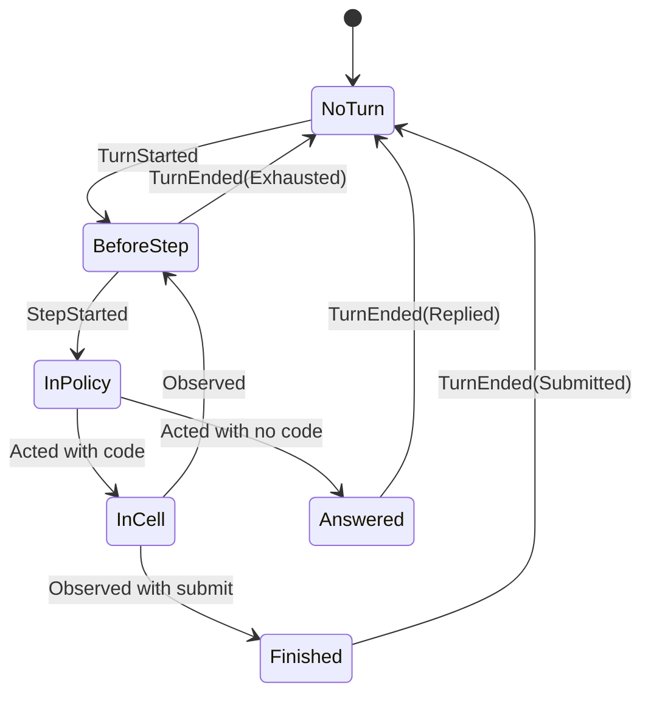

# Code harness: the design

Status: design, 2026-11-01. This document is the current design of the dspy4s harness. It takes the place of section 4
of [CODE_HARNESS.md](CODE_HARNESS.md), which keeps the analysis and the history. Nothing here exists in the code of
dspy4s yet. The sketches of the kernel and of the guest API compile and ran in checks (section 12). Section 14 lists
the choices that are new in this document.

## Summary

The harness is a coding agent that acts only by writing Scala. A session is one journal, and four pure functions
decide everything about it. Small interpreters do the effects. The compiler, the handlers and an OS sandbox limit the
authority of a session. Each LM call is a `Predict` leaf, so the dspy4s optimizers can tune the full harness.

The controller, a work session, a child and an optimizer rollout are the same thing: a session with a different
configuration. So the design has one kernel.

## 1. The seven ideas

| # | Idea | Why |
|---|---|---|
| 1 | **Code is the only action.** The model writes Scala against a typed API, and the source of that API is its reference. | One cell can do the work of many tool calls. Its values stay in the REPL, outside the LM context. |
| 2 | **A session is one journal.** Only committed state is observable. | A live session, a reopened session and a test have one model. |
| 3 | **The kernel is pure.** `evolve`, `next`, `decide` and `repair` hold all the decisions, and threads only interpret them. | The laws can run with no thread, no model and no REPL. |
| 4 | **Authority has three levels.** A mode for the compiler, a guard for each call, and a sandbox for each process. | Each level stops what the level above it cannot see. |
| 5 | **The context is a projection.** A strategy changes only what the model sees, and the journal keeps all. | Compaction loses nothing, and the model can get each detail back. |
| 6 | **All work is a session.** A session can start other sessions, up to a limit that its capability holds. | Delegation needs no second mechanism. |
| 7 | **Each LM call is a leaf.** The policy, the summaries, the goal check and the reviewer are `Predict` leaves. | The optimizers see the full harness. |

## 2. What each project gives

| Project | What this design takes | What it leaves |
|---|---|---|
| atc | One action language, the API source as the reference, capabilities as `using` parameters, compile errors as observations, safe mode | The lock for the full JVM, compaction that loses detail |
| pi | The session as an append-only list, the context as a pure projection, `store` and `load` kept in the session | JSON tools as the action language |
| `pi-durable` | "Only committed state is observable", an intent and an outcome for each effect, request ids, version checks | Each task as a state machine, a deterministic JavaScript sandbox |
| uniichat | The memory tree, `zoom`, a cheaper model for summaries, the goal check, a report as a message | JSON tools, one chat for all work |
| deepseek-harness | Crash repair by append, the mark for optional entries, a sandbox that fails closed, recorded model streams, tests that kill a process | Agent teams with a task graph, the opt-in REPL that is never durable |
| Codex | Commit on success for the store, soft and hard stops as two commands, world-state diffs, taint, an LLM reviewer, best-of-N | Four levels of loops, the yield protocol, the message board |
| tacit | Results that show that capability-safe Scala works for agents, a timed-out cell that keeps the earlier state, an early MCP server | A validator as a boundary |
| dspy4s `RLM` | Inputs as REPL values, `llmQuery`, recursion that returns a typed value | The Python interpreter |
| dspy4s | `Predict`, `History`, `Module`, the optimizers | `AgentLoop.run` for this loop (`next` holds the limit) |
| Kyo | `kyo-actor` for the session host, `kyo-sql-sqlite` for the journal, `kyo-mcp` for the MCP server, the claim token as a fence | `kyo-flow` for the turn, `kyo-ai` for `Predict`, `kyo-compat` for pluggable programs |

The analysis of each project is in [CODE_HARNESS.md](CODE_HARNESS.md) (sections 2 and 9),
[CODE_HARNESS_LOOPS.md](CODE_HARNESS_LOOPS.md), [CODE_HARNESS_RUNTIME.md](CODE_HARNESS_RUNTIME.md),
[CODE_HARNESS_DURABILITY.md](CODE_HARNESS_DURABILITY.md) and [CODE_HARNESS_KYO.md](CODE_HARNESS_KYO.md).

## 3. The words

These words settle section 4 of [CODE_HARNESS_CONCEPTS.md](CODE_HARNESS_CONCEPTS.md). Each word has one meaning.

| Word | Meaning | Do not use it for |
|---|---|---|
| Session | A durable conversation: an id and a journal | The live objects |
| Activation | The live part of a session in one process: the REPL, the threads, the mailbox | |
| Journal | The append-only list of the entries of a session | `History`, the transcript, the trace |
| Entry | One fact in a journal | An event for clients, which is a published event |
| Commit | One atomic write of entries to a journal | A git commit, which is always "git commit" |
| Turn | From `TurnStarted` to `TurnEnded` | One model reply |
| Step | One policy call and what it starts | The result of `AgentLoop` |
| Cell | One unit of code that the REPL runs | |
| Effect | One guest API call | A tool call |
| Job | A command that runs after its cell ends | |
| Policy | The `Predict` leaf that writes the next cell | Guard rules, a sandbox profile |
| Mode | The capabilities of a session, and their views | Code mode, a sandbox mode |
| Scope | The place of the work of a session: a directory, a worktree or a scratch directory | The range of a graph query, which is a `GraphRange` |
| Task | The work that a session gets at its start | A row of a task set, which is a rollout task |
| Goal | A condition that the work must meet | |
| Steer | A message that enters between two steps (`Send` in a turn) | |
| Abort | The hard stop of a turn | `Thread.interrupt`, which is the only meaning of "interrupt" |
| Fork | Say which one: a journal fork, a workspace fork or a session fork | |
| Replay | A new run of cells with recorded results | Recovery, which is a fold |

## 4. The kernel

The kernel is pure data and pure functions. It has no thread, no REPL and no LM call. `tmp/design-check/` holds the
code in this section.

### 4.1 The journal

```scala
final case class Logged(seq: Long, meta: Meta, entry: Entry) derives Schema

// The data that the model never sees. `required` tells a reader what to do with an entry that it cannot decode.
final case class Meta(atMillis: Long, source: Source, taint: Taint, required: Boolean) derives Schema

enum Entry derives Schema:
  case Activated(versions: Versions, config: SessionConfig)    // a start, a reopen, or the first entry after a crash
  case Input(request: RequestId, text: String)                 // `meta.source` is the sender
  case TurnStarted
  case StepStarted(step: Int)                                  // the intent of the LM call
  case Acted(reasoning: String, text: String, code: Option[String]) // the LM outcome, and the intent of the cell
  case EffectStarted(id: EffectId, op: String, args: DynamicValue)  // the intent of a guest API call
  case EffectDone(id: EffectId, result: EffectResult)          // the outcome of the guest API call
  case Observed(output: String, outcome: CellOutcome, writes: Map[String, DynamicValue]) // the outcome of the cell
  case StopRequested(reason: String)
  case Granted(rule: GuardRule)                                // a person widened the guard (5.5)
  case ScopeRecorded(head: String, clean: Boolean)             // the git head of the scope, at the end of each turn
  case TurnEnded(outcome: TurnOutcome)
  case Ended(outcome: SessionOutcome, reason: String)

final case class EffectId(cell: Long, n: Int)                  // `cell` is the `seq` of the `Acted` entry

enum EffectResult derives Schema:
  case Value(value: DynamicValue, rendered: String)            // the typed value for a replay, and the text for a reader
  case Error(message: String)
  case Unknown                                                 // a stop or a crash cut the call

enum TurnOutcome derives Schema:
  case Replied(text: String)
  case Submitted(value: DynamicValue)
  case Exhausted, Aborted, Crashed
  case Failed(error: String)
```

The entries of one turn form a small language. `Input`, `StopRequested`, `Granted` and `ScopeRecorded` can occur at
any place:

```text
Turn  ::= TurnStarted Step* TurnEnded
Step  ::= StepStarted [ Acted [ Cell ] ]
Cell  ::= ( EffectStarted | EffectDone )* Observed
```

Two rules about the journal:

- **The commit.** `commit` returns after the write reaches the backend, so an intent is in the journal before its
  effect starts. A stream delta to a client is not state: a client can show it, and a crash can lose it.
- **Unknown entries.** A reader that cannot decode an entry stops a rebuild if `required` is true, and it skips the
  entry if `required` is false.

| Effect | Intent | Outcome |
|---|---|---|
| The LM call of the policy | `StepStarted` | `Acted` |
| A cell | `Acted` with code | `Observed` |
| A guest API call, with `llmQuery` and `rlm(...)` | `EffectStarted` | `EffectDone` |

### 4.2 The state is a fold

```scala
enum Position:
  case NoTurn
  case BeforeStep(step: Int)
  case InPolicy(step: Int)
  case InCell(step: Int, cell: Long, code: String)
  case Answered(text: String)
  case Finished(value: DynamicValue)

final case class SessionState(
    config  : SessionConfig,
    nextSeq : Long,
    position: Position,
    stopping: Boolean,
    closed  : Boolean,
    waiting : Int,                       // inputs that no step has seen, since the last stop
    open    : Set[EffectId],             // effects with an intent and no outcome
    store   : Map[String, DynamicValue],
    requests: Set[RequestId],
    grants  : Set[GuardRule]
)

def evolve(s: SessionState, logged: Logged): SessionState   // total and pure
```

`evolve` is the only place where state changes. `SessionState` is `journal.foldLeft(initial)(evolve)`, so a fold of a
prefix continues to the same state: the journal is a free monoid, and the fold is a homomorphism from it to the
functions on the state.

Each other view of a journal is also a fold, for example the ledger, the usage totals and the deterministic part of a
`SessionCard`. Folds compose, so several views need one pass:

```scala
final case class Fold[-E, S, +A](initial: S, step: (S, E) => S, done: S => A):
  def apply(entries: Iterable[E]): A = done(entries.foldLeft(initial)(step))
  def map[B](f: A => B): Fold[E, S, B] = Fold(initial, step, s => f(done(s)))
  def zip[F <: E, T, B](that: Fold[F, T, B]): Fold[F, (S, T), (A, B)] =
    Fold(
      (initial, that.initial),
      { case ((s, t), e) => (step(s, e), that.step(t, e)) },
      { case (s, t) => (done(s), that.done(t)) }
    )
```

### 4.3 The next piece of work is an unfold

`next` reads the state and says what comes next. So a session is an unfold of work and a fold of results.

```scala
enum Next:
  case Wait                                    // no open turn, or an effect is in progress
  case CallPolicy(step: Int, mustAnswer: Boolean)
  case RunCell(cell: Long, code: String)
  case End(outcome: TurnOutcome)

def next(s: SessionState): Next =
  if s.position == Position.NoTurn then Next.Wait
  else if s.stopping then Next.End(TurnOutcome.Aborted)
  else
    val limit = s.config.steps
    s.position match
      case Position.BeforeStep(i) if i < limit => Next.CallPolicy(i, mustAnswer = false)
      case Position.BeforeStep(i) if i == limit && s.config.kind == TurnKind.Chat => Next.CallPolicy(i, mustAnswer = true)
      case Position.BeforeStep(_)              => Next.End(TurnOutcome.Exhausted)
      case Position.InCell(i, _, _) if i >= limit => Next.End(TurnOutcome.Exhausted)
      case Position.InCell(_, cell, code)      => Next.RunCell(cell, code)
      case Position.Answered(text)             => Next.End(TurnOutcome.Replied(text))
      case Position.Finished(value)            => Next.End(TurnOutcome.Submitted(value))
      case Position.InPolicy(_) | Position.NoTurn => Next.Wait
```



A stop can end a turn from each of these states. The two stop rules are one rule in `next`:

| Event | Chat turn | Program call |
|---|---|---|
| A cell calls `submit(...)` | `Submitted` | The value is the output. |
| A reply with no cell | `Replied`, and the text is the answer | `Replied`, and the `finisher` leaf makes the output |
| The step limit | One more policy call with a note to answer. The harness runs no cell from it. | `Exhausted`, and the `finisher` leaf makes the output |

### 4.4 The repair

```scala
def closing(s: SessionState): Vector[Entry] =
  val effects = s.open.toVector.sortBy(id => (id.cell, id.n)).map(Entry.EffectDone(_, EffectResult.Unknown))
  s.position match
    case Position.InCell(_, _, _) => effects :+ Entry.Observed("", CellOutcome.Failed("the cell did not complete"), Map.empty)
    case _                        => effects

def repair(s: SessionState): Vector[Entry] =
  if s.position == Position.NoTurn then Vector.empty else closing(s) :+ Entry.TurnEnded(TurnOutcome.Crashed)
```

A stop and a crash close a turn with the same entries. The old entries never change. Nothing runs an effect with an
unknown outcome again automatically.

### 4.5 The guard

`decide` says which entries a command can commit. It keeps each journal inside the language of 4.1.

```scala
enum Command:
  case Activate(versions: Versions, config: SessionConfig)
  case Send(request: RequestId, text: String)
  case Commit(entries: Vector[Entry])
  case Abort(reason: String)
  case Grant(rule: GuardRule)
  case Close(outcome: SessionOutcome, reason: String)

def decide(command: Command, s: SessionState): Either[Rejection, Vector[Entry]]
```

| Command | What it commits |
|---|---|
| `Activate` | `repair(s)`, then `Activated`. If an input waits, also `TurnStarted`. |
| `Send` with a known request id | Nothing |
| `Send` with no open turn | `Input` and `TurnStarted` |
| `Send` in a turn | `Input`. The projection shows it at the next `StepStarted`. |
| `Commit` | The entries, if each one is valid at that position (the rules below). |
| `Abort` in a turn | `StopRequested`, which also clears the inputs that wait |
| `Grant` | `Granted` |
| `Close` | `Ended`, only with no open turn |

The rules for `Commit`:

- After `StopRequested`, only outcomes can commit: `EffectDone`, `Observed` and `TurnEnded`.
- `EffectStarted` needs an `EffectId` of the current cell. So a late message from an old cell cannot enter a later
  cell.
- A late `EffectDone` of a closed effect adds nothing, because an interrupt does not wait for a commit in progress.
- If an input waits when `TurnEnded` commits, `TurnStarted` commits with it.

Two questions have one answer here. An input that no step saw gets a turn, also after a crash. An input from before a
stop starts no turn, and the next turn shows it.

### 4.6 The worker

The worker interprets `next`. It holds no decision and no state of its own:

```scala
trait TurnEffects:
  def callPolicy(state: SessionState, mustAnswer: Boolean): Either[String, PolicyReply]
  def runCell(cell: Long, code: String): CellResult

trait Journal:
  def state: SessionState
  def run(command: Command): Either[Rejection, SessionState]
  final def commit(entries: Entry*): Either[Rejection, SessionState] = run(Command.Commit(entries.toVector))

@tailrec def drive(journal: Journal, effects: TurnEffects): SessionState =
  val state = journal.state
  next(state) match
    case Next.Wait => state
    case Next.CallPolicy(step, mustAnswer) =>
      journal.commit(Entry.StepStarted(step)).foreach { started =>
        val _ = effects.callPolicy(started, mustAnswer) match
          case Right(reply) => journal.commit(Entry.Acted(reply.reasoning, reply.text, reply.code))
          case Left(error)  => journal.commit(Entry.TurnEnded(TurnOutcome.Failed(error)))
      }
      drive(journal, effects)
    case Next.RunCell(cell, code) =>
      val result = effects.runCell(cell, code)
      val open = closing(journal.state).filter(_.isInstanceOf[Entry.EffectDone])
      val _ = journal.commit((open :+ Entry.Observed(result.output, result.outcome, result.writes))*)
      drive(journal, effects)
    case Next.End(outcome) =>
      val _ = journal.commit((closing(journal.state) :+ Entry.TurnEnded(outcome))*)
      drive(journal, effects)
```

A test gives `TurnEffects` as a script. The harness gives a `Predict` leaf and a REPL. A journal can be a value in
memory or an actor with SQLite behind it, and `drive` stays the same.

An example journal: a user asks a question, the model runs one cell with one guest API call, and then it answers.

```text
Activated  Input  TurnStarted
  StepStarted(0)  Acted(code)  EffectStarted  EffectDone  Observed
  StepStarted(1)  Acted(no code)
TurnEnded(Replied)  ScopeRecorded
```

The same journal, with a stop during the guest API call:

```text
Activated  Input  TurnStarted
  StepStarted(0)  Acted(code)  EffectStarted  StopRequested  EffectDone(Unknown)  Observed(Failed)
TurnEnded(Aborted)
```

### 4.7 The laws of the kernel

| Law | Statement |
|---|---|
| Fold | `SessionState` is the fold of the journal. |
| Homomorphism | `state(a ++ b)` is the fold of `b` from `state(a)`. |
| Language | Each journal is a word of the language of 4.1. |
| Commit | A reader sees an entry only after its commit. |
| Effect | An intent commits before its effect, and the outcome commits after the effect. Each intent has exactly one outcome after a repair. |
| Stop | After `StopRequested`, `next` starts no new work, and `decide` accepts no new intent. |
| Input | Two `Send` commands with one request id give one `Input`. |
| Rest | With no open turn, no input waits. |
| Repair | `repair` closes each open part, and `repair(state after repair)` is empty. |
| Store | The store holds only the writes of cells that completed. |
| Log | No part of the harness changes or removes an entry. |

## 5. Authority

### 5.1 The guest API

The guest API is one trait for each effect. The bare type is the read-only view, and `T^` is the full view. Each
definition that a cell can use has `@assumeSafe`, because safe mode rejects the other definitions.

```scala
@assumeSafe trait Cap extends caps.Stateful, caps.ExclusiveCapability

@assumeSafe trait Files extends Cap:
  def read(path: String): String
  update def write(path: String, content: String): Unit

@assumeSafe trait Shell extends caps.ExclusiveCapability:
  def exec(command: String)(using Files^): String
  def spawn(command: String)(using Files^): JobId
  def jobOutput(job: JobId): String

@assumeSafe trait Store extends Cap:
  def keys: Vector[String]
  update def store[A: Data](key: String, value: A): Unit

@assumeSafe trait Sessions extends Cap:
  def list(): Vector[String]
  update def tell(session: String, message: String): Unit

@assumeSafe object api:
  def println(value: Any): Unit = scala.Console.println(value)
  def read(path: String)(using f: Files): String = f.read(path)
  def write(path: String, content: String)(using f: Files^): Unit = f.write(path, content)
  def exec(command: String)(using s: Shell^, f: Files^): String = s.exec(command)
  def store[A: Data](key: String, value: A)(using s: Store^): Unit = s.store(key, value)
  // and the other functions
```

The sketch shows the shape. The full API also has `edit`, `httpGet`, `llmQuery`, `rlm`, `start`, `observe`, `zoom` and
`submit`. The source text of these traits, with a notation header, is the API reference in the prompt. A search
function and the reference on demand can come later, for a large API.

**`Data` is the type of a value that can leave a cell.** Safe code cannot name the `Schema` of zio-blocks: `store("k",
1)` with `A: Schema` gives "Cannot refer to value int in object Schema from safe code". So the guest API owns a small
type class, and the host converts its values to `DynamicValue`:

```scala
@assumeSafe trait Data[A]:
  def encode(value: A): DynamicValue
  // and `decode`, for `load` and `rlm`

@assumeSafe object Data:
  given Data[Int] = v => DynamicValue.Primitive(PrimitiveValue.Int(v))
  given Data[String] = v => DynamicValue.Primitive(PrimitiveValue.String(v))
  given [A](using element: Data[A]): Data[Vector[A]] = v => DynamicValue.Sequence(Chunk.from(v.map(element.encode)))
  inline def derived[A](using m: Mirror.ProductOf[A]): Data[A] = // from the names and the elements of `m`
```

A cell can write `case class Point(x: Int, y: String) derives Data`, and then `store("p", Point(1, "a"))`.

### 5.2 Modes

A mode is a set of givens that the compiler checks. As a value, a mode is an element of a bounded meet-semilattice: a
product of chains `None < Read < Full`.

```scala
enum Access:
  case None, Read, Full

final case class Mode(files: Access, shell: Access, network: Access, llm: Access, sessions: Access, store: Access):
  def <=(that: Mode): Boolean
  def meet(that: Mode): Mode
```

| Mode | Givens in the preamble |
|---|---|
| Full | `files: Files^`, `shell: Shell^`, `net: Network^`, `llm: Llm^`, `peers: Sessions^`, `state: Store^` |
| Local | `files: Files^`, `shell: Shell^`, `llm: Llm^`, `peers: Sessions^`, `state: Store^` |
| Read-only | `files: Files`, `llm: Llm^`, `peers: Sessions`, `state: Store^` |
| Controller | `files: Files`, `llm: Llm^`, `peers: Sessions^`, `state: Store^` |

Each mode has `Store^`, because the store changes only the state of the session. A change of mode needs a new REPL,
because the preamble changes, so it is a new activation.

**The ceiling law.** A `Sessions^` capability holds a ceiling. The mode of a new session is at most that ceiling. For
a work session, the ceiling is its own mode, so a child never has more authority than its parent. For the controller,
the ceiling comes from the configuration of the user. So the controller can start a session with `Files^`, but it
cannot write a file itself.

### 5.3 Handlers

The value behind each given is a handler. Handler transformers form a monoid under composition, for example
`recorded(guarded(Files.overlay(base), rules))`.

| Handler | Purpose |
|---|---|
| `Files.local(root)`, `Files.overlay(base)`, `Files.memory(snapshot)` | Real files, copy on write for one rollout, or files in memory for tests |
| `Shell.sandboxed(root, profile)`, `Shell.denied` | Commands in an OS sandbox, or no commands. If no sandbox works, `exec` fails. |
| `Store.snapshot(state)` | A snapshot for one cell and a write buffer. `CellResult.writes` holds the buffer. |
| `recorded(h)` | Commits `EffectStarted` before each call and `EffectDone` after it |
| `replayed(journal)` | Answers each call from a journal |
| `guarded(h, rules)` | Checks the guard rules before each call. A deny rule wins. |
| `reviewed(h, leaf)` | Asks a `Predict` leaf about a call that the rules do not settle. It fails closed. |

Laws:

- `guarded` is a monoid homomorphism: `guarded(allowAll)(h)` behaves as `h`, and `guarded(p)(guarded(q)(h))` behaves
  as `guarded(p and q)(h)`.
- For the calls in a journal, `replayed(journal)` gives the same results as the handler from which `recorded` wrote
  it.

### 5.4 The sandbox

Capture checking stops at the process boundary. A command that a session can start can run code that the session
wrote. So each command runs in an OS sandbox, with a profile from the capabilities at the call. F7 and F8 of
[CODE_HARNESS.md](CODE_HARNESS.md) have the threat model and the backends.

| Capabilities at the `exec` call | Profile of the child process |
|---|---|
| No `Shell` | No child process |
| `Shell^` and `Files^` | Writes only under the scope and a private temporary directory. No network. |
| `Shell^`, `Files^` and `Network^` | The same, plus the network through a proxy that applies the host list |
| Each mode | Secrets and classified paths are not readable. Other paths outside the scope are read-only. |

Law: `profile` is monotone in the mode, and the authority of a child process is at most the authority of the
capabilities at its `exec` call.

Seatbelt on macOS and bubblewrap on Linux come first. `kyo-pod` is a possible later backend for rollouts.

### 5.5 Approvals: a cell never waits for a person

A guard or a reviewer that needs a person denies the call, and the cell gets a `NeedsApproval` error with the rule.
The model ends its turn and asks. The person answers through a client, which sends `Grant(rule)`. The grant commits as
`Granted`, and the handler reads the grants from the state. The next cell can then make the call.

- No thread waits for days, so a restart loses nothing.
- Only a client of the user can send `Grant`. The model and the controller cannot.
- A grant widens the guard rules. It does not change the mode.

### 5.6 Secrets and taint

- A `Classified` value never enters a journal in clear text, and a derivation sees only masked values.
- `Meta.taint` marks each entry from external content. The model does not see this mark. The reviewer and the graph
  read it.
- Real secrets stay out of cells. A handler adds them to a request (`secretHeaders`).

## 6. The REPL

- **One REPL for each activation.** `ReplDriver` runs in the same JVM, with capture checking and safe mode. The five
  guards of Phase 0 stay ([CODE_HARNESS.md](CODE_HARNESS.md), section 11).
- **One cell at a time, on its own thread,** with `Console.withOut` and the stop flag.
- **A cell commits only if it completes.** After `CompileError`, `Failed` or `TimedOut`, a later cell sees only the
  definitions from before the cell, and the store writes are gone.

The session has two kinds of state between cells:

| State | What it holds | After a restart |
|---|---|---|
| The store | `Data` values under a key. It is a fold of the journal. | It comes back from the journal. |
| The REPL state | Definitions and live objects. It is a cache. | A new REPL starts, and the model gets a note with the names that it lost. |

**Long work is a job.** A build or a test run can take minutes, and a cell must stay short. `spawn(command)` starts a
job and gives a `JobId`, which is plain data, so it stays valid in a later cell and after a restart. The session owns
each job: an `Abort` does not stop a job, and the end of the session does. This takes the place of the yield protocol
of Codex. A cell has a timeout, and no second cell runs at the same time.

**Replay comes later.** Replay of cells ([CODE_HARNESS.md](CODE_HARNESS.md), 8.4) can rebuild the definitions. It is
possible because the journal already holds each typed result and the versions. The first version does not need it.

## 7. The context

A strategy derives data from the journal and makes the policy input. It never changes the journal.

```scala
trait Derivation[D]:
  def empty: D
  def update(journal: Vector[Logged], d: D)(using RuntimeContext): Either[DspyError, D]  // can call Predict leaves

trait ContextStrategy[D] extends Derivation[D]:
  def project(journal: Vector[Logged], d: D, budget: Int): PolicyInput                   // pure
  def guestApi: GuestApi                                                                 // for example `zoom`

final case class PolicyInput(task: String, api: String, status: String, observation: String, history: History)
final case class PolicyStep(text: String, code: Option[String])
```

| Strategy | Derived data | Projection | Use |
|---|---|---|---|
| Window | None | The last entries that fit | A rollout, a child |
| Prefix summary | Summary entries | The last summary, then the entries after it | A work session |
| Memory tree | The nodes of a binary tree of summaries | A cut through the tree, with `zoom` in the guest API | The controller, a long work session |

- **Cheap steps first.** A strategy cuts long observations with no LM call, and it adds a note that says how to read
  the remainder. A summary that does not shrink is rejected.
- **The status section.** `status` holds the names in the REPL, the keys of the store, the jobs and the scope. It is
  typed, and it renders only its changes, so the prompt prefix stays the same.
- **Laws.** `project` depends only on the journal and the derived data. Two updates give the same structure as one
  update on the full journal. The memory tree has the laws Coverage, Zoom, Prefix, Immutability, Order, Size and Roots
  ([CODE_HARNESS.md](CODE_HARNESS.md), 6.2).
- **Derived data has a journal of its own.** An LM makes it, so a new derivation costs money and gives a different
  result.

## 8. Sessions

### 8.1 One kernel, four configurations

```scala
final case class SessionConfig(
    kind    : TurnKind,          // Chat or Program
    steps   : Int,
    mode    : Mode,
    ceiling : Mode,              // the most that a session started from here can get
    strategy: StrategyName,
    scope   : Scope,
    owner   : Owner,             // the user, or the session that started this one
    model   : ModelChoice,
    goal    : Option[String]
)
```

| Session | Mode | Strategy | Scope | Lifetime | Started by |
|---|---|---|---|---|---|
| Controller | Controller | Memory tree | The home of the user | Never ends | The harness, one for each user |
| Work session | Full or local | The choice of the user | A directory, a worktree or a scratch directory | Until the user closes it | The user or `start` |
| Child | At most the mode of the parent | Window | The scope of the parent, or a fork | Until `submit` | `rlm(...)` |
| Rollout | Local | Window | A workspace fork | One task | An optimizer |

### 8.2 The operations

| Function | Needs | Meaning |
|---|---|---|
| `rlm[A: Data](task, inputs): A` | `Sessions^` | Runs a child inside the cell and gives its value. It is one effect of the parent, and the child has its own journal. |
| `start(goal, scope, strategy): SessionRef` | `Sessions^` | Starts a session in the background. Its report comes back as an `Input` with `Source.Child`, and this starts a turn. |
| `tell(session, message)` | `Sessions^` | `Send` to that session, with `Source.Controller` or `Source.Child`. |
| `observe(session, question): String` | `Sessions`, `Llm^` | A read-only `rlm` with the journal of that session as an input. It changes nothing in that session. |
| `zoom(session, ref): String` | `Sessions` | Reads a part of a journal. |
| `list(): Vector[SessionCard]` | `Sessions` | The cards of the sessions. |

`rlm` shares the budget of the parent and has a depth limit. `start` has no budget of its parent. There is no third
form of subagent.

### 8.3 What the controller sees

Information goes from the sessions to the controller. A session reads the graphs only on demand, and nothing goes into
its context automatically. The decisions of [CODE_HARNESS.md](CODE_HARNESS.md), 7.10 stay.

| Layer | What it is | LM |
|---|---|---|
| Ledger | A fold of the effects of a session: what it read and what it made | No |
| Graph | Facts and links with time. An LM extracts them at the end of each turn, and they are a derivation. The ontology is a value, and it is pluggable. | Yes |
| Probes | `observe(session, question)` | Yes |

The controller journal gets an entry only when a layer changes in a way that matters. Sections 7.5 to 7.8 of
[CODE_HARNESS.md](CODE_HARNESS.md) have the ontology, the time queries and `Graph`, with `GraphRange` as the name of
`GraphScope`.

### 8.4 The end of a session

The end is an entry, and the journal stays. A pure function makes a release plan from the state of the scope:
`releasePlan(scope, outcome): Vector[ReleaseStep]`. Reversible steps run automatically, and a step that stays
irreversible needs a `Grant`. Section 7.9 of [CODE_HARNESS.md](CODE_HARNESS.md) has the plans and their laws.

### 8.5 The goal

A goal stays in the configuration, but the permission to continue by itself is live, and a person must give it again
after a restart. After a turn, the `goal` leaf answers "is the goal met now?". On `false`, the harness sends a message
with `Source.Harness`, and this starts a turn. A goal is "blocked" after three turns with the same blocker.

## 9. Programs and optimization

`Harness` is a dspy4s `Module`, so the current optimizers can tune it:

```scala
final case class Harness[I, O](
    signature: Signature[I, O],
    policy   : Predict[PolicyInput, PolicyStep],
    finisher : Predict[FinishInput, O],
    subQuery : Predict[Query, Answer],
    goal     : Predict[GoalInput, GoalVerdict],
    strategy : Strategy,               // its leaves join the leaves of the harness
    env      : HarnessEnv,             // handlers, workspace, REPL factory, mode; not optimizable
    limits   : HarnessLimits           // not optimizable
) extends Module[I, O]
```

`forward` makes a journal in memory and a REPL in a workspace fork. It sends the input, runs `drive`, and reads the
last `TurnEnded`. `Submitted` gives the output. `Replied` and `Exhausted` run the `finisher` leaf. This path needs no
actor and no thread other than the cell thread.

| Leaf | Where | What it decides |
|---|---|---|
| `policy` | Each step | The next cell or reply |
| `finisher` | The end of a program call | The output, from the journal |
| `subQuery` | `llmQuery` | The answer to a question from code |
| `goal` | After a turn | If the goal is met |
| `compactor`, or `compress` and `merge` | A strategy | What a summary keeps |
| `extract`, `card` | The controller layers | The facts and the card of a session |
| `reviewer` | `reviewed` | If a call is safe |

- **What the optimizers tune.** The work rules in the policy instructions. The API reference is an input field, so
  GEPA cannot change it.
- **The thought.** The policy has `text` and `code`. A `reasoning` field is an option of the leaf, and it is on only
  for a model with no native reasoning. `Acted.reasoning` holds either one.
- **Metrics.** A `FeedbackMetric` runs the tests in the fork of the rollout. A memory metric asks questions about old
  messages. A graph metric compares the graph with probes. Critical-path time can be a second score.
- **Tasks.** The first source is the history of this repository: a commit that makes a test pass gives a task and a
  metric.
- **Tests with no model.** A script of `TurnEffects`, and later recorded model streams.

## 10. The runtime

### 10.1 The layers

A runtime enters in two places. The middle stays the same in each option, because the model writes direct-style code
and a cell needs a thread.

```text
Session host: mailbox, worker start and stop, event broadcast   <- pluggable; first version on kyo-actor
Kernel: evolve, next, decide, repair                            pure, one implementation
Worker, cell, REPL: drive on plain threads                      one implementation
Guest API handlers: LM, files, shell, network                   <- pluggable; each handler can use Kyo inside
```

```scala
trait SessionHost:
  def open(id: SessionId, config: SessionConfig): Either[DspyError, SessionRef]

trait SessionRef:
  def send(command: Command): Either[DspyError, Unit]   // into the mailbox; it does not wait for the commit
  def state: SessionState                               // the committed state
  def published: Subscription[Logged]                   // only committed entries
```

Each of the kernel functions, `drive`, `Journal` and `SessionHost` is free of Kyo types. So a ZIO or Pekko host stays
possible, and an API change in Kyo stays in the adapters.

### 10.2 The first host

- **`kyo-actor`.** One actor for each session is the one writer of its journal. A worker commit is an `ask` across the
  bridge (`KyoApp.Unsafe.runAndBlock`). Each reply needs `Abort.run[Closed](...)`, because an interrupted `ask` closes
  its reply subject.
- **`kyo-sql-sqlite` for the journal.** One row for each entry, with a primary key on the session and `seq`. The
  primary key rejects a stale writer. A JSONL file stays possible behind `Journal`.
- **JDK 25.** Kyo RC7 needs it. dspy4s compiles and passes its tests on it.

[CODE_HARNESS_KYO.md](CODE_HARNESS_KYO.md) has the measurements and the limits.

### 10.3 The path of a hard stop

1. `Abort` arrives as a message, and the actor commits `StopRequested`.
2. The host sets the stop flag and interrupts the cell thread. The worker thread gets no interrupt, so its commits
   complete.
3. The host stops the LM transport and the process groups of the running `exec` calls: TERM, a grace period, then
   KILL.
4. The cell ends, and the worker commits the closing entries and `TurnEnded(Aborted)`.
5. If the cell does not end after a grace period, the host marks the process as unclean (guard 3 of Phase 0). The
   actor then commits the closing entries. A later commit from that worker gets a rejection.

A stop never cuts a commit, because the commit runs in the actor.

### 10.4 Distribution

Distribution comes later. "Sessions in a cluster" means three different things:

| Meaning | What it needs | Sharding? |
|---|---|---|
| Rollouts on many machines | A job queue. A failed rollout runs again. | No |
| A session on one host, and its tools on another | A remote handler behind `Files` and `Shell` | No |
| Many sessions on many hosts, addressed by id | One writer for each session, and routing | Yes |

Only a multi-user server needs the third meaning. An idle session with a clean scope has its state in the journal and
in a git commit, so it can reopen on another host. A session in a turn cannot move. The primary key of the journal is
the fence.

### 10.5 The modules

| Module | Contents | Depends on |
|---|---|---|
| `harness-guest` | The guest API traits, `Data`. The source text is the API reference. | zio-blocks only |
| `harness-kernel` | `Entry`, `SessionState`, `evolve`, `next`, `decide`, `repair`, `Fold`, `Mode`, `ContextStrategy`, the memory tree | zio-blocks only |
| `harness-repl` | `ScalaRepl`, the guards of Phase 0 | `harness-guest`, `scala3-repl` |
| `harness-sandbox` | Seatbelt, bubblewrap, the profiles | `harness-kernel` |
| `harness` | `Harness`, `drive`, the handlers, the leaves | The modules above, dspy4s `programs` |
| `harness-host-kyo` | The session host, the SQLite journal, the MCP server | `harness`, Kyo |
| `harness-cli` | The terminal client | `harness-host-kyo` |

## 11. The kinds of state, and the questions that test them

[CODE_HARNESS_CONCEPTS.md](CODE_HARNESS_CONCEPTS.md) lists eight kinds of state. Each kind has one model:

| Kind | Model |
|---|---|
| Control | `Position`, `stopping` and `closed`: a fold of the journal |
| Record | The journal |
| Data | `SessionConfig` in `Activated`, and the store: a fold of the journal |
| Derived | A `Fold` if it is pure. A `Derivation` with a journal of its own if an LM makes it. |
| Live | The activation. Nothing outside it depends on it, and a restart makes a new one. |
| World | A handler. `ScopeRecorded` records the head, and a turn reads the world again. |
| Remote | Not modeled. The prompt cache is a benefit of a stable prefix, and a provider handle is stored as data. |
| Transient | A published event or a stream delta. It is never state. |

The answers to the scenarios of [CODE_HARNESS_CONCEPTS.md](CODE_HARNESS_CONCEPTS.md), section 5:

| # | Scenario | Answer |
|---|---|---|
| 1 | A message during a 10-minute cell | The cell does not see it and does not stop. The `Input` commits at once, and the policy reads it at the next step. |
| 2 | `sbt ~test` with `spawn`, and the turn ends | The session owns the job. It stays until `stopJob` or the end of the session. |
| 3 | A session closes and opens the next day on another machine | It is the same session: one id and one journal. A new activation and a new REPL start, and the store comes back. The scope comes from `ScopeRecorded` if it was clean. |
| 4 | `val x`, then the next line throws | A later cell gets `Not found: x`, and it still sees the earlier definitions. |
| 5 | A rollout forks a session at entry `k` | A journal fork is a pointer to the parent and `k`. The workspace fork starts at the last clean `ScopeRecorded` at or before `k`. The REPL is new, and the store is the fold up to `k`. No process comes along, and the prompt prefix stays the same. |
| 6 | `rlm(...)`, and the parent crashes during the call | Both views hold: it is an effect of the parent, and a session of its own. The effect gets `Unknown`. The child gets `Crashed` at its next activation, and nothing runs it again. |
| 7 | A reply with text and no code | In a chat turn, it ends the turn. In a program call, the `finisher` leaf makes the output. |
| 8 | An approval that comes two days later | A cell never waits for a person (5.5). The answer is a `Grant` and a new turn. |
| 9 | A compaction between two steps | It belongs to no unit. The derivation runs in the background, and a step reads what is built. An `Abort` does not cut it. |
| 10 | A cell yields after 10 s | A cell does not yield. Long work is a job, so no new step runs during a cell. |

## 12. What ran

The checks used Scala `3.10.2-RC1-bin-20261015-88be2f5-NIGHTLY` and JDK 25.0.5. The code is in `tmp/design-check/` and
`tmp/kyo-check/`, and it is not committed.

| Check | Result |
|---|---|
| The kernel under random schedules, with no threads | 200,000 runs with 317,684 crashes, 222,897 stops and 151,983 late messages. No run broke a law of 4.7. |
| The check of that check | Three mutants: keep the waiting inputs after a stop (56,217 runs fail), accept an effect of any cell (9,582), keep a late outcome (31,766). |
| `drive` with scripts | A chat answer, `submit`, the step limit of both kinds, a failed cell, a failed LM call, a stop during a cell, and a crash during a cell give the expected journals. |
| `Mode` | The semilattice laws hold over 81 modes. |
| Modes as givens in a real REPL, with capture checking and safe mode | Read-only mode: `read` compiles, and `write`, `exec`, `spawn` and `tell` do not. Controller: `tell` compiles, and `write` and `exec` do not. Local: all compile. |
| Safe mode in the same REPL | It rejects `asInstanceOf`, the name of the host, `caps.unsafe`, `@assumeSafe`, `Thread`, `System.exit`, `java.io.File`, `Predef.println` and the `Schema` of zio-blocks. |
| A session host on `kyo-actor` with threads | 2,000 sessions with a stop at a random time: no violation ([CODE_HARNESS_KYO.md](CODE_HARNESS_KYO.md), 4.1). |
| A commit through an actor to SQLite | About 140 µs from a plain thread and back. |
| dspy4s on JDK 25 | A compile from no classes passes, and 2,172 tests have no failures (6 skipped). |

These checks found errors in the earlier design. They are fixed here:

- A stop before the first step started a new turn.
- An interrupted `ask` ended the session actor.
- `store[A: Schema]` cannot compile in safe mode.

What did not run:

- The kernel with a real REPL and a real LM.
- The stop flag and the guards of Phase 0 on JDK 25.
- A hard stop that reaches the LM transport and a process group.
- The OS sandbox.
- A process kill during a commit, and durability after a host crash.
- `Data` with `decode`, and `rlm`, `start`, `observe` and `zoom`.
- The full `SessionConfig` of 8.1. The kernel check has only `kind` and `steps`.
- Any metric or optimizer run.

## 13. What the design leaves out

| Left out | Reason |
|---|---|
| `spawn` for subagents | `rlm` and `start` cover both uses. |
| The yield protocol | Jobs cover long work. |
| Replay in the first version | The store is enough for a restart. The journal keeps the option. |
| Fresh cells | A persistent REPL lets the model build on its values. The store covers what must survive. |
| Effects as values for guest code | Models write direct-style code with fewer errors, and handlers give record, replay and guard. |
| `A < S` or `F[_]` as the program type of the harness | A cell needs a thread in each case. The question for `Predict` stays open (RUNTIME 5.4). |
| Agent teams, shared boards | The controller and `tell` cover them. |
| A merge of graphs across sessions | The first version has one graph for each session. |
| Pekko and Cluster Sharding | The session host contract keeps the option (RUNTIME 5.5). |

## 14. The choices

The decisions of [CODE_HARNESS.md](CODE_HARNESS.md), 7.10 and 8.7 stay, except decision 1 of 8.7, as item 7 says.
These choices are new in this document, and they are not yet confirmed:

| # | Choice | Answers |
|---|---|---|
| 1 | The kernel has four pure functions, and `drive` takes the place of `AgentLoop.run`. | |
| 2 | `Activated` takes the place of `Started` and `Reopened`, and it holds the configuration. `Child` and `Submitted` are not entries. | |
| 3 | All work is a session. `Sessions` takes the place of `Agents`, and it holds a ceiling. `spawn` for subagents goes away. | Question 5 of section 11 |
| 4 | Long work is a job. There is no yield protocol. | Question 2 of 9.4 |
| 5 | A cell never waits for a person. Approvals use `Grant`. | |
| 6 | `Data` is the type of a value that leaves a cell. | |
| 7 | The session host is on `kyo-actor`, and the journal is on `kyo-sql-sqlite`, behind contracts. The turn stays on plain threads. | Question 2 of 8.7, decision 1 of 8.7 for the host |
| 8 | dspy4s moves to JDK 25. | |
| 9 | Replay is not in the first version. | Question 1 of 8.7 |
| 10 | The early MCP server uses `kyo-mcp`, and it comes after the guest API. | Question 4 of 9.4 |
| 11 | A derivation sees only masked `Classified` values. | Question 5 of 9.4 |
| 12 | The words of section 3. | Section 4 of the concept inventory |

Open questions:

1. Does the journal use one SQLite file for each session, or one shared file? One shared file gives a commit across
   sessions, and it has one writer for all sessions.
2. How long does a `Grant` last: one call, one turn, or the session?
3. Does an `Abort` also stop the jobs of the turn, if the user asks for it?
4. Is the `Mirror` derivation of `Data` enough for sum types and for the values that models write?

## 15. The plan

Each phase ends with something that runs.

| Phase | Work | Result |
|---|---|---|
| 1. Kernel | `harness-kernel`, with the laws as ScalaCheck properties and the mutants of section 12. No REPL and no LM. | The laws of 4.7 run in CI. |
| 2. Guest API and REPL | `harness-guest`, `harness-repl`, the modes, the guards of Phase 0 on JDK 25, the error hints, and negative tests for modes. | Model code runs against the guest API in each mode. |
| 3. Sandbox | `harness-sandbox`: Seatbelt and bubblewrap, profiles from modes, and escape tests. | `exec` runs only in a sandbox. |
| 4. One task | `Harness`, `drive`, the window strategy, `OptimizableStructure`, `ProgramRunner`. | A harness for one task that the optimizers accept. |
| 5. RLM | `llmQuery`, `rlm`, the shared budget, the depth limit. | RLM in the harness. |
| 6. Optimization | A metric from tests, a small task set, one GEPA run. | A first measured improvement, or a reason for its absence. |
| 7. The session host | `harness-host-kyo`: the actor, SQLite, the path of a hard stop, crash tests with SIGKILL. `harness-cli`. | A coding agent for daily use, one session at a time. |
| 8. Memory | The memory tree and its metric. | Long sessions that lose no detail. |
| 9. The controller | `Sessions`, the ledger, the graph, probes, release plans. | One controller above all sessions. |
| Later | Replay, the reviewer, jobs across a restart, a container backend, LSP as a guest API, the early MCP server if phase 2 needs it, prompt-cache marks. | |

Phase 6 comes before the session host on purpose. The optimizers are what makes this harness different from the
others, so the design must meet them early.
